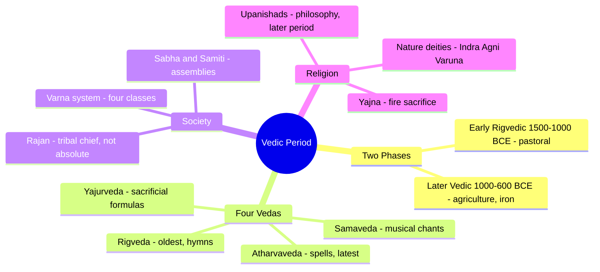

# NOTE — VEDIC PERIOD
**Section:** GK | **Category:** History | **Topic:** Vedic Period | **Slug:** `hist-vedic-period`
**Source:** 🔧 GENERAL KNOWLEDGE (standard ancient history reference; not yet cross-checked against PARMAR SSC reference excerpt)
**Status:** 🔧 DRAFT — awaiting AIR-91 verification before publish
**PYQ Frequency:** 🔥 High-frequency Ancient History topic, follows [[hist-indus-valley-civilization]] chronologically | **High Yield:** ✅

---

## 🎭 THE HOOK

After the Indus Valley cities fell silent, a different kind of civilization rose in the same general region — one that left almost no buildings, no seals, no script anyone struggles to decode, because for nearly a thousand years its entire intellectual output was composed, memorized, and transmitted **purely by sound**. The Vedic Period is named for the **Vedas** — Rigveda, Samaveda, Yajurveda, Atharvaveda — composed in early Sanskrit and preserved through an oral tradition so rigorous that scholars can still recite the Rigveda today with confidence it matches a 3,500-year-old original, never having been written down until centuries later. It's the period that gave India its earliest texts, the foundations of the caste (Varna) system, and an economy built first around cattle and later around settled agriculture and emerging kingdoms.

---

## 📖 THE CORE

### Two Phases
| Phase | Approx. Dates | Key Features |
|---|---|---|
| **Early/Rigvedic Period** | c. 1500-1000 BCE | Pastoral, semi-nomadic society; Rigveda composed; tribal political units (Jana); Punjab/northwest India region |
| **Later Vedic Period** | c. 1000-600 BCE | Settled agriculture; iron tools; eastward expansion into the Gangetic plains; emergence of Mahajanapadas (16 great kingdoms) by the period's end; rise of rigid Varna system |

### The Four Vedas
| Veda | Content |
|---|---|
| **Rigveda** | Oldest; collection of hymns to deities (Indra, Agni, Varuna, etc.) — India's oldest surviving text |
| **Samaveda** | Hymns set to musical chant, largely derived from the Rigveda |
| **Yajurveda** | Sacrificial formulas/rituals (Yajna procedures) |
| **Atharvaveda** | Spells, charms, everyday concerns (healing, protection) — considered the latest of the four |

### Society & Polity
- **Varna system**: Brahmins (priests), Kshatriyas (warriors/rulers), Vaishyas (traders/agriculturists), Shudras (labourers) — RIGID stratification developed gradually, becoming more hereditary/fixed in the LATER Vedic period (early Rigvedic society was comparatively more fluid).
- **Sabha and Samiti**: Early tribal assemblies with some role in governance/consultation — frequently cited as evidence of early (limited) democratic/consultative elements in Vedic polity.
- **Rajan**: Tribal chief/king, NOT an absolute monarch in the early period — power was checked by assemblies and clan structures.
- Economy: Early period centered on **cattle** (a key measure of wealth — "Gomat" = wealthy in cattle); Later Vedic period shifted toward **settled agriculture**, with iron tools enabling forest clearance in the Gangetic plains.

### Religion
- Worship centered on **nature deities**: Indra (rain/war), Agni (fire), Varuna (cosmic order/water), Surya (sun), Vayu (wind) — anthropomorphized natural forces.
- **Yajna** (sacrificial fire ritual) was central to religious practice, conducted by Brahmin priests.
- Later Vedic period saw the composition of the **Upanishads** (philosophical texts exploring concepts like Atman/Brahman) — marking a shift toward more abstract, philosophical religious thought, distinct from the earlier hymn-and-ritual focus.

### Key Texts (Vedic Literature Corpus)
- **Samhitas** (the four Vedas themselves), **Brahmanas** (ritual explanation texts), **Aranyakas** ("forest texts," transitional), **Upanishads** (philosophical texts) — this four-part corpus together is sometimes called **Shruti** ("that which is heard," i.e., divinely revealed/orally transmitted).

---

## 🧠 THE MIND MAP

---

## 🔑 THE MNEMONIC

**"R-S-Y-A: Rig is oldest, Sama is sung, Yajur is ritual, Atharva is last"** — the four Vedas in their commonly accepted relative order.

**"Cattle first, crops later, kingdoms last"** — the Vedic Period's economic and political evolution arc, early to late.

---

## 📌 THE PYQ ANCHOR

🔥 Vedic Period is a high-frequency Ancient History topic, chronologically following [[hist-indus-valley-civilization]] and preceding [[hist-mauryan-empire]]. 🔧 No literal Vedic Period question confirmed in the 23/46-shift CGL-2025 sample reviewed in this session — the four Vedas' names/content and the Varna system are textbook-standard SSC CGL History staples; recommend archive cross-check.

---

## ⚠️ THE TRAP ALERT

- **The Rigveda is the OLDEST of the four Vedas**, and also generally considered India's oldest surviving text — don't confuse with the Atharvaveda, which is the LATEST.
- **The Varna system became progressively MORE rigid in the LATER Vedic period**, not the early period — early Rigvedic society was comparatively more fluid/less hereditary.
- **Sabha and Samiti were consultative tribal assemblies, NOT a "democracy" in the modern sense** — avoid overstating their power; the Rajan (chief) still held primary authority, checked but not replaced by these bodies.
- **The Upanishads belong to the LATER Vedic period**, representing a shift toward philosophy — don't assume all Vedic literature is ritual/hymn-focused like the Rigveda.

---

## ✅ ACTIVE RECALL

1. Name the four Vedas in their generally accepted chronological order, oldest to newest.
2. What economic shift characterizes the transition from the Early to the Later Vedic period?
3. What were the Sabha and Samiti, and what was their role?
4. In which phase of the Vedic period did the Varna system become more rigid?
5. What philosophical texts emerged in the Later Vedic period, and what concepts do they explore?

*(Answers: 1–Rigveda, Samaveda, Yajurveda, Atharvaveda | 2–A shift from a pastoral, cattle-based economy to settled agriculture, enabled by iron tools clearing the Gangetic plains | 3–Tribal assemblies with a consultative role in governance, alongside the Rajan (chief) | 4–The Later Vedic period | 5–The Upanishads; they explore concepts like Atman (self) and Brahman (ultimate reality))*
