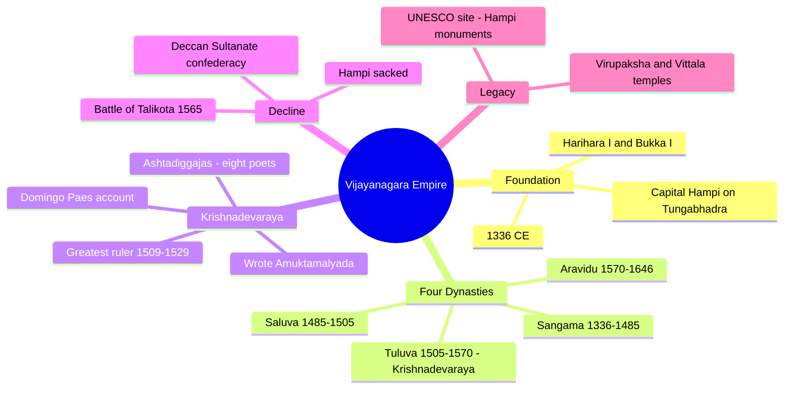

# NOTE — VIJAYANAGARA EMPIRE
**Section:** GK | **Category:** History | **Topic:** Vijayanagara Empire | **Slug:** `hist-vijayanagara-empire`
**Source:** 🔧 GENERAL KNOWLEDGE (standard medieval history reference; not yet cross-checked against PARMAR SSC reference excerpt)
**Status:** 🔧 DRAFT — awaiting AIR-91 verification before publish
**PYQ Frequency:** 🔥 High-frequency Medieval History topic | **High Yield:** ✅

---

## 🎭 THE HOOK

While the Delhi Sultanate ruled the north, an entirely separate Hindu empire rose in the south, founded in **1336 CE** by two brothers, **Harihara I and Bukka I**, on the banks of the Tungabhadra River — and built a capital city so wealthy that Portuguese and Persian travelers who visited it left behind eyewitness accounts comparing it favourably to Rome. The Vijayanagara Empire's capital, **Hampi**, became one of the largest cities in the world at its peak, and the empire's most celebrated ruler, **Krishnadevaraya**, presided over a golden age of literature, architecture, and trade — until a single catastrophic battle in 1565 ended the empire's dominance in a single afternoon.

---

## 📖 THE CORE

### Foundation
- Founded in **1336 CE** by **Harihara I** and **Bukka I** (brothers, sometimes described as the sons of Sangama, founders of the **Sangama Dynasty**, the first of four dynasties to rule Vijayanagara).
- Founded partly as a Hindu bulwark against the southward expansion of Delhi Sultanate-era Muslim power into the Deccan and South India.
- Capital: **Hampi** (Vijayanagara, meaning "City of Victory"), on the banks of the **Tungabhadra River**, in present-day Karnataka.

### Four Dynasties (Sequence)
1. **Sangama Dynasty** (1336-1485) — founding dynasty.
2. **Saluva Dynasty** (1485-1505) — short transitional dynasty.
3. **Tuluva Dynasty** (1505-1570) — INCLUDES **Krishnadevaraya**, the empire's greatest ruler.
4. **Aravidu Dynasty** (1570-1646) — ruled after the empire's decline following 1565, from a relocated capital (Penukonda, then Chandragiri).

### Krishnadevaraya (r. 1509-1529) — The Golden Age
- Widely regarded as the GREATEST ruler of Vijayanagara; brought the empire to its peak in territory, wealth, and cultural patronage.
- Patron of **Ashtadiggajas** ("Eight Elephants" of the court) — eight great Telugu poets, including **Allasani Peddana** ("Andhra Kavita Pitamaha," father of Telugu poetry).
- Authored **Amuktamalyada**, a notable Telugu literary work, himself.
- Maintained extensive trade relations with the Portuguese (notably through traveler **Domingo Paes**, who left a detailed eyewitness account of Vijayanagara's grandeur).
- Strengthened fortifications, irrigation systems, and temple architecture across the empire.

### Foreign Travelers' Accounts (Frequently Tested)
- **Domingo Paes** (Portuguese) and **Fernão Nunes** (Portuguese) both visited during/around Krishnadevaraya's reign, leaving detailed descriptions of Hampi's wealth and urban scale.
- **Abdur Razzaq** (Persian ambassador) visited earlier, during the reign of **Deva Raya II** (Sangama Dynasty), and also left an admiring account of the city.

### Decline — Battle of Talikota (1565)
- The **Battle of Talikota** (also called the Battle of Rakkasagi-Tangadagi), **1565**, saw a CONFEDERACY of Deccan Sultanates (Bijapur, Ahmadnagar, Golconda, Bidar) defeat Vijayanagara decisively.
- The defeat led to the **sack and destruction of Hampi**, effectively ending Vijayanagara's dominance, though the Aravidu Dynasty continued to rule in a much-reduced capacity from relocated capitals for several more decades.

### Architecture & Legacy
- **Hampi** is today a **UNESCO World Heritage Site** ("Group of Monuments at Hampi") — see [[misc-unesco-world-heritage-sites-india]].
- Distinctive Vijayanagara architectural style: elaborately carved temple complexes (Virupaksha Temple, Vittala Temple with its famous stone chariot and "musical pillars"), massive fortifications.

---

## 🧠 THE MIND MAP

---

## 🔑 THE MNEMONIC

**"Harihara and Bukka built it, Krishnadevaraya crowned it, Talikota ended it"** — the three-act arc of Vijayanagara's history.

**"Sangama-Saluva-Tuluva-Aravidu, SSTA, the four dynasties in order"** — quick recall for the dynasty sequence.

---

## 📌 THE PYQ ANCHOR

🔥 Vijayanagara Empire is a high-frequency Medieval History topic. 🔧 No literal Vijayanagara question confirmed in the 23/46-shift CGL-2025 sample reviewed earlier in this session — Krishnadevaraya's achievements, the Battle of Talikota, and the four-dynasty sequence are textbook-standard SSC CGL History staples; recommend a dedicated archive cross-check.

---

## ⚠️ THE TRAP ALERT

- **Krishnadevaraya belonged to the TULUVA Dynasty, not the founding Sangama Dynasty** — a frequently tested dynasty-ruler mismatch.
- **The Battle of Talikota (1565) was fought against a CONFEDERACY of FOUR Deccan Sultanates** (Bijapur, Ahmadnagar, Golconda, Bidar) — not a single sultanate; a frequently tested "who defeated Vijayanagara" detail.
- **Vijayanagara did NOT end immediately in 1565** — the Aravidu Dynasty continued ruling in reduced form for several more decades from relocated capitals; don't assume 1565 was the empire's final year.
- **Domingo Paes (Portuguese) wrote during Krishnadevaraya's reign; Abdur Razzaq (Persian) wrote earlier, during Deva Raya II's reign** — don't conflate the two travelers' accounts or eras.

---

## ✅ ACTIVE RECALL

1. Who founded the Vijayanagara Empire, and in which year?
2. Name the four dynasties of Vijayanagara, in chronological order.
3. Who is considered the greatest ruler of Vijayanagara, and to which dynasty did he belong?
4. What battle led to the decline of Vijayanagara, and who defeated it?
5. Which Portuguese traveler left a detailed account of Vijayanagara during Krishnadevaraya's reign?

*(Answers: 1–Harihara I and Bukka I, in 1336 CE | 2–Sangama, Saluva, Tuluva, Aravidu | 3–Krishnadevaraya; Tuluva Dynasty | 4–The Battle of Talikota (1565); a confederacy of four Deccan Sultanates (Bijapur, Ahmadnagar, Golconda, Bidar) | 5–Domingo Paes)*
