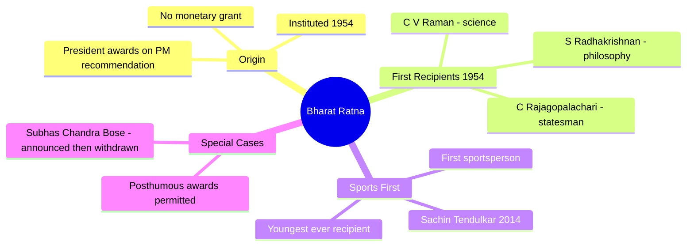

# NOTE — BHARAT RATNA AWARDEES
**Section:** GK | **Category:** Miscellaneous | **Topic:** Bharat Ratna | **Slug:** `misc-bharat-ratna-awardees`
**Source:** 🔧 GENERAL KNOWLEDGE (standard GK reference; not yet cross-checked against PARMAR SSC reference excerpt)
**Status:** 🔧 DRAFT — awaiting AIR-91 verification before publish (⚠️ the list grows whenever a new award is announced — verify the most recent recipients before publish)
**PYQ Frequency:** 🔥 Very high-frequency Static GK category | **High Yield:** ✅

---

## 🎭 THE HOOK

India's highest civilian honour was instituted in **1954**, and its very first three recipients tell you everything about how broadly the award was meant to be interpreted: a scientist (**C.V. Raman**), a philosopher-statesman (**S. Radhakrishnan**), and an industrialist (**C. Rajagopalachari**) — not a politician or freedom fighter among them, despite the award arriving just seven years after independence. That range — science, philosophy, industry, and later sports, music, and social work — is exactly why Bharat Ratna trivia spans so many unrelated fields, and exactly why SSC keeps coming back to it.

---

## 📖 THE CORE

### Origin
- Instituted in **1954**, India's highest civilian award, for exceptional service in any field of human endeavour (originally limited to arts, literature, science, and public service; expanded in 1977 to include "any field of human endeavour" — notably enabling sports figures later).
- Awarded by the **President of India** on the recommendation of the Prime Minister; NOT accompanied by any monetary grant — purely honorific (a medallion and a citation).

### First Recipients (1954)
- **C.V. Raman** (Physicist, Raman Effect, also a Nobel laureate)
- **S. Radhakrishnan** (Philosopher, later became India's second President)
- **C. Rajagopalachari** (Statesman, India's first and only Indian Governor-General)

### Notable Recipients Across Fields (Frequently Tested)
| Recipient | Field | Note |
|---|---|---|
| **Dr. B.R. Ambedkar** | Law/Social Reform | Awarded posthumously, 1990 |
| **Mother Teresa** | Social Work | 1980 |
| **Indira Gandhi** | Politics | 1971 |
| **M.G. Ramachandran (MGR)** | Politics/Cinema | 1988 |
| **Satyajit Ray** | Cinema | 1992 |
| **A.P.J. Abdul Kalam** | Science | 1997, later became President |
| **Lata Mangeshkar** | Music | 2001 |
| **Bhimsen Joshi** | Music | 2008 |
| **Sachin Tendulkar** | Sports (cricket) | 2014, FIRST sportsperson to receive the Bharat Ratna, and the YOUNGEST-ever recipient |
| **Atal Bihari Vajpayee** | Politics | 2015 |
| **Pranab Mukherjee** | Politics | 2019 |
| **Bhupen Hazarika** | Music | 2019 (posthumous) |
| **Nanaji Deshmukh** | Social Work | 2019 (posthumous) |

### Key Distinguishing Facts
- **Sachin Tendulkar (2014) was the FIRST sportsperson AND the YOUNGEST-ever Bharat Ratna recipient** (38 years old at the time) — a frequently tested double-superlative.
- **Mother Teresa (1980)** received the Bharat Ratna as a recognized Indian citizen (by naturalization), distinct from her Nobel Peace Prize (1979), awarded the year before.
- **Subhas Chandra Bose** was controversially announced as a Bharat Ratna recipient in 1992 but the award was later WITHDRAWN after a legal challenge (regarding the circumstances of his disappearance/death) — a frequently tested "trick" fact, since he is NOT currently listed as an official recipient.
- **Posthumous awards are permitted** — several recipients (Ambedkar, Bhupen Hazarika, Nanaji Deshmukh) received the honour after their death.
- **The award can be given to MORE than 3 people in a single year**, and need not be awarded every year — there is no fixed annual quota or guarantee of an award being given.

---

## 🧠 THE MIND MAP

---

## 🔑 THE MNEMONIC

**"Raman, Radhakrishnan, Rajagopalachari — the three R's of 1954"** — the first three Bharat Ratna recipients, all starting with R.

**"Sachin: first in sport, youngest overall"** — Tendulkar's double Bharat Ratna superlative.

---

## 📌 THE PYQ ANCHOR

🔥 Bharat Ratna is a very high-frequency Static GK category. 🔧 No literal Bharat Ratna question confirmed in the 23/46-shift CGL-2025 sample reviewed earlier in this session, since this topic wasn't separately tagged during PYQ extraction — first recipients, Sachin Tendulkar's "first sportsperson" status, and posthumous-award facts are textbook-standard SSC CGL GK staples; recommend a dedicated archive cross-check.

---

## ⚠️ THE TRAP ALERT

- **Sachin Tendulkar (2014) was the FIRST sportsperson to receive the Bharat Ratna** — before 2014, no athlete had received it; a frequently tested "first" fact.
- **Subhas Chandra Bose's 1992 Bharat Ratna was WITHDRAWN** after legal challenge — he is NOT currently an official recipient, a commonly mis-stated "trick" fact.
- **The Bharat Ratna carries NO monetary award** — purely a medallion and citation, unlike some other honours; don't assume it includes a cash prize.
- **The award is NOT given every year**, and there's no fixed limit on recipients per year — don't assume a regular annual cadence like some other awards.

---

## ✅ ACTIVE RECALL

1. In which year was the Bharat Ratna instituted, and who were its first three recipients?
2. Who awards the Bharat Ratna, and on whose recommendation?
3. Who was the first sportsperson to receive the Bharat Ratna, and in which year?
4. Does the Bharat Ratna come with a monetary grant?
5. What happened to Subhas Chandra Bose's 1992 Bharat Ratna announcement?

*(Answers: 1–1954; C.V. Raman, S. Radhakrishnan, and C. Rajagopalachari | 2–The President of India, on the recommendation of the Prime Minister | 3–Sachin Tendulkar, in 2014 (also the youngest-ever recipient) | 4–No, it is purely honorific — a medallion and citation, no monetary grant | 5–It was withdrawn after a legal challenge; he is not currently listed as an official recipient)*
