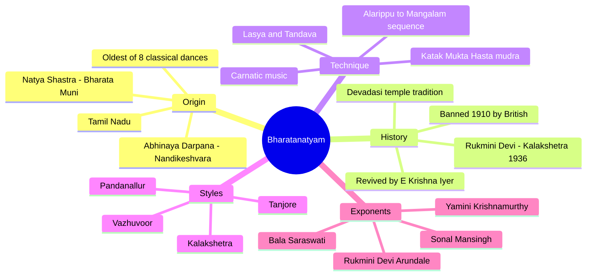

# NOTE — BHARATANATYAM
**Section:** GK | **Category:** Miscellaneous (Art & Culture) | **Topic:** Bharatanatyam | **Slug:** `misc-bharatanatyam`
**Source:** PARMAR SSC reference notes pp.1–6 (Classical Dance of India) + CHANAKYA PYQ pattern analysis (CGL 2025, 23/46 shifts)
**Status:** 🔧 DRAFT — awaiting AIR-91 verification before publish

---

## 🎭 THE HOOK

In 1910, the British banned it. They called it indecent — a temple-dancer's art performed by *devadasis*, women dedicated to deities, dismissed by colonial morality as nothing more than prostitution dressed in silk. For a generation it nearly died in the courts of public opinion.

Then, in the 1930s, a Brahmin woman named Rukmini Devi Arundale — who had never been a devadasi — walked onto a stage in a sari and performed it anyway. She didn't apologize for it. She founded a school for it. She got it a new name: not Sadir, not Thevarattam, but **Bharatanatyam** — and turned a banned temple ritual into India's most recognized classical dance form, still taught in that same Kalakshetra school today.

The dance survived because someone refused to let the British definition of "indecent" become history's final word.

---

## 📖 THE CORE

### Origins & Identity
- **Bharatanatyam** is widely held to be the **oldest of India's 8 classical dance forms**.
- Name etymology (commonly cited): from three words — **Bha**va (expression), **Ra**ga (melody), **Ta**la (rhythm) — i.e., **Bharatanatyam**.
- Classical dance of **Tamil Nadu**.
- Treatise: rooted in the **Natya Shastra** by **Bharata Muni** (the foundational Sanskrit text for all Indian classical dance, often called the **"5th Veda"**). The **Abhinaya Darpana** by **Nandikeshvara** specifically codifies Bharatanatyam's mudras, movements, and expressions.
- Historical references: described in the Tamil epic **Silappadikaram** (by Ilango Adigal); composed during the **2nd Sangam** age — the grammar text of that era is **Tolkappiyam**.
- Performed traditionally as a **solo** recital — this solo format is called **"Ekaharya."**

### History — From Temple to Stage
- Originally performed by **Devadasis** in temples as a sacred offering.
- Old names of the form: **Sadir, Thevarattam, Parathaiyadrt/Chinna Melam, Attam.**
- **Banned by the British in 1910** on grounds of "immorality."
- **Revived** in the 20th century by **E. Krishna Iyer**, who also pushed for the rename to "Bharatanatyam."
- **Rukmini Devi Arundale** is the towering figure of the revival: founded the **Kalakshetra Dance School in 1936**; became the **1st woman nominated to the Rajya Sabha**; credited with reviving Bharatanatyam (and influencing Kuchipudi too).
- **Last surviving traditional Devadasi** associated with the lineage: **R. Muthukannammal.**

### Technique & Performance
- Performed to **Carnatic music.**
- Main mudra: **Katak Mukta Hasta.**
- Two performance moods: **Lasya** (graceful, feminine — associated with Parvati) and **Tandava** (vigorous, masculine — associated with Shiva).
- Movements/stages of a Bharatanatyam recital, in sequence: **Alarippu → Jatiswaram → Shabdam → Varnam → Padam → Tillana → Mangalam.**
- Depicted in stone at the **Chidambaram Temple gopuram.**

### Styles (Gharanas)
Bharatanatyam has regional sub-styles, each tied to a *Nattuvanar* (teacher) lineage:
| Style | Notes |
|---|---|
| **Pandanallur** | Associated with Meenakshi Sundaram Pillai |
| **Vazhuvoor** | — |
| **Kalakshetra** | Rukmini Devi Arundale's codified style |
| **Melattur** | — |
| **Tanjore** | Home of the original Tanjore Nattuvanars (the four Tanjore Quartet brothers) |

### Carnatic Music Connection
- Bharatanatyam (along with Kuchipudi, Mohiniyattam, Kathakali) is performed to **Carnatic music** — distinct from **Kathak**, which uses **Hindustani music**.
- **The Trinity of Carnatic Music:** **Tyagaraja, Muthuswami Dikshitar, Syama Sastri.**
- **M.S. Subbulakshmi** — honoured as the "Queen" of Carnatic music; **Bharat Ratna (1998)**; **Ramon Magsaysay Award (1974).**

### Exponents & Honours
| Exponent | Notable Fact |
|---|---|
| **Rukmini Devi Arundale** | Founder, Kalakshetra (1936); revived the form |
| **E. Krishna Iyer** | Led the revival & rename movement |
| **Bala Saraswati** | Legendary traditional exponent |
| **Yamini Krishnamurthy** | Padma Shri & Padma Bhushan; also a Kuchipudi exponent |
| **Sonal Mansingh** | Youngest-ever recipient of Padma Vibhushan (2003); Sangeet Natak Akademi (1977) |
| **Mrinalini Sarabhai, Mallika Sarabhai** | Mother-daughter exponents |
| **Hema Malini, Leela Samson, Narthaki Nataraj, Padma Subramanyam** | Prominent modern exponents |
| **VP Dhananjayan / Shanta Dhananjayan** | Noted teaching duo |

---

## 🧠 THE MIND MAP

---

## 🔑 THE MNEMONIC

**"BHA-RA-TA = Bhava + Raga + Tala"** — the three pillars baked into the dance's own name: expression, melody, rhythm.

For the performance sequence, remember **"A Jolly Saint Visits Pretty Temples, Marvels"** →
**A**larippu → **J**atiswaram → **S**habdam → **V**arnam → **P**adam → **T**illana → **M**angalam.

For the revival: **"Krishna Iyer Renamed It, Rukmini Built the School"** — E. **Krishna Iyer** led the revival; **Rukmini** Devi Arundale founded **Kalakshetra** (1936).

---

## 📌 THE PYQ ANCHOR

🔧 **GAP — VERIFY.** No single-shift sample (CGL 2025, 23/46 shifts reviewed) produced a literal "Identify this dance form: Bharatanatyam" question. However, the **underlying question pattern is confirmed extremely high-yield**: "Padma award winner ↔ classical dance/art field" matching-pair questions, and "match the dance with its core region/tribe/style" questions, appeared in **at least 9 of the 23 sampled shifts** — for other dance forms (Kalbelia, Sattriya-adjacent, Manipuri, Vilasini Natyam, Panthi, Tippani, Gotipua). Given Bharatanatyam is the most-taught and most-referenced classical dance nationally, treat this as **high-yield by pattern inference**, not a confirmed direct hit — recommend cross-checking against a multi-year PYQ archive before finalizing `pyq_count`.

**Confirmed adjacent PYQ pattern (real, from this sample):**
- "Which of the following pairs of Padma awardees and fields is correctly matched?" — recurring format (Shift 09 Q35 style).
- "Match the dance with its core tribe/community" — recurring format (Shift 20 Q49 style).
- Carnatic Trinity / Carnatic music questions appeared directly (relevant background for Bharatanatyam's musical accompaniment).

---

## ⚠️ THE TRAP ALERT

- **Bharatanatyam ≠ Kuchipudi**, despite both being Carnatic-music, South Indian classical forms. Bharatanatyam = Tamil Nadu, temple/solo origin. Kuchipudi = Andhra Pradesh, dance-drama origin (Bhama Kalapam), historically performed by Brahmin **boys**.
- **Lasya ≠ Tandava** — SSC loves flipping these. Lasya = graceful/feminine (Parvati). Tandava = vigorous/masculine (Shiva). Don't assume Tandava is exclusive to Bharatanatyam — it's a shared classical-dance concept.
- **Rukmini Devi Arundale revived it; E. Krishna Iyer led the broader revival/renaming movement** — examiners may swap credit between the two. Both matter; know which did what.

---

## ✅ ACTIVE RECALL

1. Which Sanskrit treatise is the foundational text for Bharatanatyam's mudras and expressions?
2. Who founded the Kalakshetra Dance School, and in which year?
3. What is the solo performance format of Bharatanatyam called?
4. Name the Trinity of Carnatic music.
5. What was Bharatanatyam's status under British rule in 1910?

*(Answers: 1–Abhinaya Darpana by Nandikeshvara | 2–Rukmini Devi Arundale, 1936 | 3–Ekaharya | 4–Tyagaraja, Muthuswami Dikshitar, Syama Sastri | 5–Banned)*
