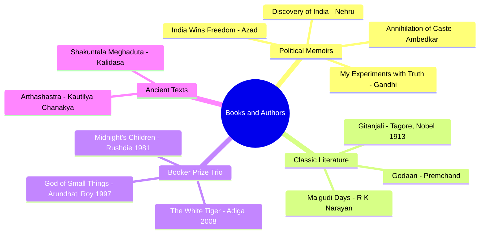

# NOTE — BOOKS AND AUTHORS
**Section:** GK | **Category:** Miscellaneous | **Topic:** Books and Authors | **Slug:** `misc-books-and-authors`
**Source:** 🔧 GENERAL KNOWLEDGE (standard GK reference; not yet cross-checked against PARMAR SSC reference excerpt)
**Status:** 🔧 DRAFT — awaiting AIR-91 verification before publish
**PYQ Frequency:** 🔥 Very high-frequency Static GK category | **High Yield:** ✅

---

## 🎭 THE HOOK

Some of India's most consequential political memoirs and manifestos were written not in offices but in prison cells. Jawaharlal Nehru wrote **"The Discovery of India"** while imprisoned at Ahmednagar Fort during the Quit India movement (1942-46); Bhagat Singh's prison writings became foundational revolutionary texts. SSC's "Books and Authors" category leans heavily on exactly this kind of pairing — a book title and the single name attached to it — making it one of the highest-density, fastest-scoring GK categories if you've memorized the right list, and one of the most embarrassing to get wrong if you mix up two superficially similar titles by different authors.

---

## 📖 THE CORE

### Political/Historical Memoirs & Texts
| Book | Author |
|---|---|
| **The Discovery of India** | Jawaharlal Nehru |
| **Glimpses of World History** | Jawaharlal Nehru |
| **An Autobiography / Toward Freedom** | Jawaharlal Nehru |
| **My Experiments with Truth** | M.K. Gandhi |
| **Hind Swaraj** | M.K. Gandhi |
| **India Wins Freedom** | Maulana Abul Kalam Azad |
| **The Indian War of Independence (1857)** | V.D. Savarkar |
| **Annihilation of Caste** | B.R. Ambedkar |
| **Indian Constitution: Cornerstone of a Nation** | Granville Austin (not an Indian author — frequently tested non-Indian author of an India-related book) |
| **Arthashastra** | Kautilya / Chanakya |

### Classic Indian Literature
| Book | Author |
|---|---|
| **Gitanjali** | Rabindranath Tagore (won the Nobel Prize in Literature, 1913 — first non-European Nobel laureate) |
| **Godaan** | Munshi Premchand |
| **Malgudi Days** | R.K. Narayan |
| **Train to Pakistan** | Khushwant Singh |
| **Midnight's Children** | Salman Rushdie (won the Booker Prize, 1981, and the "Booker of Bookers") |
| **God of Small Things** | Arundhati Roy (won the Booker Prize, 1997) |
| **A Suitable Boy** | Vikram Seth |
| **Shakuntala (Abhijnanasakuntalam)** | Kalidasa |
| **Meghaduta** | Kalidasa |

### Notable Modern/Contemporary Works
| Book | Author |
|---|---|
| **Wings of Fire** (autobiography) | A.P.J. Abdul Kalam |
| **The White Tiger** | Aravind Adiga (Booker Prize, 2008) |
| **An Era of Darkness** | Shashi Tharoor |
| **The Argumentative Indian** | Amartya Sen |

### Key Distinguishing Facts
- **Three Indian-authored books have won the Booker Prize**: *Midnight's Children* (Salman Rushdie, 1981), *God of Small Things* (Arundhati Roy, 1997), and *The White Tiger* (Aravind Adiga, 2008) — a frequently tested trio.
- **Rabindranath Tagore's "Gitanjali"** won the **1913 Nobel Prize in Literature** — making Tagore the first non-European to win a Nobel Prize in any category.
- **Kautilya/Chanakya's "Arthashastra"** is an ancient treatise on statecraft, predating modern Indian literature by roughly 2,000 years — don't confuse its era with the Mughal/colonial/modern works listed above.

---

## 🧠 THE MIND MAP

---

## 🔑 THE MNEMONIC

**"Discovery is Nehru's, Experiments are Gandhi's"** — the two most commonly tested, most easily confused political memoirs.

**"Rushdie '81, Roy '97, Adiga '08 — the Booker trio in order"** — the three Indian-authored Booker Prize winners with their years.

---

## 📌 THE PYQ ANCHOR

🔥 Books and Authors is a very high-frequency Static GK category. 🔧 No literal Books and Authors question confirmed in the 23/46-shift CGL-2025 sample reviewed earlier in this session, since this topic wasn't separately tagged during PYQ extraction — book-to-author matching is one of the most consistently tested SSC CGL GK categories across every cycle; recommend a dedicated archive cross-check.

---

## ⚠️ THE TRAP ALERT

- **"The Discovery of India" is Nehru's; "My Experiments with Truth" is Gandhi's** — these two political memoirs are the most frequently swapped pair in this category.
- **Three Indian-authored Booker Prize winners exist** (Rushdie, Roy, Adiga) — examiners may test which book belongs to which author, or which year each won.
- **Granville Austin, the author of a major book on the Indian Constitution, is NOT Indian** — a frequently tested "is this author Indian" trap, since the book is entirely about India.
- **Tagore won the Nobel Prize for Gitanjali in 1913** — the FIRST non-European Nobel laureate in any category, not just literature; a frequently tested superlative.

---

## ✅ ACTIVE RECALL

1. Who wrote "The Discovery of India," and under what circumstances was it written?
2. Who wrote "My Experiments with Truth"?
3. Name the three Indian-authored novels that have won the Booker Prize, with their authors.
4. For which work did Rabindranath Tagore win the Nobel Prize, and in which year?
5. Who is the author of the "Arthashastra"?

*(Answers: 1–Jawaharlal Nehru; written while imprisoned at Ahmednagar Fort during the Quit India movement (1942-46) | 2–M.K. Gandhi | 3–Midnight's Children (Salman Rushdie, 1981), The God of Small Things (Arundhati Roy, 1997), The White Tiger (Aravind Adiga, 2008) | 4–Gitanjali; 1913 | 5–Kautilya, also known as Chanakya or Vishnugupta)*
