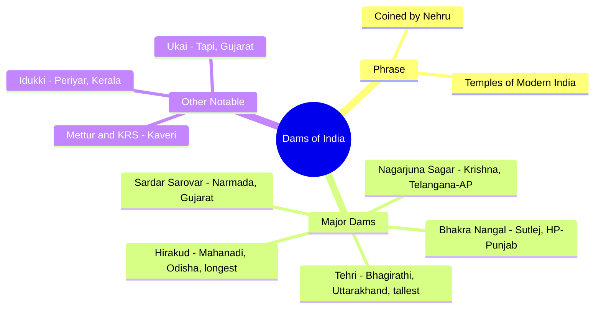

# NOTE — DAMS OF INDIA
**Section:** GK | **Category:** Miscellaneous | **Topic:** Dams of India | **Slug:** `misc-dams-of-india`
**Source:** 🔧 GENERAL KNOWLEDGE (standard GK reference; not yet cross-checked against PARMAR SSC reference excerpt)
**Status:** 🔧 DRAFT — awaiting AIR-91 verification before publish
**PYQ Frequency:** 🔥 High-frequency Static GK category, connects to [[geo-rivers-of-india]] | **High Yield:** ✅

---

## 🎭 THE HOOK

Jawaharlal Nehru called them the **"Temples of Modern India"** — not literal places of worship, but monuments to a newly independent nation's faith in engineering and planned development. India's major dams, built mostly in the decades right after independence, weren't just irrigation/power infrastructure; they were political symbols of self-reliance, each one tied to a specific river and a specific state, making "dam-to-river" matching one of SSC's cleanest, most reliable GK question formats.

---

## 📖 THE CORE

### Major Dams (Dam-to-River-to-State Matching, Frequently Tested)
| Dam | River | State |
|---|---|---|
| **Bhakra Nangal Dam** | Sutlej | Himachal Pradesh/Punjab border (one of India's earliest and largest multi-purpose projects) |
| **Hirakud Dam** | Mahanadi | Odisha (one of the world's LONGEST dams) |
| **Tehri Dam** | Bhagirathi | Uttarakhand (one of India's TALLEST dams) |
| **Sardar Sarovar Dam** | Narmada | Gujarat (a major, historically contentious project due to displacement concerns) |
| **Nagarjuna Sagar Dam** | Krishna | Telangana/Andhra Pradesh border (one of the world's largest masonry dams) |
| **Indira Sagar Dam** | Narmada | Madhya Pradesh |
| **Mettur Dam** | Kaveri | Tamil Nadu |
| **Krishna Raja Sagara (KRS) Dam** | Kaveri | Karnataka |
| **Rihand Dam** | Rihand (tributary of Son) | Uttar Pradesh |
| **Idukki Dam** | Periyar | Kerala (arch dam, one of the highest in Asia) |
| **Ukai Dam** | Tapi | Gujarat |

### Key Distinguishing Facts
- **"Temples of Modern India"** — a phrase coined by Jawaharlal Nehru, referring to large dam/infrastructure projects as symbols of post-independence development.
- **Bhakra Nangal Dam** is built on the **Sutlej River**, straddling the Himachal Pradesh-Punjab border, and was one of the first and largest river valley projects undertaken after independence.
- **Hirakud Dam (Odisha)** is frequently cited as one of the WORLD'S LONGEST dams (by total length, including earthen sections).
- **Tehri Dam (Uttarakhand)** is one of India's TALLEST dams, built on the Bhagirathi River (a tributary of the Ganga).
- **Sardar Sarovar Dam (Narmada, Gujarat)** has historically been one of India's most politically contentious infrastructure projects, due to large-scale displacement of communities along the Narmada Valley — associated with the Narmada Bachao Andolan protest movement.

---

## 🧠 THE MIND MAP

---

## 🔑 THE MNEMONIC

**"Hirakud is long, Tehri is tall, Bhakra Nangal started it all"** — three superlative dam facts anchored to memorable adjectives.

**"Narmada has two: Sardar Sarovar and Indira Sagar"** — both major dams on the same river, in Gujarat and Madhya Pradesh respectively.

---

## 📌 THE PYQ ANCHOR

🔥 Dams of India is a high-frequency Static GK category, directly connecting to [[geo-rivers-of-india]]. 🔧 No literal Dams question confirmed in the 23/46-shift CGL-2025 sample reviewed earlier in this session, since this topic wasn't separately tagged during PYQ extraction — dam-to-river-to-state matching is a textbook-standard SSC CGL GK staple; recommend a dedicated archive cross-check.

---

## ⚠️ THE TRAP ALERT

- **Hirakud Dam (Mahanadi, Odisha) is known for LENGTH; Tehri Dam (Bhagirathi, Uttarakhand) is known for HEIGHT** — don't conflate the two superlatives.
- **Sardar Sarovar Dam and Indira Sagar Dam are BOTH on the Narmada River**, but in different states (Gujarat and Madhya Pradesh respectively) — a frequently tested same-river, different-dam pairing.
- **Bhakra Nangal Dam straddles the Himachal Pradesh-Punjab border**, not located entirely within one state — a frequently tested location nuance.
- **Mettur Dam and KRS Dam are BOTH on the Kaveri River**, but in different states (Tamil Nadu and Karnataka respectively) — central to the long-running Cauvery water-sharing dispute between the two states.

---

## ✅ ACTIVE RECALL

1. What phrase did Nehru use to describe large dam projects, and why?
2. On which river is the Bhakra Nangal Dam built, and where is it located?
3. Which dam is known as one of the world's longest, and on which river/state is it located?
4. Which dam is known as one of India's tallest, and on which river is it built?
5. Name the two major dams on the Narmada River, and their respective states.

*(Answers: 1–"Temples of Modern India," symbolizing post-independence faith in engineering and planned development | 2–Sutlej River; on the Himachal Pradesh-Punjab border | 3–Hirakud Dam; on the Mahanadi River, Odisha | 4–Tehri Dam; on the Bhagirathi River, Uttarakhand | 5–Sardar Sarovar Dam (Gujarat) and Indira Sagar Dam (Madhya Pradesh))*
