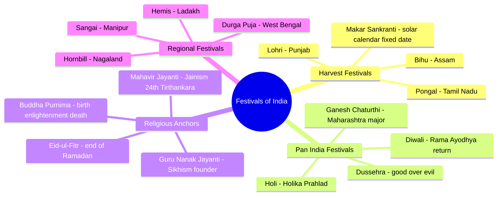

# NOTE — FESTIVALS OF INDIA
**Section:** GK | **Category:** Miscellaneous (Art & Culture) | **Topic:** Festivals of India | **Slug:** `misc-festivals-of-india`
**Source:** 🔧 GENERAL KNOWLEDGE (standard GK reference; not yet cross-checked against PARMAR SSC reference excerpt — the rendered pages 1-30 covered only Dance, not Festivals; the Festivals chapter, if present, is elsewhere in the 563-page document)
**Status:** 🔧 DRAFT — awaiting AIR-91 verification before publish
**PYQ Frequency:** 🔥 Very high-frequency SSC GK category | **High Yield:** ✅

---

## 🎭 THE HOOK

A single harvest festival has at least four different names depending on which state you're standing in — **Pongal** in Tamil Nadu, **Makar Sankranti** in most of North/Central India, **Lohri** in Punjab, **Bihu** in Assam, **Uttarayan** in Gujarat — all clustered around the same mid-January solar event, the sun's transition into Capricorn. That single fact captures exactly what makes Festivals such a productive SSC GK topic: India doesn't have one festival calendar, it has dozens of regional calendars converging on the same astronomical and agricultural anchor points, and the exam rewards knowing which name belongs to which state.

---

## 📖 THE CORE

### Harvest Festivals (Same Event, Different Names — Frequently Tested)
| Festival Name | State/Region |
|---|---|
| **Pongal** | Tamil Nadu |
| **Makar Sankranti** | Most of North/Central India, Maharashtra |
| **Lohri** | Punjab |
| **Bihu (Magh/Bhogali Bihu)** | Assam |
| **Uttarayan** | Gujarat |
| **Onam** | Kerala (harvest festival, but distinct timing — typically Aug-Sept, associated with King Mahabali's legendary return) |

### Major Pan-India Festivals
| Festival | Significance |
|---|---|
| **Diwali (Deepavali)** | Festival of lights; marks Lord Rama's return to Ayodhya after 14 years of exile and the defeat of Ravana |
| **Holi** | Festival of colours; associated with the legend of Holika and Prahlad, and Krishna-Radha's playful colour-throwing tradition |
| **Dussehra (Vijayadashami)** | Marks the victory of good over evil — Rama's defeat of Ravana (North India) OR Goddess Durga's defeat of Mahishasura (Bengal, as the culmination of Durga Puja) |
| **Navratri** | Nine nights honouring Goddess Durga; celebrated differently across regions (Garba/Dandiya in Gujarat, Durga Puja culmination in Bengal, Golu doll displays in Tamil Nadu) |
| **Raksha Bandhan** | Celebrates the bond between brothers and sisters |
| **Ganesh Chaturthi** | Birth of Lord Ganesha; especially major in Maharashtra (large public Ganpati pandals, popularized as a public festival by Bal Gangadhar Tilak) |
| **Krishna Janmashtami** | Birth of Lord Krishna |
| **Eid-ul-Fitr** | Marks the end of Ramadan (the Islamic month of fasting) |
| **Eid-ul-Zuha (Bakrid)** | Commemorates Prophet Ibrahim's willingness to sacrifice his son; associated with animal sacrifice |
| **Christmas** | Birth of Jesus Christ, celebrated 25 December |
| **Guru Nanak Jayanti (Gurpurab)** | Birth anniversary of Guru Nanak, founder of Sikhism |
| **Buddha Purnima** | Commemorates the birth, enlightenment, AND death (Mahaparinirvana) of Gautama Buddha — all three events fall on this same day, a frequently tested fact |
| **Mahavir Jayanti** | Birth of Lord Mahavira, the 24th Tirthankara of Jainism |

### Notable Regional/State-Specific Festivals
| Festival | State |
|---|---|
| **Durga Puja** | West Bengal (also widely celebrated pan-India and abroad) |
| **Bihu** | Assam (three Bihus a year: Rongali/Bohag — spring/New Year, Kati/Kongali — autumn, Magh/Bhogali — winter/harvest) |
| **Hornbill Festival** | Nagaland (December, showcases Naga tribal culture) |
| **Pushkar Camel Fair** | Rajasthan |
| **Hemis Festival** | Ladakh (Buddhist monastic festival) |
| **Rann Utsav** | Gujarat (Kutch region) |
| **Sangai Festival** | Manipur |
| **Losar** | Tibetan Buddhist New Year, celebrated in Sikkim, Ladakh, Arunachal Pradesh |
| **Chapchar Kut** | Mizoram |
| **Karva Chauth** | North India (married women's fast for husbands' longevity) |

### Calendar-Linked Facts
- **Makar Sankranti** is one of the few Hindu festivals tied to the **solar calendar** (fixed date, ~14 January), unlike most Hindu festivals, which follow the **lunar calendar** and shift dates yearly.
- **Buddha Purnima** uniquely marks THREE events on one day: Buddha's birth, enlightenment, and death.

---

## 🧠 THE MIND MAP

---

## 🔑 THE MNEMONIC

**"Same sun, different names"** — Pongal, Makar Sankranti, Lohri, Bihu, Uttarayan all mark the same mid-January solar transition under different regional names.

**"Buddha: Born, Enlightened, Gone — all on one day"** — Buddha Purnima's unique three-events-one-day status.

---

## 📌 THE PYQ ANCHOR

🔥 Festivals is one of the highest-frequency GK categories in SSC CGL/CHSL history. 🔧 No literal Festivals question confirmed in the 23/46-shift CGL-2025 sample reviewed earlier in this session, since this topic wasn't separately tagged during PYQ extraction — but festival-to-state/religion matching is a textbook-standard SSC GK staple across virtually every exam cycle; recommend a dedicated archive cross-check.

---

## ⚠️ THE TRAP ALERT

- **Makar Sankranti follows the SOLAR calendar (fixed ~14 January)**, unlike most Hindu festivals which follow the LUNAR calendar and shift dates each year — a frequently tested calendar-type distinction.
- **Buddha Purnima marks THREE separate events on the same day** (birth, enlightenment, death/Mahaparinirvana) — don't assume it celebrates only the birth.
- **Dussehra's meaning shifts by region** — North India emphasizes Rama's victory over Ravana; West Bengal frames it as the culmination of Durga Puja (Durga's victory over Mahishasura) — both are correct, region-dependent.
- **The same harvest festival has different state-specific names** (Pongal/Makar Sankranti/Lohri/Bihu/Uttarayan) — a very frequently tested "which state calls it what" matching trap.

---

## ✅ ACTIVE RECALL

1. Name at least three regional names for the mid-January harvest festival, and their respective states.
2. What event does Diwali commemorate?
3. Which calendar (solar or lunar) does Makar Sankranti follow, and why is this unusual among Hindu festivals?
4. What three events does Buddha Purnima commemorate?
5. Name the festival associated with Nagaland that showcases tribal culture in December.

*(Answers: 1–Any three of: Pongal (Tamil Nadu), Lohri (Punjab), Bihu (Assam), Uttarayan (Gujarat), Makar Sankranti (most of North/Central India) | 2–Lord Rama's return to Ayodhya after 14 years of exile, following his defeat of Ravana | 3–Solar calendar; unusual because most Hindu festivals follow the lunar calendar and shift dates yearly | 4–Buddha's birth, enlightenment, and death (Mahaparinirvana) | 5–Hornbill Festival)*
