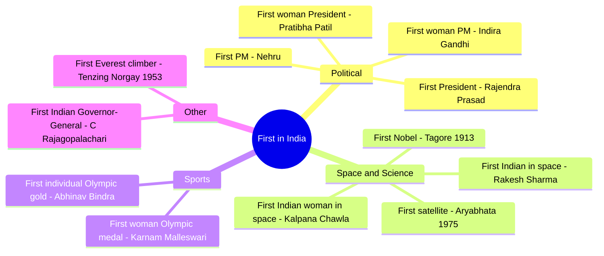

# NOTE — FIRST IN INDIA
**Section:** GK | **Category:** Miscellaneous | **Topic:** First in India | **Slug:** `misc-first-in-india`
**Source:** 🔧 GENERAL KNOWLEDGE (standard GK reference; not yet cross-checked against PARMAR SSC reference excerpt)
**Status:** 🔧 DRAFT — awaiting AIR-91 verification before publish
**PYQ Frequency:** 🔥 Very high-frequency Static GK category | **High Yield:** ✅

---

## 🎭 THE HOOK

"Firsts" are SSC's favourite kind of fact because they're unambiguous — there's only ever ONE first person to do something, which makes the question format clean and the trap simple: confusing the FIRST with the MOST FAMOUS. India's first woman Prime Minister, Indira Gandhi, is far more famous than India's first woman Chief Justice or first woman Governor — and that fame gap is exactly where examiners like to test whether you actually know the specific "first," not just the most prominent name in a category.

---

## 📖 THE CORE

### Political & Constitutional Firsts
| First | Person |
|---|---|
| First President of India | **Dr. Rajendra Prasad** |
| First Prime Minister of India | **Jawaharlal Nehru** |
| First woman Prime Minister | **Indira Gandhi** |
| First Vice President of India | **Dr. Sarvepalli Radhakrishnan** |
| First woman President of India | **Pratibha Patil** |
| First Chief Justice of India | **H.J. Kania** |
| First woman Chief Justice of a High Court | **Leila Seth** (Himachal Pradesh High Court) |
| First Speaker of the Lok Sabha | **G.V. Mavalankar** |
| First CEC (Chief Election Commissioner) | **Sukumar Sen** |
| First woman Governor of an Indian state | **Sarojini Naidu** (United Provinces, post-independence) |

### Space & Science Firsts
| First | Person/Detail |
|---|---|
| First Indian in space | **Rakesh Sharma** (1984, aboard Soyuz T-11, Soviet mission) |
| First Indian woman in space | **Kalpana Chawla** (1997, NASA, died in the 2003 Columbia disaster) |
| First satellite launched by India | **Aryabhata** (1975, launched from the Soviet Union) |
| First Indian to win a Nobel Prize | **Rabindranath Tagore** (Literature, 1913) |
| First Indian to win a Nobel Prize in Science | **C.V. Raman** (Physics, 1930, for the "Raman Effect") |
| First Indian woman to win a Nobel Prize | **Mother Teresa** (Peace, 1979) — 🔧 note: Mother Teresa was an Indian citizen by naturalization; some lists separately note her Albanian birth origin |

### Sports Firsts
| First | Person |
|---|---|
| First Indian to win an individual Olympic gold medal | **Abhinav Bindra** (2008 Beijing, shooting) |
| First Indian woman to win an Olympic medal | **Karnam Malleswari** (2000 Sydney, weightlifting, bronze) |
| First Indian to win the Bharat Ratna among sportspersons | **Sachin Tendulkar** (2014, also the youngest-ever Bharat Ratna recipient) |

### Other Notable Firsts
| First | Person/Detail |
|---|---|
| First Indian Governor-General (post-independence) | **C. Rajagopalari** (Chakravarti Rajagopalachari) — the only Indian Governor-General; Lord Mountbatten was the first Governor-General of independent India but a Briton |
| First woman to become an IAS officer | **Anna Rajam Malhotra** (1951) |
| First Indian to climb Mount Everest | **Tenzing Norgay** (with Edmund Hillary, 1953) |
| First Indian woman to climb Mount Everest | **Bachendri Pal** (1984) |

---

## 🧠 THE MIND MAP

---

## 🔑 THE MNEMONIC

**"Rajendra leads the President's chair, Nehru leads the PM's affair"** — the first President and first PM, kept distinct from each other.

**"Rakesh flew first, Kalpana followed for her gender, Bindra won gold alone"** — three distinct space/sports "firsts" anchored to different achievements.

---

## 📌 THE PYQ ANCHOR

🔥 First in India is a very high-frequency Static GK category. 🔧 No literal "First in India" question confirmed in the 23/46-shift CGL-2025 sample reviewed earlier in this session, since this topic wasn't separately tagged during PYQ extraction — political, space, and sports "firsts" are textbook-standard SSC CGL GK staples; recommend a dedicated archive cross-check.

---

## ⚠️ THE TRAP ALERT

- **Indira Gandhi is the first WOMAN Prime Minister**, but NOT the first woman President (that's Pratibha Patil) or first woman Chief Justice — don't conflate different "first woman in X" categories.
- **C. Rajagopalachari was the first and ONLY Indian Governor-General** — Lord Mountbatten was India's first Governor-General after independence, but he was British, not Indian; a frequently tested nuance.
- **Rakesh Sharma (1984) is the first Indian IN SPACE; Kalpana Chawla (1997) is the first Indian WOMAN in space** — but Kalpana Chawla flew with NASA, not ISRO or a Soviet mission like Sharma; don't conflate their missions.
- **Abhinav Bindra is the first Indian to win an INDIVIDUAL Olympic gold** — India had won team gold medals (hockey) earlier; this distinction (individual vs. team) is frequently tested.

---

## ✅ ACTIVE RECALL

1. Who was India's first President, and who was the first Prime Minister?
2. Who was the first Indian in space, and who was the first Indian woman in space?
3. Who was the first Indian to win a Nobel Prize, and in which category?
4. Who was the first and only Indian Governor-General of independent India?
5. Who was the first Indian to win an individual Olympic gold medal?

*(Answers: 1–Dr. Rajendra Prasad (President); Jawaharlal Nehru (Prime Minister) | 2–Rakesh Sharma (1984); Kalpana Chawla (1997) | 3–Rabindranath Tagore, Literature, 1913 | 4–C. Rajagopalachari (Chakravarti Rajagopalachari) | 5–Abhinav Bindra (2008 Beijing Olympics, shooting))*
