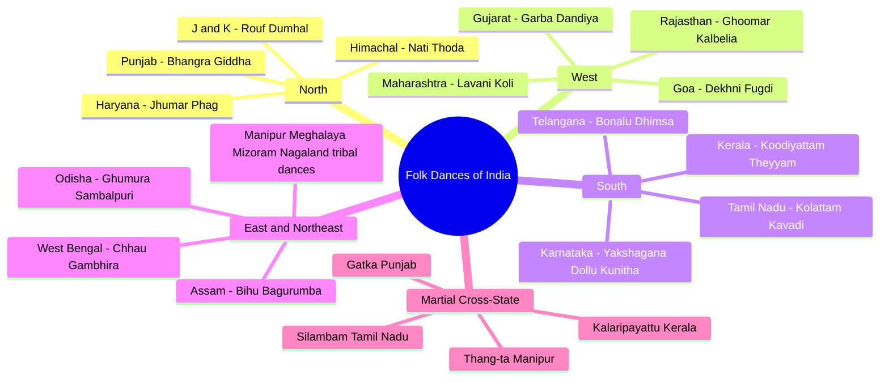

# NOTE — FOLK DANCES OF INDIA
**Section:** GK | **Category:** Miscellaneous (Art & Culture) | **Topic:** Folk Dances of India | **Slug:** `misc-folk-dances-of-india`
**Source:** PARMAR SSC reference notes, pages 12-29 ("Folk Dances of India" chapter, state-by-state) + general-knowledge cross-check for Punjab (not found as a dedicated page in the rendered excerpt)
**Status:** 🔧 DRAFT — awaiting AIR-91 verification before publish (⚠️ source pages were read visually at 150dpi; some dance-name spellings carry transcription risk — recommend a full-resolution recheck)
**PYQ Frequency:** 🔥 Very high-frequency SSC GK matching-question category | **High Yield:** ✅

---

## 🎭 THE HOOK

Every Indian state has at least one folk dance, and SSC has exactly one favourite way to test all of them at once: "match the dance with the state." It's one of the most reliable point-scoring categories in the entire GK section, precisely because the pattern never changes — only the names rotate. Some pairings are gifts (Bhangra is unmistakably Punjab), but others are deliberately confusable: two states can have dances with nearly identical names, or a state can have three or four distinct dances any one of which could be the "correct" answer in a poorly-written distractor set. The only real defense is a complete state-by-state map, held in memory as one block rather than scattered facts.

---

## 📖 THE CORE

### State-by-State Folk Dance Reference

| State / UT | Key Folk Dances |
|---|---|
| **Andhra Pradesh** | Kuchipudi (classical, see [[misc-kuchipudi]]), Lambadi, Dappu, Tappeta Gullu |
| **Arunachal Pradesh** | Buiya, Aji Lhamu, Pasi Kongki, Ponung |
| **Assam** | Bihu, Bagurumba, Jhumur (tea-tribe dance) |
| **Bihar** | Jat-Jatin, Karma, Jhijhia, Pawri |
| **Chhattisgarh** | Panthi, Karma, Raut Nacha, Saila |
| **Goa** | Dekhni, Fugdi, Mando, Dhalo |
| **Gujarat** | Garba, Dandiya Raas, Tippani |
| **Haryana** | Jhumar, Phag, Daph, Khoria |
| **Himachal Pradesh** | Nati, Thoda (martial), Dangi |
| **Jammu & Kashmir** | Rouf, Dumhal, Hikat |
| **Jharkhand** | Karam/Karma, Paika, Mundari, Domkach, Jhumar, Chhau |
| **Karnataka** | Yakshagana (dance-drama), Veeragase, Dollu Kunitha, Kamsale |
| **Kerala** | Onnamthullal (introduced by Kunchan Nambiar), Kaliyattam (=Theyyam), Koodiyattam, Thiruvathirakali, Chakyar Koothu |
| **Madhya Pradesh** | Saila, Karma, Jawara, Bhagoria, Maach |
| **Maharashtra** | Lavani, Koli, Powada (describes Shivaji's heroics), Tamasha, Dhangari Gaja |
| **Manipur** | Thang-ta (martial), Lai Haraoba, Pung Cholom, Dol Cholom, Khamba Thoibi |
| **Meghalaya** | Nongkrem (Khasi), Wangala (Garo), Shad Suk Mynsiem (Jaintia), Laho ("Festival of Hundred Drums") |
| **Mizoram** | Cheraw (Bamboo Dance), Khuallam, Chheihlam |
| **Nagaland** | Rangma, Bamboo Dance, Changai (Ao tribe), Zeliang |
| **Odisha** | Ghumura, Sambalpuri, Danda Nata, Pua Khaya |
| **Punjab** | Bhangra (male), Giddha (female) — 🔧 not found in the rendered PARMAR excerpt; sourced from stable general knowledge |
| **Rajasthan** | Ghoomar (worship of Goddess Parvati), Gangaur, Kalbelia (Snake/Sapera tribe — UNESCO-recognized), Chaari, Teratali |
| **Sikkim** | Khukuri Nritya/Chu-Faat, Singhi Chham (Snow Lion dance), Yak Chham — performed by Lepcha/Bhutia communities during harvest and festivals |
| **Tamil Nadu** | Kolattam (stick dance), Silambattam (martial), Oyilattam, Devarattam, Kavadi Attam (worship of Murugan) |
| **Telangana** | Bonalu (festival dance), Dhimsa, Gussadi (Gond tribe) |
| **Tripura** | Hojagiri (Reang tribe), Bizhu (Chakma tribe), Lebang Boomani (harvest dance) |
| **Uttar Pradesh** | Charkula (Braj region), Raslila (Krishna's life), Nautanki, Kajri |
| **Uttarakhand** | Chhapeli, Chanchlani/Ashish Chanchlani, Jhora, Chholiya (a sword dance reflecting Kumaoni martial tradition), Tandi |
| **West Bengal** | Chhau (also Jharkhand/Odisha), Gambhira, Purulia Chau, Tusu |

### Martial Dances (Special Cross-State Category)
A distinct cross-state category, frequently tested SEPARATELY from general folk dances:
| Martial Dance | State |
|---|---|
| **Lathi** | Punjab / West Bengal |
| **Gatka** | Punjab |
| **Silambam** | Tamil Nadu |
| **Sarit Sarak / Thang-ta** | Manipur |
| **Kalaripayattu** | Kerala |
| **Thoda** | Himachal Pradesh |
| **Inbuan** | Mizoram |
| **Mardani Khel** | Maharashtra |
| **Pari Khanda** | Bihar |
| **Mallakhamba** | Madhya Pradesh |
| **Musti Yudha** | Varanasi (Uttar Pradesh) |

### Key Cross-Cutting Facts
- **Chhau** is shared across THREE states/regions (Jharkhand, Odisha, West Bengal/Purulia) with regional variations — a frequently tested multi-state dance.
- **Bamboo dances** appear in TWO distinct northeastern contexts: **Cheraw** (Mizoram) and a separate bamboo dance tradition in **Nagaland** — don't conflate the two.
- **Kalbelia** (Rajasthan, performed by the Sapera/snake-charmer community) holds **UNESCO Intangible Cultural Heritage** status.

---

## 🧠 THE MIND MAP

---

## 🔑 THE MNEMONIC

**"Garba sways in Gujarat, Bhangra jumps in Punjab, Bihu welcomes spring in Assam, Lavani spins in Maharashtra"** — four unmistakable, never-confused regional anchors to build the rest of the map around.

**"Chhau belongs to three: Jharkhand, Odisha, Bengal"** — the most commonly tested multi-state dance overlap.

---

## 📌 THE PYQ ANCHOR

🔥 Folk Dances is one of the highest-frequency GK matching categories in SSC CGL/CHSL history. 🔧 No literal Folk Dance question confirmed in the 23/46-shift CGL-2025 sample reviewed earlier in this session, though the broader "match the dance with state/region" pattern recurred constantly across classical-dance questions — folk dances follow the identical question format. Recommend archive cross-check.

---

## ⚠️ THE TRAP ALERT

- **Chhau is NOT unique to one state** — it spans Jharkhand (Seraikella Chhau), Odisha (Mayurbhanj Chhau), and West Bengal (Purulia Chhau), each a distinct sub-style; "which state is Chhau from" has multiple defensible answers depending on the sub-style named.
- **Bamboo dances exist in BOTH Mizoram (Cheraw) and Nagaland** — these are separate traditions; don't assume "bamboo dance" uniquely identifies one state.
- **Martial dances are a SEPARATE matching category from general folk dances** — Gatka (Punjab), Kalaripayattu (Kerala), and Thang-ta (Manipur) are specifically martial-arts-rooted, often tested as their own table distinct from purely festive/celebratory folk dances.
- **Kalbelia (Rajasthan) carries UNESCO recognition** — a frequently tested "which Indian folk dance has UNESCO status" answer.

---

## ✅ ACTIVE RECALL

1. Name the folk dances of Gujarat and Punjab.
2. Which dance form is shared, in different regional styles, across Jharkhand, Odisha, and West Bengal?
3. Which Rajasthani folk dance, performed by the Sapera community, has UNESCO Intangible Cultural Heritage status?
4. Name the martial dance forms associated with Kerala and Manipur.
5. What is "Lavani," and which state is it from?

*(Answers: 1–Gujarat: Garba, Dandiya Raas; Punjab: Bhangra, Giddha | 2–Chhau | 3–Kalbelia | 4–Kerala: Kalaripayattu; Manipur: Thang-ta (also Sarit Sarak) | 5–A folk dance from Maharashtra, traditionally performed for private gatherings, known for its expressive storytelling and rhythm)*
