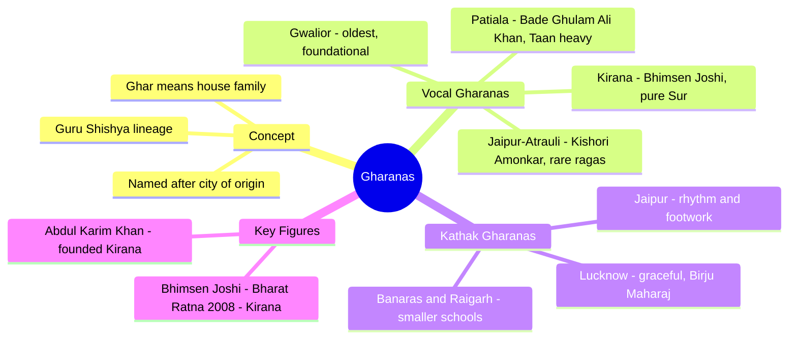

# NOTE — GHARANAS OF INDIAN CLASSICAL MUSIC
**Section:** GK | **Category:** Miscellaneous (Art & Culture) | **Topic:** Gharanas of Indian Classical Music | **Slug:** `misc-gharanas-of-indian-classical-music`
**Source:** 🔧 GENERAL KNOWLEDGE (standard GK reference; not yet cross-checked against PARMAR SSC reference excerpt)
**Status:** 🔧 DRAFT — awaiting AIR-91 verification before publish
**PYQ Frequency:** 🔥 Recurring SSC GK category, closely linked to [[misc-kathak]] | **High Yield:** ✅

---

## 🎭 THE HOOK

A Gharana isn't a school you enroll in — it's a bloodline of style, traditionally passed from a master (Guru) to disciples (often, but not only, within an actual family), each generation adding its own signature while staying recognizably loyal to a city's name. "Gharana" literally derives from **"Ghar"** (house/family) — and that's the whole concept: a "house" of music, identifiable by where its founding lineage lived and taught. Kathak alone among India's classical dances developed competing Gharanas (Lucknow vs. Jaipur), but Gharanas are really a HINDUSTANI MUSIC concept first — vocal music, especially Khayal singing, has dozens of named lineages, each with its own technical signature, and SSC tests the most famous ones by name and city of origin almost every cycle.

---

## 📖 THE CORE

### What Is a Gharana?
- A **Gharana** is a system of social organization linking musicians/dancers by lineage (Guru-Shishya tradition) and/or by a distinctive musical/stylistic ideology, traditionally named after the **city or region** where the lineage originated.
- Concept applies most prominently to **Hindustani classical vocal music** (especially Khayal singing) and to **Kathak** dance.

### Major Hindustani Vocal Music Gharanas
| Gharana | Known For | Notable Exponents |
|---|---|---|
| **Gwalior Gharana** | Considered the OLDEST of the Khayal gharanas; foundational style | Ustad Haddu Khan, Ustad Hassu Khan |
| **Kirana Gharana** | Emphasis on pure melodic note (Sur), slow elaboration | Pandit Bhimsen Joshi, Gangubai Hangal, Abdul Karim Khan (founder) |
| **Agra Gharana** | Blend of Khayal and Dhrupad elements, forceful style | Faiyaz Khan |
| **Jaipur-Atrauli Gharana** | Complex, rare ragas; intricate rhythmic patterns | Mallikarjun Mansur, Kishori Amonkar |
| **Patiala Gharana** | Fast, ornamental (Taan-heavy) style | Bade Ghulam Ali Khan |
| **Rampur-Sahaswan Gharana** | Balance of emotional depth and technical command | Ustad Nissar Hussain Khan |

### Kathak Gharanas (see also [[misc-kathak]])
- **Lucknow Gharana** — graceful, expressive (Abhinaya-focused), associated with the Awadh/Nawabi court; Birju Maharaj's lineage.
- **Jaipur Gharana** — rhythm-heavy, footwork-dominant, associated with the Rajput court.
- Smaller schools: **Banaras Gharana**, **Raigarh Gharana**.

### Key Distinguishing Facts
- **Gwalior Gharana is widely regarded as the oldest/"mother" gharana** of Hindustani Khayal singing, with many later gharanas tracing influence back to it.
- **Pandit Bhimsen Joshi**, a Bharat Ratna recipient (2008), belonged to the **Kirana Gharana**.
- Gharanas are NOT exclusive to vocal music — instrumental traditions (e.g., sitar and sarod playing styles) also have their own gharana-like lineage classifications, though this is less rigidly named by "Gharana" terminology than vocal/Kathak traditions.

---

## 🧠 THE MIND MAP

---

## 🔑 THE MNEMONIC

**"Ghar = House, Gharana = a House of Music"** — the literal-meaning anchor for the entire concept.

**"Gwalior is the grandparent, Kirana is the purist, Patiala is the showman"** — three of the most-tested vocal gharanas, characterized by one defining trait each.

---

## 📌 THE PYQ ANCHOR

🔥 Gharanas is a recurring SSC GK category, closely paired with Kathak questions (see [[misc-kathak]]). 🔧 No literal Gharana question confirmed in the 23/46-shift CGL-2025 sample reviewed earlier in this session, since this topic wasn't separately tagged during PYQ extraction — gharana-to-exponent and gharana-to-city matching are textbook-standard SSC GK staples; recommend a dedicated archive cross-check.

---

## ⚠️ THE TRAP ALERT

- **Gwalior Gharana is the OLDEST of the major Khayal gharanas** — a frequently tested "which gharana came first" fact; don't assume Kirana or Patiala (more famous names today) are older.
- **Kathak's Lucknow and Jaipur Gharanas are DIFFERENT from the vocal-music Gharanas of the same/similar city names** — e.g., "Jaipur Gharana" can refer to EITHER a Kathak dance lineage OR the separate "Jaipur-Atrauli" vocal gharana; context matters, and examiners may exploit this overlap.
- **Pandit Bhimsen Joshi belonged to the Kirana Gharana**, not Gwalior or Patiala — a frequently tested exponent-to-gharana pairing.

---

## ✅ ACTIVE RECALL

1. What does the word "Gharana" literally mean, and what concept does it describe?
2. Which Gharana is considered the oldest of the major Hindustani Khayal singing traditions?
3. Which Gharana did Pandit Bhimsen Joshi belong to?
4. Name the two major Kathak Gharanas, and one defining characteristic of each.
5. Is "Jaipur Gharana" used in both Kathak (dance) and vocal music contexts? If so, are they the same lineage?

*(Answers: 1–"Ghar" means house/family; a Gharana is a lineage-based "house" of musical/stylistic tradition, passed via the Guru-Shishya system | 2–Gwalior Gharana | 3–Kirana Gharana | 4–Lucknow Gharana (graceful, expressive/Abhinaya-focused) and Jaipur Gharana (rhythm-heavy, footwork-dominant) | 5–Yes, the term is used in both contexts, but they refer to DIFFERENT, separate lineages — the Kathak Jaipur Gharana and the vocal Jaipur-Atrauli Gharana are not the same tradition)*
