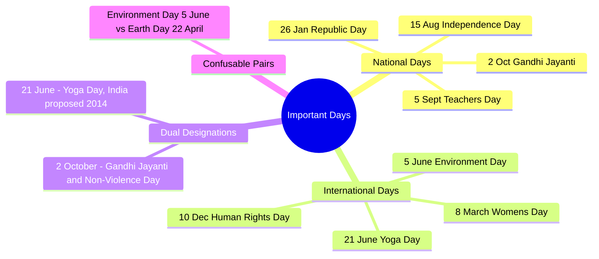

# NOTE — IMPORTANT DAYS & DATES
**Section:** GK | **Category:** Miscellaneous | **Topic:** Important Days & Dates | **Slug:** `misc-important-days-and-dates`
**Source:** 🔧 GENERAL KNOWLEDGE (standard GK reference; not yet cross-checked against PARMAR SSC reference excerpt)
**Status:** 🔧 DRAFT — awaiting AIR-91 verification before publish
**PYQ Frequency:** 🔥 Very high-frequency Static GK category | **High Yield:** ✅

---

## 🎭 THE HOOK

The calendar itself is a GK syllabus if you know where to look — nearly every month carries at least one internationally or nationally designated "Day," each tied to a specific founding body, a specific year, and a specific cause. SSC mines this calendar relentlessly because it's a closed, finite list: there are only so many days in a year, and once you've matched each date to its theme, the question type becomes trivially fast to answer. The trap is never really about KNOWING a day exists — it's about confusing two similarly-themed days that fall on different dates (Environment Day vs. Earth Day; Human Rights Day vs. Democracy Day).

---

## 📖 THE CORE

### National Days (India-Specific)
| Date | Day |
|---|---|
| **26 January** | Republic Day (Constitution came into force, 1950) |
| **15 August** | Independence Day (1947) |
| **2 October** | Gandhi Jayanti (also International Day of Non-Violence, UN-designated) |
| **14 November** | Children's Day (Jawaharlal Nehru's birthday) |
| **5 September** | Teachers' Day (Dr. S. Radhakrishnan's birthday) |
| **23 January** | Parakram Diwas (Netaji Subhas Chandra Bose's birthday) |
| **31 October** | National Unity Day (Sardar Vallabhbhai Patel's birthday) |
| **11 May** | National Technology Day |

### International Days (UN-Designated, Frequently Tested)
| Date | Day |
|---|---|
| **8 March** | International Women's Day |
| **22 March** | World Water Day |
| **21 March** | International Day of Forests / World Forestry Day |
| **7 April** | World Health Day |
| **22 April** | International Mother Earth Day (Earth Day) |
| **23 April** | World Book and Copyright Day |
| **1 May** | International Labour Day (May Day) |
| **31 May** | World No Tobacco Day |
| **5 June** | World Environment Day |
| **21 June** | International Day of Yoga |
| **12 August** | International Youth Day |
| **8 September** | International Literacy Day |
| **21 September** | International Day of Peace |
| **1 October** | International Day of Older Persons |
| **10 October** | World Mental Health Day |
| **24 October** | United Nations Day |
| **16 November** | International Day for Tolerance |
| **1 December** | World AIDS Day |
| **10 December** | Human Rights Day |

### Key Distinguishing Facts
- **World Environment Day (5 June)** vs. **Earth Day (22 April)**: BOTH exist as separate, distinct observances — Environment Day is UN-designated (since 1973); Earth Day originated separately in the US (1970), later became internationally recognized — a frequently tested "which day is which" confusion.
- **International Day of Yoga (21 June)**: proposed by India's PM Narendra Modi at the UN General Assembly in 2014, first observed in **2015** — chosen for the **summer solstice** date (longest day in the Northern Hemisphere).
- **Gandhi Jayanti (2 October)** carries a DUAL designation: India's national observance of Gandhi's birthday AND the UN's International Day of Non-Violence — a frequently tested two-in-one fact.

---

## 🧠 THE MIND MAP

---

## 🔑 THE MNEMONIC

**"26-15-2: Republic, Independence, Gandhi"** — the three most iconic Indian national dates (January 26, August 15, October 2), in calendar order.

**"5th June is Environment, 22nd April is Earth"** — the two easily confused green-themed days, kept apart by date.

---

## 📌 THE PYQ ANCHOR

🔥 Important Days & Dates is a very high-frequency Static GK category. 🔧 No literal Important Days question confirmed in the 23/46-shift CGL-2025 sample reviewed earlier in this session, since this topic wasn't separately tagged during PYQ extraction — national and UN-designated day-to-date matching is one of the most consistently tested SSC CGL GK categories across every cycle; recommend a dedicated archive cross-check.

---

## ⚠️ THE TRAP ALERT

- **World Environment Day (5 June) and Earth Day (22 April) are DIFFERENT, separate observances** — a very frequently tested date-confusion trap.
- **International Day of Yoga (21 June) was proposed by India in 2014 and first observed in 2015** — don't confuse the proposal year with the first observance year.
- **Gandhi Jayanti (2 October) is BOTH a national holiday AND the UN's International Day of Non-Violence** — a dual-designation fact frequently tested as "what is 2 October also known as internationally."
- **Children's Day (14 November) is Nehru's birthday; Teachers' Day (5 September) is Dr. S. Radhakrishnan's birthday** — a frequently swapped pair, since both are India-specific "person's birthday" observances.

---

## ✅ ACTIVE RECALL

1. What three dates mark Republic Day, Independence Day, and Gandhi Jayanti?
2. What is 2 October's dual designation — national and international?
3. What is the difference between World Environment Day and Earth Day, in terms of date and origin?
4. When was International Day of Yoga first observed, and why was 21 June chosen?
5. Whose birthdays are commemorated as Children's Day and Teachers' Day respectively?

*(Answers: 1–26 January (Republic Day), 15 August (Independence Day), 2 October (Gandhi Jayanti) | 2–Nationally, Gandhi Jayanti; internationally, the UN's International Day of Non-Violence | 3–World Environment Day (5 June) is UN-designated since 1973; Earth Day (22 April) originated separately in the US in 1970 | 4–First observed in 2015, proposed by India in 2014; 21 June was chosen as it is the summer solstice, the longest day in the Northern Hemisphere | 5–Children's Day: Jawaharlal Nehru's birthday; Teachers' Day: Dr. S. Radhakrishnan's birthday)*
