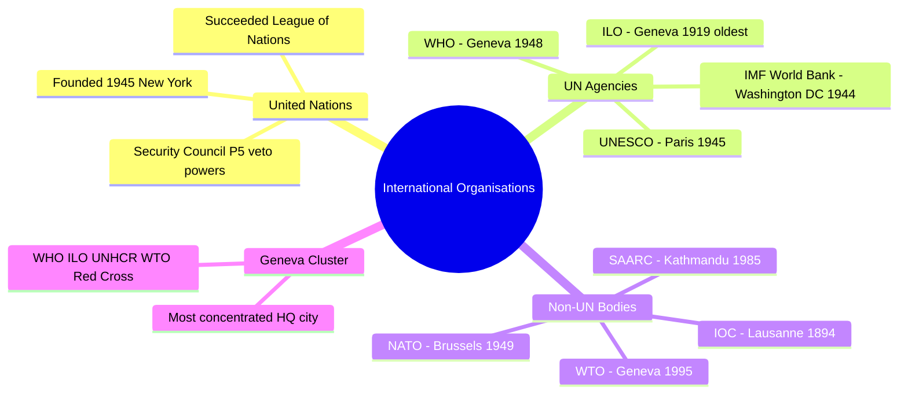

# NOTE — INTERNATIONAL ORGANISATIONS
**Section:** GK | **Category:** Miscellaneous | **Topic:** International Organisations | **Slug:** `misc-international-organisations`
**Source:** 🔧 GENERAL KNOWLEDGE (standard GK reference; not yet cross-checked against PARMAR SSC reference excerpt)
**Status:** 🔧 DRAFT — awaiting AIR-91 verification before publish
**PYQ Frequency:** 🔥 Very high-frequency SSC GK category | **High Yield:** ✅

---

## 🎭 THE HOOK

After the deadliest war in human history ended in 1945, the world's surviving powers tried something it had already failed at once before — building a permanent international body to prevent the next one. The League of Nations, founded after World War I, had collapsed for lack of teeth; its successor, the **United Nations**, was built with the explicit lesson learned that an international body without major-power buy-in (and a mechanism to enforce decisions) was just a debating society. Out of the UN's founding charter grew an entire family of specialized agencies — WHO for health, UNESCO for education and culture, ILO for labour — each headquartered in a different city, each with its own founding year, and each a near-guaranteed line item on every SSC GK paper's "match the organisation with its headquarters" question.

---

## 📖 THE CORE

### The United Nations & Key Facts
- **United Nations (UN)**: Founded **24 October 1945**; headquartered in **New York, USA**.
- Succeeded the **League of Nations** (founded 1920, dissolved 1946, headquartered in **Geneva, Switzerland**).
- **UN Security Council**: 5 permanent members (P5) with veto power — **USA, UK, France, Russia, China** — plus 10 non-permanent members (2-year terms).
- **Secretary-General** (current, as of this note's drafting): António Guterres (Portugal) — 🔧 verify currency, as this office changes periodically.

### Major UN Specialized Agencies (Frequently Tested HQ Matching)
| Organisation | Full Name | Headquarters | Founded |
|---|---|---|---|
| **WHO** | World Health Organization | Geneva, Switzerland | 1948 |
| **UNESCO** | UN Educational, Scientific and Cultural Organization | Paris, France | 1945 |
| **ILO** | International Labour Organization | Geneva, Switzerland | 1919 (oldest UN specialized agency, predates the UN itself, originally under the League of Nations) |
| **UNICEF** | UN Children's Fund | New York, USA | 1946 |
| **FAO** | Food and Agriculture Organization | Rome, Italy | 1945 |
| **IMF** | International Monetary Fund | Washington D.C., USA | 1944 (Bretton Woods Conference) |
| **World Bank** | (World Bank Group) | Washington D.C., USA | 1944 (also Bretton Woods) |
| **UNHCR** | UN High Commissioner for Refugees | Geneva, Switzerland | 1950 |
| **IAEA** | International Atomic Energy Agency | Vienna, Austria | 1957 |
| **ICJ** | International Court of Justice | The Hague, Netherlands | 1945 |

### Major Non-UN International Organisations
| Organisation | Headquarters | Founded | Purpose |
|---|---|---|---|
| **WTO** | World Trade Organization | Geneva, Switzerland | 1995 (succeeded GATT) |
| **NATO** | North Atlantic Treaty Organization | Brussels, Belgium | 1949 |
| **SAARC** | South Asian Association for Regional Cooperation | Kathmandu, Nepal | 1985 |
| **ASEAN** | Association of Southeast Asian Nations | Jakarta, Indonesia | 1967 |
| **OPEC** | Organization of the Petroleum Exporting Countries | Vienna, Austria | 1960 |
| **Interpol** | International Criminal Police Organization | Lyon, France | 1923 |
| **IOC** | International Olympic Committee | Lausanne, Switzerland | 1894 |
| **Red Cross (ICRC)** | International Committee of the Red Cross | Geneva, Switzerland | 1863 |
| **Amnesty International** | (Human rights NGO) | London, UK | 1961 |
| **G20** | Group of 20 (major economies forum) | No fixed HQ (rotating presidency/summit host) | 1999 |
| **BRICS** | Brazil, Russia, India, China, South Africa (+ newer members) | No fixed HQ | 2009 (first summit) |

### Geneva: The Most-Tested City
- **Geneva, Switzerland** hosts an unusually large concentration of international bodies: WHO, ILO, UNHCR, WTO, Red Cross (ICRC) — making it one of the single most frequently correct answers in "which city" GK questions.

---

## 🧠 THE MIND MAP

---

## 🔑 THE MNEMONIC

**"Geneva collects them: WHO, ILO, UNHCR, WTO, Red Cross"** — the single city with the most concentrated cluster of major international HQs.

**"1944 Bretton Woods birthed twins: IMF and World Bank"** — both founded the same year, at the same conference, both headquartered in Washington D.C.

---

## 📌 THE PYQ ANCHOR

🔥 International Organisations is one of the highest-frequency GK categories in SSC CGL/CHSL history. 🔧 No literal International Organisations question confirmed in the 23/46-shift CGL-2025 sample reviewed earlier in this session, since this topic wasn't separately tagged during PYQ extraction — organisation-to-HQ and organisation-to-founding-year matching are textbook-standard SSC GK staples; recommend a dedicated archive cross-check.

---

## ⚠️ THE TRAP ALERT

- **ILO (1919) is OLDER than the UN itself (1945)** — it originated under the League of Nations and was carried over as a UN specialized agency; a frequently tested "which organisation predates the UN" trap.
- **IMF and World Bank were BOTH founded in 1944 at Bretton Woods**, and both are headquartered in **Washington D.C.** — frequently confused with Geneva-based agencies due to their "international" nature.
- **The League of Nations (predecessor to UN) was headquartered in GENEVA**, while the **UN itself is headquartered in NEW YORK** — a commonly swapped city pair.
- **SAARC's headquarters is in Kathmandu, Nepal**, NOT in India, despite India being a founding/major member — a frequently tested location trap.

---

## ✅ ACTIVE RECALL

1. When was the United Nations founded, and where is it headquartered?
2. Which UN specialized agency is older than the UN itself, and why?
3. Name three major international organisations headquartered in Geneva.
4. Where are the IMF and World Bank headquartered, and in which year were both founded?
5. Where is SAARC headquartered?

*(Answers: 1–24 October 1945; headquartered in New York, USA | 2–ILO (International Labour Organization), founded in 1919 under the League of Nations, before the UN existed | 3–Any three of: WHO, ILO, UNHCR, WTO, Red Cross (ICRC) | 4–Washington D.C., USA; both founded in 1944 at the Bretton Woods Conference | 5–Kathmandu, Nepal)*
