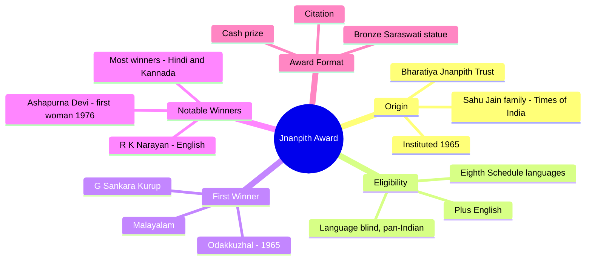

# NOTE — JNANPITH AWARD
**Section:** GK | **Category:** Miscellaneous | **Topic:** Jnanpith Award | **Slug:** `misc-jnanpith-award`
**Source:** 🔧 GENERAL KNOWLEDGE (standard GK reference; not yet cross-checked against PARMAR SSC reference excerpt)
**Status:** 🔧 DRAFT — awaiting AIR-91 verification before publish
**PYQ Frequency:** 🔥 Official Phase-1 priority topic (GK_PRIORITY_TOPICS, Miscellaneous bucket) | **High Yield:** ✅

---

## 🎭 THE HOOK

India has 22 languages officially recognized in the Constitution's Eighth Schedule, and one single literary prize that towers above all of them in prestige: the **Jnanpith Award**. Instituted in **1965** by the **Bharatiya Jnanpith Trust** (founded by the Sahu Jain family, owners of the Times of India group), it is India's oldest and highest literary honour — and deliberately language-blind: it can go to a work written in ANY of the languages listed in the Eighth Schedule (plus English, added later to eligibility), not just Hindi or any single dominant language. The first-ever recipient set the tone for the award's pan-Indian ambition: **G. Sankara Kurup**, honoured in 1965 for his Malayalam poetry collection *Odakkuzhal* (The Bamboo Flute) — a Malayalam writer winning India's top literary prize before a single Hindi author ever did.

---

## 📖 THE CORE

### Origin
- Instituted in **1965** by the **Bharatiya Jnanpith**, a trust established by the **Sahu Jain family** (publishers of the Times of India group).
- Name "Jnanpith" translates roughly to **"seat/abode of knowledge."**
- Awarded annually (though sometimes awarded for a body of work over multiple years, or occasionally shared between two recipients) to an Indian writer for an **outstanding contribution to literature**.

### Eligibility & Scope
- Open to works written in any of the languages listed in the **Eighth Schedule of the Indian Constitution**, plus **English** (added to the eligible languages list later).
- Unlike some literary prizes that honour a single book, the Jnanpith Award has historically recognized either a single outstanding work OR a writer's entire body of literary contribution, depending on the specific award cycle's rules.

### First Recipient
- **G. Sankara Kurup** (Malayalam poet) was the **first Jnanpith Award winner in 1965**, for his poetry collection ***Odakkuzhal*** (The Bamboo Flute).

### Notable Recipients (Frequently Tested)
| Recipient | Language | Notable Work/Note |
|---|---|---|
| **G. Sankara Kurup** | Malayalam | First winner, 1965, *Odakkuzhal* |
| **Ashapurna Devi** | Bengali | First WOMAN to win the Jnanpith (1976) |
| **R.K. Narayan** | English | Noted novelist |
| **Amrita Pritam** | Punjabi | Noted poet/writer |
| **Mahasweta Devi** | Bengali | Noted social activist-writer |
| **Girish Karnad** | Kannada | Noted playwright |
| **U.R. Ananthamurthy** | Kannada | Noted novelist |

- **Hindi has produced the largest number of Jnanpith winners** of any single language to date, with Kannada also being among the most-honoured languages — a frequently tested "which language has won the most" comparison.

### Format of the Award
- Comprises a citation, a bronze replica of **Saraswati** (the Hindu goddess of knowledge), and a cash prize (amount revised periodically upward over the decades).

---

## 🧠 THE MIND MAP

---

## 🔑 THE MNEMONIC

**"1965, Malayalam, Sankara Kurup"** — the first Jnanpith Award's year, language, and recipient, locked together.

**"Saraswati in bronze, knowledge in any tongue"** — the award's symbol (bronze Saraswati statue) and its defining feature (open to any Eighth Schedule language).

---

## 📌 THE PYQ ANCHOR

🔥 Jnanpith Award is on the app's **official Phase-1 priority list** (GK_PRIORITY_TOPICS, Miscellaneous). 🔧 No literal Jnanpith Award question confirmed in the 23/46-shift CGL-2025 sample reviewed — first recipient (G. Sankara Kurup), founding year (1965), and the Bharatiya Jnanpith Trust are textbook-standard SSC CGL GK staples; recommend archive cross-check.

---

## ⚠️ THE TRAP ALERT

- **The first Jnanpith Award winner (1965) was a MALAYALAM writer (G. Sankara Kurup), NOT a Hindi writer** — a very commonly tested "first winner" trap, since many aspirants assume Hindi dominance from the start.
- **Ashapurna Devi (Bengali) was the FIRST WOMAN to win the Jnanpith**, in 1976 — don't confuse with other notable women writers honoured later.
- **The award is open to English too**, not just the 22 Eighth Schedule languages — R.K. Narayan won for English-language work; a frequently overlooked eligibility detail.

---

## ✅ ACTIVE RECALL

1. In which year was the Jnanpith Award instituted, and by which trust?
2. Who was the first recipient of the Jnanpith Award, and for which work?
3. Which languages are eligible for the Jnanpith Award?
4. Who was the first woman to win the Jnanpith Award?
5. What does the award physically consist of (besides the cash prize)?

*(Answers: 1–1965, by the Bharatiya Jnanpith Trust (Sahu Jain family) | 2–G. Sankara Kurup, for his Malayalam poetry collection Odakkuzhal (The Bamboo Flute) | 3–Any language listed in the Eighth Schedule of the Constitution, plus English | 4–Ashapurna Devi (Bengali), in 1976 | 5–A citation and a bronze replica of the goddess Saraswati)*
