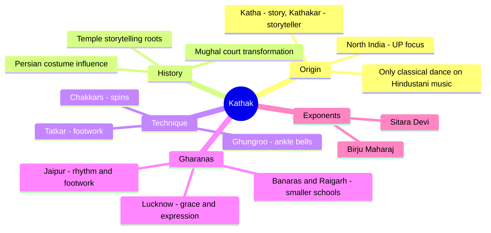

# NOTE — KATHAK
**Section:** GK | **Category:** Miscellaneous (Art & Culture) | **Topic:** Kathak | **Slug:** `misc-kathak`
**Source:** 🔧 GENERAL KNOWLEDGE (NOT sourced from PARMAR SSC reference excerpt — pages 1-30 of that document cover Bharatanatyam, Kuchipudi, Mohiniyattam, Manipuri, Sattriya, then transition straight to Folk Dances; Kathak was not found in the rendered range). If a Kathak page exists elsewhere in the 563-page source, recommend supplying it for direct cross-check.
**Status:** 🔧 DRAFT — awaiting AIR-91 verification before publish (HIGHER priority verification, general-knowledge-sourced, not reference-anchored)

---

## 🎭 THE HOOK

Every other classical dance on this list is set to Carnatic music. Kathak is the one exception — and that single fact is the most commonly tested detail about it. Born as a storytelling tradition in North Indian temples (the word "Kathak" comes from "Katha," story, and "Kathakar," the one who tells it), it later moved into Mughal courts and absorbed Persian-influenced costume, the spinning **Chakkars**, and a sharper, percussive footwork style built around **Tatkar**. That dual heritage — Hindu temple storytelling fused with Mughal-court refinement — is why Kathak alone among the 8 classical dances is performed to **Hindustani**, not Carnatic, music, and why it alone developed two competing schools, or **Gharanas**: Lucknow (graceful, expressive, Nawabi-court style) and Jaipur (powerful, rhythm-heavy, footwork-dominant style), with smaller Banaras and Raigarh gharanas alongside them.

---

## 📖 THE CORE

### Origin & Identity
- **Kathak** = classical dance of **North India** (associated especially with Uttar Pradesh), the only one of the 8 classical dances set to **Hindustani classical music** rather than Carnatic.
- Name derives from **Katha** (story) and **Kathakar** (storyteller) — originally temple-based storytellers who narrated mythological tales through dance, music, and mime.
- Distinctive features: rapid spins called **Chakkars**, intricate footwork (**Tatkar**) synced with the tabla, and use of ankle bells (**Ghungroo**).

### History
- Rooted in ancient temple-storytelling tradition (Kathakars/Kathavachakas).
- Significantly transformed during the **Mughal era**, when it moved from temple to royal court, absorbing Persian-influenced costume (the long, flared skirt and refined court aesthetics) and a more secular, entertainment-oriented performance style.
- Developed into distinct **Gharanas** (schools), most notably:
  - **Lucknow Gharana** — associated with the Awadh/Nawabi court; emphasis on grace, expression (Abhinaya), and elegance.
  - **Jaipur Gharana** — associated with the Rajput court; emphasis on rhythmic complexity, footwork, and technical virtuosity.
  - (Smaller schools: Banaras Gharana, Raigarh Gharana.)

### Exponents
| Exponent | Note |
|---|---|
| **Birju Maharaj** | Most celebrated modern Kathak exponent, leading figure of the Lucknow Gharana, Bharat Ratna-tier cultural stature |
| **Sitara Devi** | Major 20th-century exponent, Jaipur Gharana–trained |
| **Shovana Narayan** | Noted exponent |
| **Kumudini Lakhia** | Noted exponent and choreographer, founder of Kadamb dance school |
| **Shambhu Maharaj**, **Lacchu Maharaj** | Earlier generation Lucknow Gharana gurus, part of the same Maharaj family lineage as Birju Maharaj |

---

## 🧠 THE MIND MAP

---

## 🔑 THE MNEMONIC

**"Kathak = the odd one out on music"** — the only classical dance set to Hindustani (not Carnatic) music; instant elimination trick in matching questions.

**"Lucknow for Lyrical, Jaipur for Jolt"** — Lucknow Gharana = graceful expression; Jaipur Gharana = powerful footwork/rhythm.

---

## 📌 THE PYQ ANCHOR

🔧 **GAP — VERIFY.** No literal "Kathak" identification question confirmed in the 23/46-shift CGL-2025 sample reviewed. Kathak is one of the 8 officially recognized classical dances and a recurring "match the dance to its state/music-system" pattern target — its Hindustani-vs-Carnatic distinction makes it especially exam-friendly. Treat as high-yield by category membership, but this note carries an ELEVATED verification priority since none of its content is reference-anchored (general-knowledge sourced only).

---

## ⚠️ THE TRAP ALERT

- **Kathak is the ONLY one of the 8 classical dances performed to Hindustani classical music** — all others (Bharatanatyam, Kuchipudi, Mohiniyattam, Kathakali, Odissi, Manipuri, Sattriya) use Carnatic or regional devotional music systems. This single fact is a favourite elimination-style MCQ trap.
- **Lucknow and Jaipur Gharanas are commonly swapped** — Lucknow = graceful/expressive (Nawabi court), Jaipur = rhythm-heavy/footwork-dominant (Rajput court). Don't mix up which gharana is known for which quality.
- **Birju Maharaj belongs to the Lucknow Gharana**, not Jaipur — a frequently tested exponent-to-gharana pairing.

---

## ✅ ACTIVE RECALL

1. Which classical music system is Kathak performed to, and how does this differ from the other 7 classical dances?
2. What do the words "Katha" and "Kathakar" mean, and how do they relate to Kathak's origin?
3. Name Kathak's signature spinning movement and its rhythmic footwork technique.
4. What are the two major Gharanas of Kathak, and what is each known for?
5. Which gharana does Birju Maharaj, Kathak's most celebrated modern exponent, belong to?

*(Answers: 1–Hindustani classical music; it is the only one of the 8 not set to Carnatic music | 2–Katha = story, Kathakar = storyteller — Kathak originated as temple-based mythological storytelling | 3–Chakkars (spins) and Tatkar (footwork) | 4–Lucknow Gharana (grace/expression) and Jaipur Gharana (rhythm/footwork) | 5–Lucknow Gharana)*
