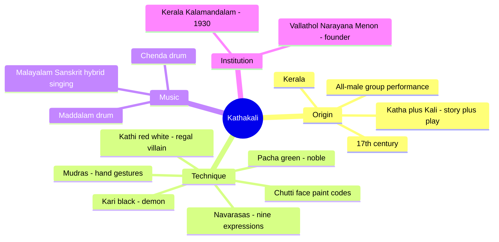

# NOTE — KATHAKALI
**Section:** GK | **Category:** Miscellaneous (Art & Culture) | **Topic:** Kathakali | **Slug:** `misc-kathakali`
**Source:** 🔧 GENERAL KNOWLEDGE (NOT sourced from PARMAR SSC reference excerpt — pages 1-30 of that document cover Bharatanatyam, Kuchipudi, Mohiniyattam, Manipuri, Sattriya, then transition straight to Folk Dances; Kathakali was not found in the rendered range). If a Kathakali page exists elsewhere in the 563-page source, recommend supplying it for direct cross-check.
**Status:** 🔧 DRAFT — awaiting AIR-91 verification before publish (HIGHER priority verification than other notes in this set, since this entire note is general-knowledge-sourced, not reference-anchored)

---

## 🎭 THE HOOK

Picture a face that takes three hours to paint, for a performance that runs all night. Kathakali — literally "story-play" — is Kerala's answer to grand opera: towering headdresses, mirror-bright costumes, and a face transformed by symbolic colour into something almost inhuman. Green for nobility and virtue, red-and-white "Chuttipacha"-adjacent codes for kingly villains, full red beards for the worst of them, black for forest-dwellers and the wicked, yellow for ascetics and women. The performers never speak. Every emotion is carried through **Mudras** (hand gestures), **Navarasas** (the nine facial expressions of classical Indian aesthetics), and eyes trained for years to move independently of the face. Behind them, vocalists sing the Malayalam-Sanskrit hybrid text while drums — the **Chenda** and **Maddalam** — drive the rhythm. It is dance, theatre, and ritual fused into one of the most visually unmistakable art forms in India.

---

## 📖 THE CORE

### Origin & Identity
- **Kathakali** = classical dance-DRAMA of **Kerala**; the name combines *Katha* (story) + *Kali* (play/performance).
- Evolved around the **17th century**, drawing on older Kerala performance traditions (Koodiyattam, Krishnanattam, and martial-arts-linked movement vocabularies like Kalaripayattu).
- Traditionally an **all-male, group performance form** (unlike solo forms like Bharatanatyam or Mohiniyattam) — though some modern troupes have opened roles to women.

### Technique
- Built on elaborate **face-paint (Chutti) and makeup codes** that classify characters by colour:
  - **Pacha (green)** — noble, virtuous characters (gods, kings, heroes).
  - **Kathi (knife-pattern, red-and-white)** — villainous but regal characters.
  - **Thaadi (beard) types** — red beard (evil), white beard (semi-divine, e.g. Hanuman), black beard (hunters/forest characters).
  - **Kari (black)** — demons, wicked forest-dwellers.
  - **Minukku** — minimal, "polished" makeup for sages, women, and noble characters.
- Performers communicate purely through **Mudras** (codified hand gestures, derived from the Hastalakshana Deepika) and **Navarasas** — the nine classical expressions (love, laughter, sorrow, anger, courage, fear, disgust, wonder, peace).
- Eye and eyebrow movement is a highly trained, distinct skill — facial muscles are isolated to convey emotion without speech.
- Music: vocalists sing the narrative (in a Malayalam-Sanskrit hybrid), accompanied by **Chenda** (cylindrical drum) and **Maddalam** (barrel drum), plus cymbals.
- Performances traditionally run through the **night**, often outdoors near temples.

### Texts & Patronage
- Strongly associated with stories from the **Ramayana, Mahabharata**, and Puranic literature.
- The Raja of Kottarakkara (Kottarakkara Thampuran) is traditionally credited as an early patron/systematizer of the form (circa 17th century).
- **Kerala Kalamandalam** (founded by poet Vallathol Narayana Menon in 1930) is the premier modern training institution for Kathakali, alongside Mohiniyattam and other Kerala arts.

### Exponents
| Exponent | Note |
|---|---|
| **Kalamandalam Gopi** | Major modern exponent, Padma Shri/Bhushan recipient |
| **Kalamandalam Krishnan Nair** | Legendary 20th-century performer |
| **Kalamandalam Ramankutty Nair** | Renowned guru/performer |
| **Kottakkal Sivaraman** | Noted for female (Minukku/Stree) roles |

---

## 🧠 THE MIND MAP

---

## 🔑 THE MNEMONIC

**"Green is good, Red-and-white is royal-but-wicked, Black is bad"** — the fastest way to decode Kathakali face-paint colour codes for matching-type questions.

**"Katha + Kali = Story + Play"** — the name is literally a definition.

---

## 📌 THE PYQ ANCHOR

🔧 **GAP — VERIFY.** No literal "Kathakali" identification question confirmed in the 23/46-shift CGL-2025 sample reviewed. Kathakali is one of the 8 officially recognized classical dances and a recurring "match the dance to its state/feature" pattern target — treat as high-yield by category membership, but this note carries an ELEVATED verification priority since none of its content is reference-anchored (general-knowledge sourced only).

---

## ⚠️ THE TRAP ALERT

- **Kathakali is a GROUP dance-drama with dialogue/narrative roles**, unlike Mohiniyattam (solo, lyrical, female) — despite both training prominently at Kerala Kalamandalam, don't conflate the two Kerala forms.
- **Face-paint colour codes are the most-tested detail** — green (Pacha) = noble/virtuous, NOT villain; red-tinged (Kathi) and black (Kari) types mark antagonists — a frequent reversal trap in MCQs.
- **Kathakali performers do not speak** — the narrative is sung by separate vocalists while performers convey it through Mudras and facial expression; don't assume the dancers themselves narrate.

---

## ✅ ACTIVE RECALL

1. What does the word "Kathakali" literally mean?
2. Which state is Kathakali native to?
3. What does the green (Pacha) face-paint code typically represent?
4. Name the two main drums used in Kathakali music.
5. Which institution, founded in 1930, is the premier modern training centre for Kathakali?

*(Answers: 1–Story-play (Katha + Kali) | 2–Kerala | 3–Noble/virtuous characters (gods, kings, heroes) | 4–Chenda and Maddalam | 5–Kerala Kalamandalam)*
