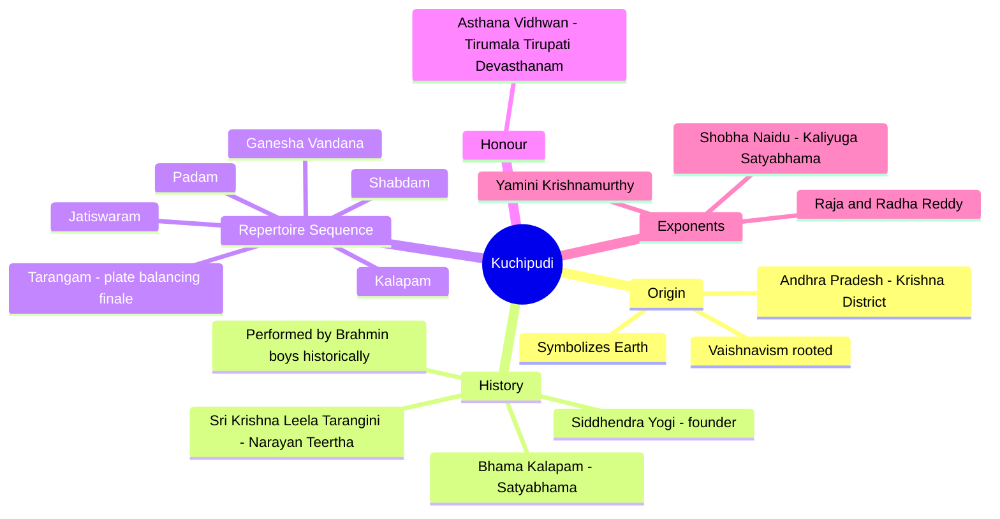

# NOTE — KUCHIPUDI
**Section:** GK | **Category:** Miscellaneous (Art & Culture) | **Topic:** Kuchipudi | **Slug:** `misc-kuchipudi`
**Source:** PARMAR SSC reference notes p.6-8 ("Kuchipudi")
**Status:** 🔧 DRAFT — awaiting AIR-91 verification before publish

---

## 🎭 THE HOOK

Most classical dances end with the dancer's feet on the ground. Kuchipudi ends with the dancer balanced on the rim of a brass plate, still dancing.

That final sequence — **Tarangam** — is the form's signature trick: the dancer performs intricate footwork while standing on the edge of a metal plate, sometimes balancing a pot of water on the head at the same time. It's a fitting symbol for a dance that started as devotion and ended as spectacle. Kuchipudi began in **Andhra Pradesh's Krishna District**, in the village that gave it its name, as a dance-drama tradition built by a Vaishnavite ascetic named **Siddhendra Yogi**, who composed **Bhama Kalapam** — a piece centered on Satyabhama, one of Krishna's wives. For centuries it was performed exclusively by **Brahmin boys**, even in female roles, until 20th-century revivalists broke that convention and brought women into the form.

---

## 📖 THE CORE

### Origin & Identity
- **Kuchipudi** = classical dance of **Andhra Pradesh**, named after the village in **Krishna District** where it originated.
- Symbolically described as a dance that **"symbolizes Earth."**
- Rooted in **Vaishnavism**; historically a dance-drama tradition rather than pure solo dance.

### History
- Founded/systematized by **Siddhendra Yogi**, a Vaishnavite ascetic, who composed the dance-drama **Bhama Kalapam**, centered on **Satyabhama** (a consort of Krishna).
- Traditionally performed by **Brahmin boys**, including in female roles — an all-male performing tradition for centuries.
- Text associated with the tradition: **Sri Krishna Leela Tarangini**, by **Narayan Teertha**, gives the form its concluding sequence its name (Tarangam).
- Modern revival figure: **Tirtha Narayanayati**.
- 20th-century revivalists who modernized/popularized the form and opened it to women: **Vempata Chinna Satyam**, **Balasaraswati**, and **Ragini Devi** (cross-form revivalist figures).
- Historically linked to the broader **Yakshagana** dance-drama tradition of coastal Andhra/Karnataka.

### Elements / Repertoire Sequence
A Kuchipudi performance traditionally moves through stages:
1. **Ganesha Vandana** — invocation to Ganesha.
2. **Jatiswaram** — pure rhythmic dance.
3. **Shabdam** — dance set to devotional verse.
4. **Kalapam** — dance-drama segment (as in Bhama Kalapam).
5. **Padam** — expressive/emotive dance.
6. **Tarangam** — the climactic sequence: dancer performs footwork while standing on the rim of a brass plate, sometimes balancing a water pot on the head.

### Institutional Honour
- The **Tirumala Tirupati Devasthanam** confers the honorific title **"Asthana Vidhwan"** on distinguished Kuchipudi (and other classical) artists associated with the institution.

### Exponents
| Exponent | Note |
|---|---|
| **Raja Reddy & Radha Reddy** | Noted performing duo |
| **Padmaja Reddy** | Noted exponent |
| **Bhavana Reddy** | Noted exponent (younger generation) |
| **Yamini Reddy** | Noted exponent |
| **Yamini Krishnamurthy** | Major exponent, also trained in Bharatanatyam |
| **Mallika Sarabhai** | Noted exponent, also actress/activist |
| **Vempata Chinna Satyam** | Key 20th-century revivalist/guru |
| **Aparna Satish** | Noted exponent |
| **Shobha Naidu** | Renowned for her Satyabhama portrayal, titled "Kaliyuga Satyabhama" |
| **Lakshmi Narayan Shastri** | Noted exponent |
| **Vedantam Satyanarayan** | Noted exponent/guru |
| **Swapna Sundari** | Noted exponent, also a scholar of the form |
| **Haleem Khan** | Noted exponent |

---

## 🧠 THE MIND MAP

---

## 🔑 THE MNEMONIC

**"Tarangam on a Thali"** — the climactic sequence has the dancer balancing on the rim of a brass plate (thali), often with a water pot on the head — Kuchipudi's signature visual.

**"Siddhendra's Satyabhama"** — founder Siddhendra Yogi wrote Bhama Kalapam about Satyabhama; this pairing is a recurring matching-question trap.

---

## 📌 THE PYQ ANCHOR

🔧 **GAP — VERIFY.** No literal "Kuchipudi" identification question confirmed in the 23/46-shift CGL-2025 sample reviewed. The "match the classical dance with its state/founder" pattern recurred heavily (9+ confirmed hits across other forms) — treat Kuchipudi as high-yield by pattern given it is one of the 8 officially recognized classical dances, recommend archive cross-check before finalizing pyq_count.

---

## ⚠️ THE TRAP ALERT

- **Kuchipudi is from Andhra Pradesh**, not Tamil Nadu (Bharatanatyam) or Kerala (Mohiniyattam/Kathakali) — a common state-mixup trap given all are South Indian and Carnatic-music-based.
- **Tarangam (plate-balancing) is Kuchipudi's signature**, not Bharatanatyam's or any other form's — examiners frequently test "which dance involves dancing on a brass plate."
- **Siddhendra Yogi is the founder/systematizer**, while **Vempata Chinna Satyam** is the 20th-century reviver who modernized and popularized the form (including opening it to women) — don't conflate the two different historical roles.

---

## ✅ ACTIVE RECALL

1. Which state and district does Kuchipudi originate from?
2. Who is credited as the founder of Kuchipudi, and what dance-drama did he compose?
3. What is the name of Kuchipudi's climactic sequence, and what makes it distinctive?
4. Historically, who exclusively performed Kuchipudi, including female roles?
5. Which honorific title does the Tirumala Tirupati Devasthanam confer on distinguished classical artists?

*(Answers: 1–Andhra Pradesh, Krishna District | 2–Siddhendra Yogi; Bhama Kalapam | 3–Tarangam; dancer balances on the rim of a brass plate, sometimes with a water pot on the head | 4–Brahmin boys | 5–Asthana Vidhwan)*
