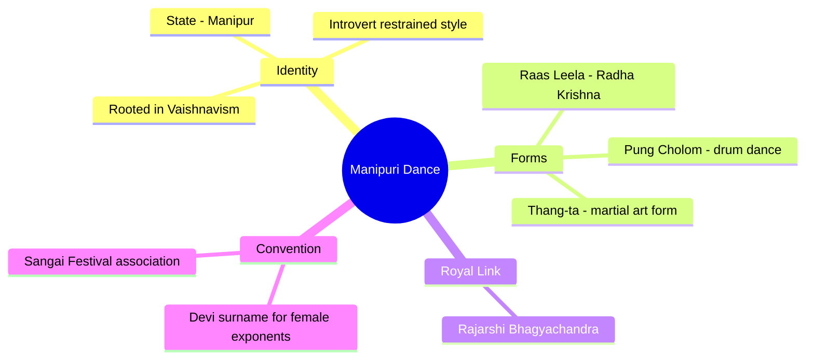

# NOTE — MANIPURI DANCE
**Section:** GK | **Category:** Miscellaneous (Art & Culture) | **Topic:** Manipuri Dance | **Slug:** `misc-manipuri-dance`
**Source:** PARMAR SSC reference notes p.10 ("7. Manipur")
**Status:** 🔧 DRAFT — awaiting AIR-91 verification before publish

---

## 🎭 THE HOOK

Most classical dances announce themselves — loud footwork, dramatic eyes, a build to a climax. Manipuri does the opposite. It's described in its own reference notes as an **"introvert" form** — soft, restrained, devotional, the dancer's gaze often lowered rather than locked on the audience.

It grew out of devotion to **Krishna and Radha**, structured around **Vaishnavism** — the same Bhakti current that shaped so much of eastern Indian art. Its most famous form, **Raas Leela**, re-enacts Krishna's divine dance with the gopis, traditionally credited to royal patronage in Manipur (Raja Bhagyachandra). But Manipur is also a land of warriors, and that shows up too — **Thang-ta**, a martial art form, sits inside Manipuri's broader dance vocabulary, alongside **Pung Cholom**, the famous drum dance where dancers play the *pung* (a barrel drum) while dancing — devotion and discipline, fused into the same art form.

---

## 📖 THE CORE

### Origin & Identity
- **Manipuri** is the classical dance of **Manipur**.
- Described as an **"introvert" style** — restrained, lyrical, devotional, in contrast to more extroverted classical forms.
- Rooted in **Vaishnavism** (Krishna-bhakti tradition).

### Forms Within Manipuri
| Form | Description |
|---|---|
| **Raas Leela** | Re-enacts the divine dance of Krishna and the gopis (Radha-Krishna theme); credited to royal patronage — associated with **Rajarshi Bhagyachandra**. |
| **Pung Cholom** | "Pung" (barrel drum) + "Cholom" (dance) — dancers play the pung drum while dancing; a vigorous, rhythmic devotional form. |
| **Thang-ta** | A martial-art-rooted dance form (sword/spear-based), reflecting Manipur's warrior tradition. |

### Cultural Conventions
- Female Manipuri dancers/exponents traditionally carry the surname **"Devi"** as part of stage/performing names — a useful identification trick for matching-type PYQs.
- Modern popular association: the **Sangai Festival** of Manipur prominently features Manipuri dance forms.

---

## 🧠 THE MIND MAP

---

## 🔑 THE MNEMONIC

**"RPT"** for the three forms: **R**aas Leela (devotional), **P**ung Cholom (drum), **T**hang-ta (martial).

**"Introvert in Manipur, extrovert nowhere else"** — the one classical dance explicitly described by its restrained, lowered-gaze style.

---

## 📌 THE PYQ ANCHOR

🔧 **GAP — VERIFY.** No literal "Manipuri dance" identification question confirmed in the 23/46-shift CGL-2025 sample. The broader "match the dance with its theme/state/origin" pattern recurred heavily across the sample (9+ confirmed hits for other forms) — treat as high-yield by pattern, recommend archive cross-check.

---

## ⚠️ THE TRAP ALERT

- **Manipuri ≠ Sattriya**, despite both being Vaishnavism-rooted, eastern/northeastern classical forms. Manipuri = Manipur, Raas Leela/Krishna-Radha theme. Sattriya = Assam, founded by Srimanta Sankaradeva, performed in monasteries (sattras).
- **Pung Cholom is a drum dance, not a separate classical form** — it's a sub-style/component within Manipuri, a common SSC trap (treating sub-forms as independent "9th classical dance").
- Don't confuse **Thang-ta** (Manipuri martial dance form) with **Chhau** (a separate eastern Indian martial-rooted dance from Odisha/Jharkhand/West Bengal) — both are martial-art-influenced but are distinct traditions.

---

## ✅ ACTIVE RECALL

1. What broad spiritual tradition does Manipuri dance draw from?
2. Name the Manipuri dance form that re-enacts Krishna and the gopis.
3. What does "Pung Cholom" literally combine?
4. Which Manipuri dance form has martial-art roots?
5. What surname convention is traditionally used by female Manipuri dance exponents?

*(Answers: 1–Vaishnavism | 2–Raas Leela | 3–Pung (drum) + Cholom (dance) | 4–Thang-ta | 5–Devi)*
