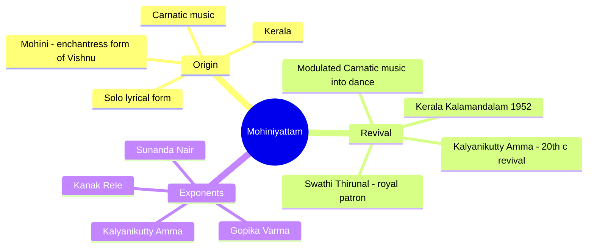

# NOTE — MOHINIYATTAM
**Section:** GK | **Category:** Miscellaneous (Art & Culture) | **Topic:** Mohiniyattam | **Slug:** `misc-mohiniyattam`
**Source:** PARMAR SSC reference notes (Classical Dance of India chapter) — ⚠️ source slide header reads "Exponents of Kathakali" but content is unambiguously Mohiniyattam (Swathi Thirunal, Kalyanikutty Amma, Kalamandalam) — likely a mislabeled slide in the source material, flagged for the user's awareness.
**Status:** 🔧 DRAFT — awaiting AIR-91 verification before publish

---

## 🎭 THE HOOK

A king who composed music. A dance nearly erased by 19th-century moral panic, branded the same way Bharatanatyam was. And a woman who spent her life teaching it back from the edge.

**Swathi Thirunal**, the Maharaja of Travancore, didn't just patronize Mohiniyattam — he composed Carnatic compositions specifically for it, fusing royal music with temple dance. Then colonial-era hostility nearly killed it. It took **Kalyanikutty Amma**, a 20th-century revivalist, to rebuild it technique by technique, teaching it at the very institution — **Kerala Kalamandalam** — that had become Kerala's guardian of classical art.

The name itself means "dance of the enchantress" — Mohini, the divine enchantress form of Vishnu. A solo, lyrical, swaying dance, built to seduce attention back to itself after nearly disappearing.

---

## 📖 THE CORE

### Origin & Identity
- **Mohiniyattam** = classical dance of **Kerala**.
- Name derives from **"Mohini"** — the enchantress avatar of Vishnu — and **"Attam"** (dance): "dance of the enchantress."
- Performed to **Carnatic music**, like Bharatanatyam, Kuchipudi, and Kathakali (as a group, contrasted with Kathak's Hindustani music).
- Traditionally a **solo, lyrical** form danced by women, marked by gentle swaying movements.

### History & Revival
- **Maharaja Swathi Thirunal** (King of Travancore) is credited with reviving Mohiniyattam in his era and — critically — **modulating Carnatic classical music specifically into the dance form**, shaping its musical identity.
- The dance nearly faced extinction/decline (paralleling Bharatanatyam's colonial-era suppression).
- **Kalyanikutty Amma** is the central 20th-century revivalist figure who rebuilt and systematized the technique.
- Associated closely with **Kerala Kalamandalam** (the premier Kerala institution for classical arts, training ground for Mohiniyattam, Kathakali, and other Kerala dance forms) — founding/consolidation context dated to **1952** in this material.

### Exponents
| Mnemonic Tag | Exponent |
|---|---|
| Mohini | (namesake / generic reference) |
| Gopi | **Gopika Varma** |
| Kan | **Kanak Rele** |
| Suna | **Sunanda Nair** |
| Jag | **Jagannatha** (associated name in lineage) |
| Krishna / Amma | **Kalyanikutty Amma** — revivalist |
| VR Mohan | Credited with reviving the dance form |

---

## 🧠 THE MIND MAP

---

## 🔑 THE MNEMONIC

**"Swathi Sang It, Kalyani Saved It"** — Swathi Thirunal composed/modulated the Carnatic music for Mohiniyattam; Kalyanikutty Amma saved/revived the dance technique in the 20th century.

Name trick: **Mohini = enchantress (Vishnu's form) + Attam = dance** → "the enchantress's dance."

---

## 📌 THE PYQ ANCHOR

🔧 **GAP — VERIFY.** No literal "Mohiniyattam" identification question was confirmed in the 23/46-shift CGL-2025 sample reviewed. However, the recurring "match the dance form / classical dance feature" question pattern (confirmed 9+ times across the sample for other dance forms) makes this a plausible high-yield topic by pattern. Recommend cross-checking a multi-year archive.

---

## ⚠️ THE TRAP ALERT

- **Swathi Thirunal ≠ Kalyanikutty Amma** — different centuries, different roles. Swathi Thirunal (royal-era patron, composed/modulated the music). Kalyanikutty Amma (20th-century technique revivalist). Don't merge them into one "founder."
- **Mohiniyattam ≠ Kathakali**, despite both being Kerala classical dances trained at Kerala Kalamandalam. Mohiniyattam = solo, lyrical, feminine, Carnatic music. Kathakali = elaborate face-paint, group dance-drama, masculine/dramatic.
- The source reference slide for this topic was internally mislabeled "Kathakali" — a useful reminder that even curated reference material needs the human-verify pass before anything goes live.

---

## ✅ ACTIVE RECALL

1. What does the name "Mohiniyattam" literally mean?
2. Which Travancore king is credited with shaping Mohiniyattam's Carnatic musical identity?
3. Who is the central 20th-century revivalist of Mohiniyattam's technique?
4. To which Kerala institution is Mohiniyattam's training closely tied?
5. Is Mohiniyattam traditionally a solo or group dance?

*(Answers: 1–Dance of the enchantress (Mohini, Vishnu's form) | 2–Swathi Thirunal | 3–Kalyanikutty Amma | 4–Kerala Kalamandalam | 5–Solo)*
