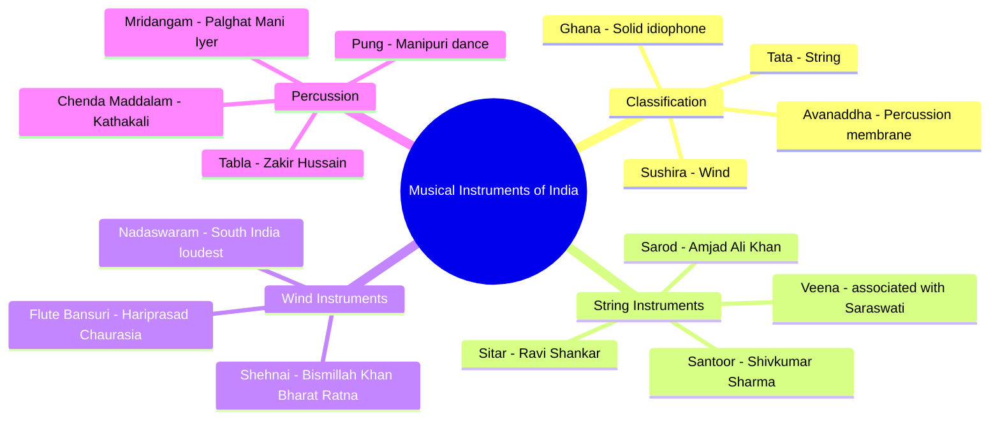

# NOTE — MUSICAL INSTRUMENTS OF INDIA
**Section:** GK | **Category:** Miscellaneous (Art & Culture) | **Topic:** Musical Instruments of India | **Slug:** `misc-musical-instruments-of-india`
**Source:** 🔧 GENERAL KNOWLEDGE (standard GK reference; not yet cross-checked against PARMAR SSC reference excerpt — the rendered pages 1-30 covered only Dance, not Instruments)
**Status:** 🔧 DRAFT — awaiting AIR-91 verification before publish
**PYQ Frequency:** 🔥 Very high-frequency SSC GK category | **High Yield:** ✅

---

## 🎭 THE HOOK

Every Indian classical instrument belongs to one of four families defined not by what they look like, but by HOW they make sound — a classification system over two thousand years old, codified in Bharata Muni's Natya Shastra, that still organizes every music textbook today. **Tata** (string instruments), **Sushira** (wind instruments), **Avanaddha** (membrane/percussion instruments), and **Ghana** (solid/idiophone instruments that don't need a stretched skin or string at all, like cymbals) — once you know which family an instrument belongs to, half the battle of identifying "who plays what" and "how is sound produced" is already won. And sitting at the top of name-recognition for two of these families are two men whose careers SSC tests almost every cycle: Ravi Shankar on the sitar, Zakir Hussain on the tabla.

---

## 📖 THE CORE

### Classification by Sound Production (Natya Shastra System)
| Category | Sanskrit Name | Examples |
|---|---|---|
| **String instruments** | **Tata Vadya** | Sitar, Sarod, Veena, Santoor, Tanpura, Violin, Sarangi |
| **Wind instruments** | **Sushira Vadya** | Flute (Bansuri), Shehnai, Nadaswaram, Harmonium (technically a reed/wind-keyboard hybrid) |
| **Percussion (membrane-covered)** | **Avanaddha Vadya** | Tabla, Mridangam, Pakhawaj, Dholak, Ghatam (a partial exception — clay pot, sometimes separately classified) |
| **Solid/self-sounding instruments** | **Ghana Vadya** | Manjira (cymbals), Jal Tarang (water-filled bowls), Ghungroo |

### Major Instruments & Their Famous Exponents
| Instrument | Family | Notable Exponent(s) |
|---|---|---|
| **Sitar** | String | Pandit Ravi Shankar, Ustad Vilayat Khan |
| **Sarod** | String | Ustad Amjad Ali Khan, Ustad Ali Akbar Khan |
| **Tabla** | Percussion | Ustad Zakir Hussain, Ustad Alla Rakha |
| **Shehnai** | Wind | Ustad Bismillah Khan |
| **Veena** | String | S. Balachander, Chitti Babu (Carnatic tradition) |
| **Santoor** | String | Pandit Shivkumar Sharma |
| **Flute (Bansuri)** | Wind | Pandit Hariprasad Chaurasia |
| **Violin (Indian classical adaptation)** | String | L. Subramaniam, M.S. Gopalakrishnan |
| **Mridangam** | Percussion | Palghat Mani Iyer |
| **Sarangi** | String | Ustad Sultan Khan |

### Regional / Folk Instruments (Frequently Tested)
- **Nadaswaram** — South Indian wind instrument, played at temples and weddings, considered the world's loudest non-brass acoustic instrument.
- **Dhol** — North Indian percussion, central to Bhangra performances (Punjab).
- **Ektara** — single-stringed folk instrument, associated with Baul singers of Bengal and wandering minstrels.
- **Dafli/Daf** — handheld frame drum, used widely in folk and devotional music across North India.
- **Pung** — barrel drum central to Manipuri dance (see [[misc-manipuri-dance]]).
- **Chenda** and **Maddalam** — Kerala drums central to Kathakali performances (see [[misc-kathakali]]).

### Key Distinguishing Facts
- **Bismillah Khan**, the legendary shehnai player, was awarded the **Bharat Ratna** (2001) — among the very few classical musicians to receive India's highest civilian honour.
- **The Veena** is one of India's oldest classical instruments, prominently associated with Goddess **Saraswati** in iconography — the instrument she is traditionally depicted holding.
- **Tanpura** is a drone instrument — it provides a continuous harmonic background, NOT a melodic lead instrument, distinguishing it from the sitar/sarod despite all being string instruments.

---

## 🧠 THE MIND MAP

---

## 🔑 THE MNEMONIC

**"Tata strings, Sushira blows, Avanaddha beats, Ghana rings"** — the four Natya Shastra sound-production families in one line.

**"Ravi on Sitar, Zakir on Tabla, Bismillah on Shehnai, Hariprasad on Flute"** — the four most exam-tested instrument-exponent pairings.

---

## 📌 THE PYQ ANCHOR

🔥 Musical Instruments is one of the highest-frequency GK categories in SSC CGL/CHSL history. 🔧 No literal Musical Instruments question confirmed in the 23/46-shift CGL-2025 sample reviewed earlier in this session, since this topic wasn't separately tagged during PYQ extraction — instrument-exponent matching and the Natya Shastra classification system are textbook-standard SSC GK staples; recommend a dedicated archive cross-check.

---

## ⚠️ THE TRAP ALERT

- **Sitar and Sarod are BOTH string instruments but are DIFFERENT instruments with different exponents** — Ravi Shankar (Sitar) vs. Amjad Ali Khan (Sarod); a frequently tested confusion pair.
- **Tanpura is a DRONE instrument, not a melodic lead instrument** — despite being a string instrument like the sitar, don't assume it's used for melody.
- **Bismillah Khan played the Shehnai (wind), and received the Bharat Ratna** — a frequently tested "which instrumentalist got India's highest civilian award" fact.
- **Veena is iconographically associated with Goddess Saraswati**, NOT any other deity — a commonly tested cultural-association fact.

---

## ✅ ACTIVE RECALL

1. Name the four categories of Indian classical instruments based on the Natya Shastra's sound-production classification system.
2. Who is the most famous exponent of the Sitar? Of the Sarod? Of the Tabla?
3. Which instrumentalist received the Bharat Ratna, and which instrument did he play?
4. What is a Tanpura used for, and how does this differ from a Sitar's role?
5. Which goddess is traditionally associated with the Veena in Indian iconography?

*(Answers: 1–Tata (string), Sushira (wind), Avanaddha (percussion/membrane), Ghana (solid/idiophone) | 2–Sitar: Pandit Ravi Shankar; Sarod: Ustad Amjad Ali Khan; Tabla: Ustad Zakir Hussain | 3–Ustad Bismillah Khan; played the Shehnai | 4–The Tanpura provides a continuous drone/harmonic background; the Sitar is a melodic lead instrument | 5–Goddess Saraswati)*
