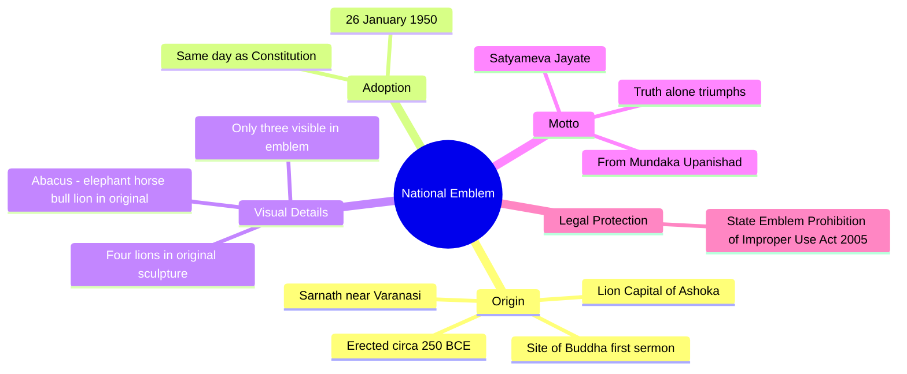

# NOTE — NATIONAL EMBLEM OF INDIA
**Section:** GK | **Category:** Miscellaneous | **Topic:** National Emblem | **Slug:** `misc-national-emblem`
**Source:** 🔧 GENERAL KNOWLEDGE (standard GK reference; not yet cross-checked against PARMAR SSC reference excerpt)
**Status:** 🔧 DRAFT — awaiting AIR-91 verification before publish
**PYQ Frequency:** 🔥 Official Phase-1 priority topic (GK_PRIORITY_TOPICS, Miscellaneous bucket) | **High Yield:** ✅

---

## 🎭 THE HOOK

Stand in front of the original sculpture and you'll see something India's official emblem deliberately leaves out: a fourth lion. The State Emblem of India is adapted from the **Lion Capital of Ashoka**, originally carved in **polished sandstone** around **250 BCE** atop a pillar erected by **Emperor Ashoka** at **Sarnath**, near Varanasi — the spot where the Buddha delivered his first sermon after enlightenment. The original sculpture has **four lions** standing back-to-back, but when India adopted it as the national emblem on **26 January 1950** (the same day the Constitution came into force), only **three lions are visible** in the official 2D rendering — the fourth lion is there, just directly behind the visible three, hidden from view by design. That single architectural fact — four lions in stone, three lions on paper — is one of the most reliably tested visual details in SSC GK.

---

## 📖 THE CORE

### Origin
- Adapted from the **Lion Capital of Ashoka**, originally erected at **Sarnath** (near Varanasi, Uttar Pradesh) by **Emperor Ashoka**, around **250 BCE**.
- Sarnath is significant as the site of the Buddha's **first sermon** (Dhammacakkappavattana) after attaining enlightenment.
- Adopted as the **State Emblem of India** on **26 January 1950** — the same date the Constitution of India came into force.
- The original Ashokan sculpture is preserved at the **Sarnath Museum**.

### Components of the Emblem
- **Four lions** stand back-to-back in the original sculpture, but only **THREE are visible** in the official emblem (the fourth is hidden directly behind, facing away from view).
- Below the lions, on the **abacus** (the circular base), the original sculpture depicts four animals: an **elephant, a galloping horse, a bull, and a lion** — separated by small wheels (chakras) — though the OFFICIAL STATE EMBLEM, in its simplified 2D form, typically shows the abacus with the central **Dharma Chakra (wheel)** flanked by a bull (right) and a horse (left), with the outline of other wheels on the extreme edges.
- The motto **"Satyameva Jayate"** ("Truth Alone Triumphs") is inscribed below the emblem in Devanagari script — sourced from the **Mundaka Upanishad**.
- The original capital also included an **inverted lotus** as the crowning element above the abacus, and a **Dharma Chakra** (wheel of law) originally surmounted the capital — though the wheel itself is not part of the official simplified emblem.

### Legal Protection
- Use of the State Emblem is regulated under the **State Emblem of India (Prohibition of Improper Use) Act, 2005**, which restricts unauthorized commercial or improper use.

### Distinction from the National Flag's Ashoka Chakra
- The **Ashoka Chakra** on the Indian national flag (navy blue, 24 spokes) is a SEPARATE national symbol, also derived from the Lion Capital's wheel motif, but it is a distinct element from the State Emblem itself — don't conflate the flag's wheel with the emblem's lions.

---

## 🧠 THE MIND MAP

---

## 🔑 THE MNEMONIC

**"Four in stone, three on show"** — the original Sarnath sculpture has 4 lions; the official emblem shows only 3 (the fourth hidden behind).

**"250 BCE Ashoka built it, 1950 India adopted it"** — the two key dates, separated by exactly 2,200 years.

---

## 📌 THE PYQ ANCHOR

🔥 National Emblem is on the app's **official Phase-1 priority list** (GK_PRIORITY_TOPICS, Miscellaneous). 🔧 No literal National Emblem question confirmed in the 23/46-shift CGL-2025 sample reviewed — origin (Sarnath, Ashoka), adoption date (26 January 1950), and the motto's source (Mundaka Upanishad) are textbook-standard SSC CGL GK staples; recommend archive cross-check.

---

## ⚠️ THE TRAP ALERT

- **The original sculpture has FOUR lions; only THREE are visible** in the official 2D emblem — a very frequently tested visual-detail trap.
- **The motto "Satyameva Jayate" comes from the Mundaka Upanishad**, NOT the Bhagavad Gita or any other text — a commonly mis-attributed source.
- **The National Emblem was adopted on 26 January 1950**, the SAME date the Constitution came into force — don't confuse this with 15 August 1947 (Independence) or 26 November 1949 (Constitution adoption date, distinct from its coming-into-force date).
- **Don't conflate the State Emblem (lions) with the Ashoka Chakra on the National Flag** (24-spoke wheel) — both derive from the same Sarnath pillar but are distinct official symbols used in different contexts.

---

## ✅ ACTIVE RECALL

1. From which historical monument is India's National Emblem adapted, and where is it located?
2. Approximately when was the original Lion Capital erected, and by whom?
3. How many lions does the original sculpture have, and how many are visible in the official emblem?
4. What is the motto inscribed on the National Emblem, and from which text is it sourced?
5. On what date was the State Emblem officially adopted?

*(Answers: 1–The Lion Capital of Ashoka, located at Sarnath, near Varanasi | 2–Around 250 BCE, by Emperor Ashoka | 3–Four lions in the original sculpture; three are visible in the official emblem | 4–"Satyameva Jayate" (Truth Alone Triumphs), sourced from the Mundaka Upanishad | 5–26 January 1950, the same date the Constitution came into force)*
