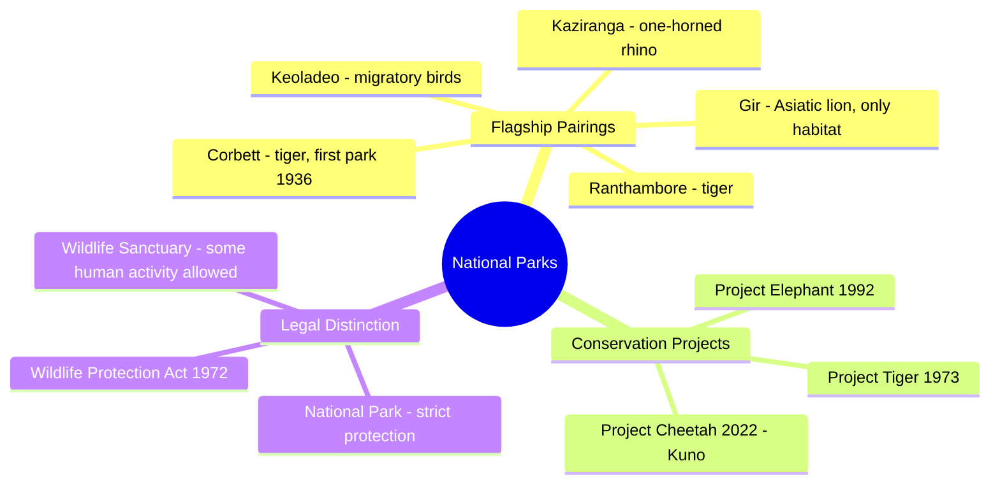

# NOTE — NATIONAL PARKS & WILDLIFE SANCTUARIES
**Section:** GK | **Category:** Miscellaneous | **Topic:** National Parks & Wildlife Sanctuaries | **Slug:** `misc-national-parks-and-wildlife-sanctuaries`
**Source:** 🔧 GENERAL KNOWLEDGE (standard GK reference; not yet cross-checked against PARMAR SSC reference excerpt)
**Status:** 🔧 DRAFT — awaiting AIR-91 verification before publish
**PYQ Frequency:** 🔥 Very high-frequency Static GK category, connects to [[sci-red-data-book]] | **High Yield:** ✅

---

## 🎭 THE HOOK

India's first national park, established in **1936** during the colonial era, wasn't originally named after wildlife at all — it was called **Hailey National Park**, after a British provincial governor. It was later renamed twice, eventually becoming **Jim Corbett National Park** (Uttarakhand), honouring the hunter-turned-conservationist who pushed for its creation. That single park's naming history captures the broader theme of India's national park system: a sanctuary network is really a story of species-by-species rescue efforts, each park associated with one flagship animal whose protection justified its creation — tigers at Corbett and Ranthambore, rhinos at Kaziranga, lions at Gir, one-horned everything at Kaziranga specifically.

---

## 📖 THE CORE

### Flagship National Parks (Park-to-Animal Matching, Frequently Tested)
| National Park | State | Flagship Species |
|---|---|---|
| **Jim Corbett National Park** | Uttarakhand | Bengal Tiger (India's FIRST national park, established 1936) |
| **Kaziranga National Park** | Assam | One-horned (Indian) Rhinoceros — also a UNESCO site |
| **Gir National Park** | Gujarat | Asiatic Lion (the ONLY natural habitat of Asiatic Lions in the world) |
| **Ranthambore National Park** | Rajasthan | Bengal Tiger |
| **Sundarbans National Park** | West Bengal | Royal Bengal Tiger (mangrove ecosystem; also a UNESCO/Project Tiger site) |
| **Bandipur National Park** | Karnataka | Tiger, elephant |
| **Periyar National Park** | Kerala | Elephant, tiger |
| **Keoladeo National Park** | Rajasthan | Migratory birds (also called Bharatpur Bird Sanctuary) |
| **Kanha National Park** | Madhya Pradesh | Tiger, Barasingha (swamp deer) |
| **Manas National Park** | Assam | Tiger, golden langur, pygmy hog |
| **Velavadar National Park** | Gujarat | Blackbuck |
| **Hemis National Park** | Ladakh | Snow Leopard (India's largest national park by area) |

### Project Tiger & Conservation Programs
- **Project Tiger** launched in **1973**, starting with **9 Tiger Reserves**; India now has a much larger number of Tiger Reserves, regularly updated as new ones are added.
- **Corbett Tiger Reserve** was the FIRST reserve declared under Project Tiger.
- **Project Elephant** launched in **1992**.
- **Project Cheetah**: launched **2022**, reintroducing cheetahs (extinct in India since 1952) into **Kuno National Park**, Madhya Pradesh, via translocation from Namibia/South Africa — a frequently tested recent conservation initiative.

### Key Distinguishing Facts
- **Gir National Park (Gujarat) is the world's ONLY natural habitat of the Asiatic Lion** — a uniquely tested superlative; African lions are a separate subspecies found elsewhere.
- **Jim Corbett National Park was India's FIRST national park (1936)**, originally named Hailey National Park.
- **Cheetahs went EXTINCT in India in 1952** and were reintroduced starting **2022** at Kuno National Park — making India the first country to attempt intercontinental translocation of a large carnivore species for reintroduction.
- **National Parks vs. Wildlife Sanctuaries**: National Parks have STRICTER protection (no human activity/grazing permitted typically); Wildlife Sanctuaries allow SOME regulated human activity — a frequently tested legal-distinction trap under the Wildlife Protection Act, 1972.

---

## 🧠 THE MIND MAP

---

## 🔑 THE MNEMONIC

**"Corbett for tiger, Kaziranga for rhino, Gir for lion — and only Gir for lion"** — the three most iconic flagship-species pairings, with Gir's uniqueness emphasized.

**"1936 Corbett, 1973 Project Tiger, 2022 Project Cheetah"** — three milestone years in India's wildlife conservation timeline.

---

## 📌 THE PYQ ANCHOR

🔥 National Parks & Wildlife Sanctuaries is a very high-frequency Static GK category, connecting to [[sci-red-data-book]] (endangered species). 🔧 No literal National Parks question confirmed in the 23/46-shift CGL-2025 sample reviewed earlier in this session, since this topic wasn't separately tagged during PYQ extraction — park-to-flagship-species matching and Project Tiger/Cheetah facts are textbook-standard SSC CGL GK staples; recommend a dedicated archive cross-check.

---

## ⚠️ THE TRAP ALERT

- **Gir National Park is the world's ONLY natural habitat of the Asiatic Lion** — a uniquely tested, unambiguous superlative; don't confuse with African lion habitats.
- **Jim Corbett National Park was India's FIRST national park (1936)**, originally named Hailey National Park — a frequently tested naming-history fact.
- **Project Cheetah (2022) reintroduces cheetahs that went EXTINCT in India in 1952** — don't assume cheetahs were always present; this is a deliberate reintroduction of a locally extinct species.
- **National Parks have STRICTER legal protection than Wildlife Sanctuaries** — Sanctuaries permit some regulated human activity (like grazing), National Parks generally do not; a frequently tested legal-category distinction.

---

## ✅ ACTIVE RECALL

1. Which was India's first national park, and what was it originally called?
2. Which national park is the world's only natural habitat of the Asiatic Lion?
3. What is the flagship species of Kaziranga National Park?
4. When was Project Tiger launched, and which reserve was the first declared under it?
5. What is Project Cheetah, and where are cheetahs being reintroduced?

*(Answers: 1–Jim Corbett National Park (Uttarakhand), originally named Hailey National Park, established 1936 | 2–Gir National Park, Gujarat | 3–One-horned (Indian) Rhinoceros | 4–1973; Corbett Tiger Reserve was the first declared under Project Tiger | 5–A 2022 conservation initiative reintroducing cheetahs (extinct in India since 1952) via translocation from Africa, into Kuno National Park, Madhya Pradesh)*
