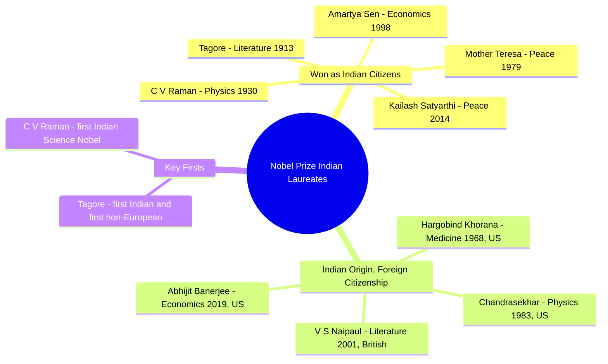

# NOTE — NOBEL PRIZE: INDIAN LAUREATES
**Section:** GK | **Category:** Miscellaneous | **Topic:** Nobel Prize — Indian Laureates | **Slug:** `misc-nobel-prize-indian-laureates`
**Source:** 🔧 GENERAL KNOWLEDGE (standard GK reference; not yet cross-checked against PARMAR SSC reference excerpt)
**Status:** 🔧 DRAFT — awaiting AIR-91 verification before publish (⚠️ list grows when new prizes are announced — verify currency)
**PYQ Frequency:** 🔥 Very high-frequency Static GK category | **High Yield:** ✅

---

## 🎭 THE HOOK

There's a quiet but important legal distinction hiding inside every "list of Indian Nobel laureates" — the difference between someone who won the prize **as an Indian citizen** and someone who was merely **born in India (or of Indian descent)** but won representing a different country. Rabindranath Tagore and C.V. Raman won as Indians, full stop. But Hargobind Khorana, Subramanyan Chandrasekhar, and Abhijit Banerjee were all Indian-born and educated, yet won their Nobel Prizes as **American citizens** — and SSC loves testing exactly this nuance, because the "obvious" answer (count everyone with an Indian name or birthplace) is usually the wrong one.

---

## 📖 THE CORE

### Nobel Laureates Who Won AS Indian Citizens
| Laureate | Category | Year | Note |
|---|---|---|---|
| **Rabindranath Tagore** | Literature | 1913 | For "Gitanjali"; first non-European Nobel laureate in any category |
| **C.V. Raman** | Physics | 1930 | For the "Raman Effect" (light scattering) |
| **Mother Teresa** | Peace | 1979 | Naturalized Indian citizen; founder of the Missionaries of Charity |
| **Amartya Sen** | Economics | 1998 | For contributions to welfare economics |
| **Kailash Satyarthi** | Peace | 2014 | Child rights activist; shared the prize with Malala Yousafzai (Pakistan) |

### Persons of Indian Origin/Birth Who Won as FOREIGN Nationals (Frequently Tested Distinction)
| Laureate | Category | Year | Citizenship at Award |
|---|---|---|---|
| **Hargobind Khorana** | Medicine | 1968 | Born in undivided India (now Pakistan); won as a **United States** citizen |
| **Subramanyan Chandrasekhar** | Physics | 1983 | Born in Lahore (undivided India); won as a **United States** citizen |
| **V.S. Naipaul** | Literature | 2001 | Of Indian descent (grandparents emigrated from India); won as a **British/Trinidadian** citizen — NOT typically counted as "Indian" |
| **Venkatraman Ramakrishnan** | Chemistry | 2009 | Indian-born; won as a **United States/British** citizen |
| **Abhijit Banerjee** | Economics | 2019 | Indian-born, educated in India; won as a **United States** citizen |

### Key Distinguishing Facts
- **Tagore (1913) was the FIRST Indian (and first non-European) Nobel laureate**, for Literature.
- **C.V. Raman (1930) was the FIRST Indian to win a Nobel Prize in SCIENCE specifically** (Physics), and remains the only Indian to win a Science Nobel while based and working entirely in India.
- **Mother Teresa is counted as an Indian laureate** because she held Indian citizenship (by naturalization) at the time of her award, despite being born in present-day North Macedonia (then part of the Ottoman Empire, of Albanian ethnicity).
- **Kailash Satyarthi shared his 2014 Peace Prize with Malala Yousafzai** — a frequently tested joint-award pairing (India-Pakistan, child rights theme).
- **Amartya Sen (1998) is India's only Nobel laureate in Economic Sciences while holding Indian citizenship** — Abhijit Banerjee (2019) is Indian-born/educated but holds US citizenship, so is typically classified separately.

---

## 🧠 THE MIND MAP

---

## 🔑 THE MNEMONIC

**"Tagore wrote it, Raman scattered it, Teresa served it, Sen counted it, Satyarthi freed it"** — five Indian-citizen Nobel laureates tied to a one-word action summarizing their work.

**"Born Indian, won American: Khorana, Chandrasekhar, Banerjee"** — the most frequently tested "Indian-origin but foreign-citizen" trio.

---

## 📌 THE PYQ ANCHOR

🔥 Nobel Prize — Indian Laureates is a very high-frequency Static GK category. 🔧 No literal Nobel Prize question confirmed in the 23/46-shift CGL-2025 sample reviewed earlier in this session, since this topic wasn't separately tagged during PYQ extraction — laureate-to-category matching and the citizen-vs-origin distinction are textbook-standard SSC CGL GK staples; recommend a dedicated archive cross-check.

---

## ⚠️ THE TRAP ALERT

- **Hargobind Khorana, Chandrasekhar, and Abhijit Banerjee are Indian-BORN but won as FOREIGN (mostly US) citizens** — a very frequently tested citizenship-vs-origin trap; don't list them as "Indian" Nobel laureates without qualification.
- **C.V. Raman (1930), not Tagore, was the first Indian Nobel laureate in SCIENCE** — Tagore's 1913 prize was in Literature, the first Indian Nobel overall, but not the first in science.
- **Kailash Satyarthi's 2014 Peace Prize was SHARED with Malala Yousafzai** — a frequently tested joint-award fact.
- **Mother Teresa is counted as Indian** due to her naturalized citizenship, despite being ethnically Albanian and born in present-day North Macedonia — a frequently tested nuance.

---

## ✅ ACTIVE RECALL

1. Who was the first Indian Nobel laureate, and in which category?
2. Who was the first Indian to win a Nobel Prize specifically in Science?
3. Name three persons of Indian origin who won Nobel Prizes as citizens of a DIFFERENT country.
4. With whom did Kailash Satyarthi share his 2014 Nobel Peace Prize?
5. Why is Mother Teresa counted among "Indian" Nobel laureates despite her Albanian ethnic background?

*(Answers: 1–Rabindranath Tagore, Literature, 1913 | 2–C.V. Raman, Physics, 1930 | 3–Any three of: Hargobind Khorana (Medicine, 1968, US), Subramanyan Chandrasekhar (Physics, 1983, US), V.S. Naipaul (Literature, 2001, British), Abhijit Banerjee (Economics, 2019, US) | 4–Malala Yousafzai (Pakistan) | 5–She held Indian citizenship by naturalization at the time of her 1979 award, despite being born in present-day North Macedonia)*
