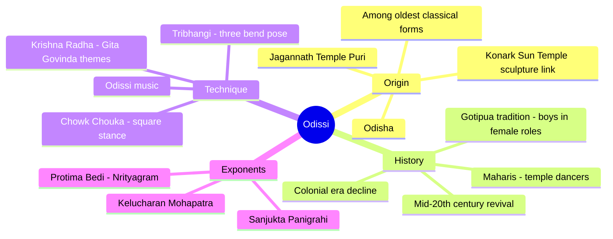

# NOTE — ODISSI
**Section:** GK | **Category:** Miscellaneous (Art & Culture) | **Topic:** Odissi | **Slug:** `misc-odissi`
**Source:** 🔧 GENERAL KNOWLEDGE (NOT sourced from PARMAR SSC reference excerpt — pages 1-30 of that document cover Bharatanatyam, Kuchipudi, Mohiniyattam, Manipuri, Sattriya, then transition straight to Folk Dances; Odissi was not found in the rendered range). If an Odissi page exists elsewhere in the 563-page source, recommend supplying it for direct cross-check.
**Status:** 🔧 DRAFT — awaiting AIR-91 verification before publish (HIGHER priority verification, general-knowledge-sourced, not reference-anchored)

---

## 🎭 THE HOOK

If one pose could summarize an entire classical dance form, Odissi's would be the **Tribhangi** — the body bent into three distinct curves at the head, torso, and knees, like a living sculpture. That's not an accident: Odissi grew directly out of temple sculpture, particularly the carvings of the **Jagannath Temple in Puri** and the **Sun Temple at Konark**, Odisha. Performers were once **Maharis** — temple dancers dedicated to Lord Jagannath, performing as ritual offering rather than public entertainment — and **Gotipuas**, young boys dressed as women who carried the tradition through the centuries when temple dancing declined. Almost erased by colonial-era moral campaigns, like Bharatanatyam and Mohiniyattam, it was painstakingly reconstructed in the mid-20th century by a handful of scholars and gurus working from temple-wall poses and surviving Gotipua technique, stitching a dead art back into a living one.

---

## 📖 THE CORE

### Origin & Identity
- **Odissi** = classical dance of **Odisha**, considered one of the oldest classical dance forms, with sculptural evidence dating back roughly 2,000 years (Udayagiri-Khandagiri caves).
- Deeply linked to **Jagannath temple worship** in Puri and Hindu temple sculpture traditions of Odisha (e.g. Konark Sun Temple).
- Signature stance: **Tribhangi** — a three-bend body posture (head, torso, knees), and **Chowk/Chouka** — a square, grounded stance symbolizing Lord Jagannath.

### History
- Originally performed by **Maharis** (temple devadasis dedicated to Jagannath worship) as a ritual offering.
- Survived through the **Gotipua tradition** — young boys trained to dance in female roles/costume, performed outside temple precincts, especially during periods when temple dancing was restricted.
- Suppressed/declined under colonial-era anti-nautch sentiment (parallel to Bharatanatyam's devadasi ban).
- **Revived in the mid-20th century** (1950s onward) by gurus and scholars — notably **Kelucharan Mohapatra**, **Pankaj Charan Das**, **Deba Prasad Das**, and **Mayadhar Raut** — who reconstructed the form using temple sculpture references and surviving Gotipua technique.

### Technique
- Performed to **Odissi music** (a distinct classical music tradition related to but separate from Carnatic/Hindustani systems).
- Built around devotional themes, particularly **Krishna-Radha (Jayadeva's Gita Govinda)** poetry and Jagannath worship.
- Movement vocabulary includes **Bhangas** (body-bend positions), with Tribhangi as the most iconic.

### Exponents
| Exponent | Note |
|---|---|
| **Kelucharan Mohapatra** | Most celebrated 20th-century guru/reviver of Odissi |
| **Sanjukta Panigrahi** | Major exponent, key in popularizing Odissi internationally |
| **Sonal Mansingh** | Major exponent (also trained in Bharatanatyam) |
| **Madhavi Mudgal** | Noted exponent |
| **Kiran Segal** | Noted exponent |
| **Protima Bedi** | Founded Nrityagram, dance village/gurukul for Odissi |

---

## 🧠 THE MIND MAP

---

## 🔑 THE MNEMONIC

**"Tribhangi = Temple Sculpture come alive"** — the three-bend pose is Odissi's signature, directly traced to Odisha temple carvings.

**"Maharis prayed it, Gotipuas saved it, Kelucharan revived it"** — the three-stage survival story of Odissi in one line.

---

## 📌 THE PYQ ANCHOR

🔧 **GAP — VERIFY.** No literal "Odissi" identification question confirmed in the 23/46-shift CGL-2025 sample reviewed. Odissi is one of the 8 officially recognized classical dances and a recurring "match the dance to its state/feature" pattern target — treat as high-yield by category membership, but this note carries an ELEVATED verification priority since none of its content is reference-anchored (general-knowledge sourced only).

---

## ⚠️ THE TRAP ALERT

- **Odissi's signature pose is Tribhangi (three bends)** — don't confuse with Bharatanatyam's more angular, geometric postures; Odissi is known for its fluid, sculptural curves.
- **Maharis (temple dancers) and Gotipuas (boy dancers in female roles) are two DIFFERENT historical carriers of the tradition** — Maharis performed inside the temple as ritual offering; Gotipuas performed outside, especially as temple dancing declined. Don't merge them into one role.
- **Kelucharan Mohapatra is the most cited Odissi revivalist**, parallel to Rukmini Devi Arundale's role for Bharatanatyam — examiners may test "who revived which dance," and the names should not be swapped across forms.

---

## ✅ ACTIVE RECALL

1. Which state is Odissi native to, and which two temples is it most closely associated with?
2. What is Odissi's signature three-bend body posture called?
3. Who were the Maharis, and what was their role?
4. Who is most credited with reviving Odissi in the 20th century?
5. What poetic/devotional text strongly influences Odissi's thematic repertoire?

*(Answers: 1–Odisha; Jagannath Temple (Puri) and Konark Sun Temple | 2–Tribhangi | 3–Temple dancers dedicated to Jagannath worship, performing as ritual offering | 4–Kelucharan Mohapatra | 5–Jayadeva's Gita Govinda)*
