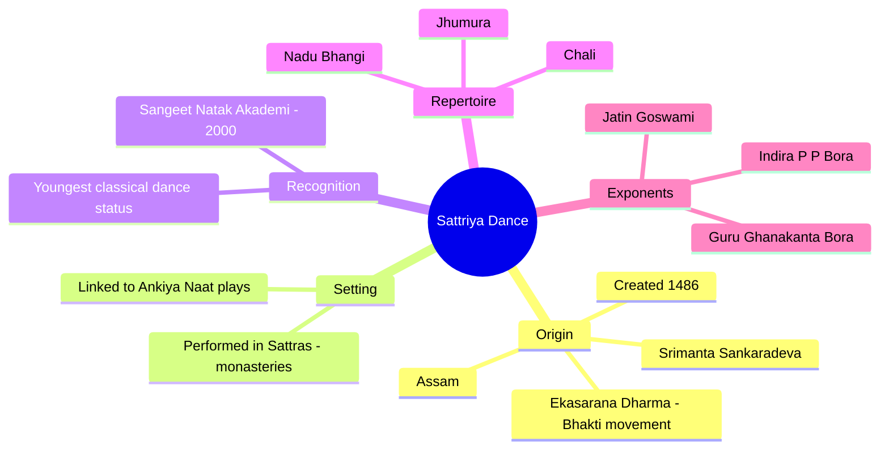

# NOTE — SATTRIYA DANCE
**Section:** GK | **Category:** Miscellaneous (Art & Culture) | **Topic:** Sattriya Dance | **Slug:** `misc-sattriya-dance`
**Source:** PARMAR SSC reference notes p.11 ("8. Sattriya") + general-knowledge cross-check for founder/recognition-year facts
**Status:** 🔧 DRAFT — awaiting AIR-91 verification before publish
**PYQ Frequency:** 🔥 Official Phase-1 priority topic (GK_PRIORITY_TOPICS, Miscellaneous bucket) | **High Yield:** ✅

---

## 🎭 THE HOOK

Every other classical dance on this list eventually left its religious home and walked onto a public stage. Sattriya refused — for nearly 500 years.

Born in **1486** inside Assam's Vaishnavite monasteries — the **sattras** — it was created as a teaching tool: a saint named **Srimanta Sankaradeva** needed a way to spread Krishna-bhakti to ordinary people, so he built dance-dramas around it. For five centuries, Sattriya stayed almost entirely inside monastery walls, performed by monks, never commercialized, never secularized. It didn't get its **Sangeet Natak Akademi classical recognition** until the year **2000** — making it the *youngest* of India's classical dances to receive formal status, despite being among the *oldest* in continuous practice. A dance born to teach religion took five hundred years to be recognized as art.

---

## 📖 THE CORE

### Origin & Identity
- **Sattriya** = classical dance of **Assam**.
- Created in **1486** by the Vaishnavite saint-reformer **Srimanta Sankaradeva**, as part of the **Ekasarana Dharma** (Bhakti movement he founded in Assam).
- Performed traditionally inside **Sattras** — Vaishnavite monasteries — which gives the dance its name.
- Closely linked to **Ankiya Naat**, the one-act devotional plays Sankaradeva composed; Sattriya dance numbers were originally performed as interludes/components within these plays.

### Recognition
- Granted **classical dance status by the Sangeet Natak Akademi in the year 2000** — the most recently recognized of India's classical dance forms.

### Repertoire (Dance Numbers)
- Per the source reference: dance numbers/forms include **Chali, Jhumura, Nadu Bhangi** — distinct rhythmic/movement categories within the Sattriya repertoire.
- Traditionally performed **without separate theatrical staging components** (i.e., integrated into monastic ritual practice rather than standalone public theatre, in its classical/traditional form).

### Exponents & Honours
| Exponent | Note |
|---|---|
| **Jatin Goswami** | Noted Sattriya exponent |
| **Shyamoo Hazarika** | Awarded **Sangeet Natak Akademi Award** (per source, cited 2019 context) |
| **Guru Ghanakanta Bora** | Noted exponent/guru |
| **Indira P. P. Bora** | Recipient of one of India's **highest civilian awards** (Padma honour) for contribution to Sattriya |

---

## 🧠 THE MIND MAP

---

## 🔑 THE MNEMONIC

**"1486, 2000"** — born in 1486 (Sankaradeva), recognized in 2000 (Sangeet Natak Akademi) — a 514-year gap between creation and formal classical status.

**"Sattriya stays in the Sattra"** — the name IS the location: dance born and kept inside Vaishnavite monasteries.

---

## 📌 THE PYQ ANCHOR

🔥 Sattriya is on the app's **official Phase-1 priority list** (GK_PRIORITY_TOPICS, Miscellaneous). 🔧 No literal Sattriya question confirmed in the 23/46-shift CGL-2025 sample reviewed — but the "classical dance origin/founder/state" matching pattern recurred constantly (9+ confirmed hits for other forms). Recommend cross-checking a multi-year archive before finalizing pyq_count.

---

## ⚠️ THE TRAP ALERT

- **Sattriya was recognized as a classical dance only in 2000** — the most recent of the 8. SSC loves asking "which classical dance got recognition last" — answer is Sattriya, NOT an older-sounding form like Bharatanatyam or Odissi.
- **Sankaradeva created Sattriya AND Ankiya Naat (the plays)** — don't separate these into unrelated facts; the dance grew out of the play tradition.
- **Sattriya ≠ Manipuri**, despite both being northeastern, Vaishnavism-linked dances. Sattriya = Assam, monastery-based, Sankaradeva, 1486. Manipuri = Manipur, Raas Leela, Krishna-Radha theme, royal patronage.

---

## ✅ ACTIVE RECALL

1. In which year was Sattriya dance created, and by whom?
2. What religious/reform movement is Sattriya tied to?
3. Where was Sattriya traditionally performed?
4. In which year did Sattriya receive Sangeet Natak Akademi classical recognition?
5. What play tradition is Sattriya dance closely linked to?

*(Answers: 1–1486, by Srimanta Sankaradeva | 2–Ekasarana Dharma (Bhakti movement) | 3–Sattras (Vaishnavite monasteries) | 4–2000 | 5–Ankiya Naat)*
