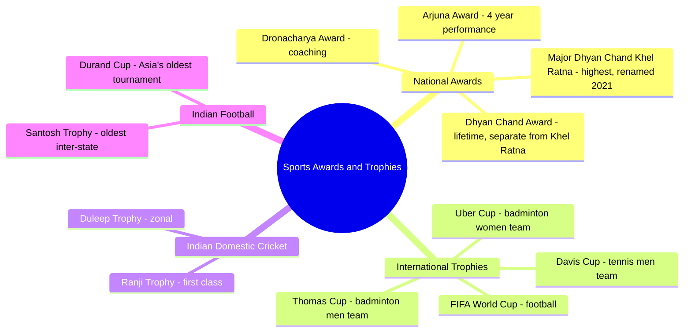

# NOTE — SPORTS AWARDS & TROPHIES (INDIA)
**Section:** GK | **Category:** Miscellaneous | **Topic:** Sports Awards & Trophies | **Slug:** `misc-sports-awards-and-trophies`
**Source:** 🔧 GENERAL KNOWLEDGE (standard sports GK reference; not yet cross-checked against PARMAR SSC reference excerpt)
**Status:** 🔧 DRAFT — awaiting AIR-91 verification before publish (⚠️ award names/criteria have changed via recent renaming — verify currency, see Trap Alert)
**PYQ Frequency:** 🔥 Very high-frequency SSC GK category, connects to [[misc-thomas-cup]] | **High Yield:** ✅

---

## 🎭 THE HOOK

India's highest sporting honour used to be named after a Mughal emperor known for his military conquests — the **Rajiv Gandhi Khel Ratna**... wait, that's not Mughal at all. Here's the actual twist: in **2021**, the Government of India renamed the award from "Rajiv Gandhi Khel Ratna" to **"Major Dhyan Chand Khel Ratna"** — honouring the legendary hockey player instead, a change significant enough that SSC questions written before and after 2021 will have DIFFERENT "correct" answers for the same question. That single renaming is exactly the kind of fact that separates aspirants who memorized an outdated answer key from those who checked the current one.

---

## 📖 THE CORE

### National Sports Awards (Current Names, Post-2021 Renaming)
| Award | Level | Notes |
|---|---|---|
| **Major Dhyan Chand Khel Ratna** | Highest sporting honour in India | Renamed from "Rajiv Gandhi Khel Ratna" in **2021**; named after hockey legend Major Dhyan Chand |
| **Arjuna Award** | For consistently outstanding performance in sports over a 4-year period | One of the oldest sports awards (instituted 1961) |
| **Dronacharya Award** | For excellence in COACHING | Named after Dronacharya, the legendary guru/teacher figure from the Mahabharata |
| **Dhyan Chand Award** | Lifetime achievement award for contribution to sports | NOT to be confused with the renamed Khel Ratna — this is a SEPARATE, lower-tier lifetime achievement award that ALSO carries Dhyan Chand's name (a frequently tested naming-confusion trap) |
| **Padma Awards** (Padma Shri, Padma Bhushan, Padma Vibhushan) | Civilian honours, NOT sports-exclusive, but frequently awarded to sportspersons | India's highest civilian honours overall (Bharat Ratna sits above these) |

### Major International Trophies (Sport-to-Trophy Matching)
| Trophy/Cup | Sport | Notes |
|---|---|---|
| **Thomas Cup** | Badminton (Men's Team) | See [[misc-thomas-cup]] — India won first in 2022 |
| **Uber Cup** | Badminton (Women's Team) | Companion to Thomas Cup |
| **Davis Cup** | Tennis (Men's Team) | Oldest international team tennis competition |
| **Fed Cup / Billie Jean King Cup** | Tennis (Women's Team) | Renamed Billie Jean King Cup in 2020 |
| **Ryder Cup** | Golf | Europe vs. USA team event |
| **World Cup (FIFA)** | Football | Held every 4 years |
| **ICC Cricket World Cup** | Cricket (ODI format) | Held every 4 years |
| **Ranji Trophy** | Cricket (Indian domestic, first-class) | Named after Ranjitsinhji |
| **Duleep Trophy** | Cricket (Indian domestic, zonal) | Named after Duleepsinhji |
| **Santosh Trophy** | Football (Indian domestic, inter-state) | Oldest football tournament in India |
| **Subroto Cup** | Football (Indian school-level) | Named after Air Marshal Subroto Mukerjee |
| **Durand Cup** | Football | Asia's oldest football tournament, India's oldest |
| **Sultan Azlan Shah Cup** | Hockey | Held in Malaysia |
| **Champions Trophy (Hockey)** | Hockey | International elite-team event |

### Key Distinguishing Facts
- **Khel Ratna (highest) and Arjuna Award (second-tier) are BOTH for active/recent sporting performance**, while **Dronacharya (coaching) and Dhyan Chand Award (lifetime)** recognize DIFFERENT kinds of contribution entirely.
- The renaming of Khel Ratna in 2021 is one of the most "currency-sensitive" facts in Indian sports GK — always confirm against the latest official naming.

---

## 🧠 THE MIND MAP

---

## 🔑 THE MNEMONIC

**"Khel Ratna for the BEST, Arjuna for the GOOD, Dronacharya for the COACH, Dhyan Chand (Award) for the LIFETIME"** — four different national sports honours, four different criteria.

**"2021: Rajiv Gandhi steps aside, Dhyan Chand steps in"** — the Khel Ratna renaming, the single most currency-sensitive fact in this topic.

---

## 📌 THE PYQ ANCHOR

🔥 Sports Awards & Trophies is one of the highest-frequency GK categories in SSC CGL/CHSL history, directly connected to the official priority topic [[misc-thomas-cup]]. 🔧 No literal Sports Awards question confirmed in the 23/46-shift CGL-2025 sample reviewed earlier in this session, since this topic wasn't separately tagged during PYQ extraction — award-name and trophy-to-sport matching are textbook-standard SSC GK staples; recommend a dedicated archive cross-check.

---

## ⚠️ THE TRAP ALERT

- **"Rajiv Gandhi Khel Ratna" was RENAMED to "Major Dhyan Chand Khel Ratna" in 2021** — questions/materials written before this date use the old name; always verify which naming convention is current.
- **Dhyan Chand Award (lifetime achievement) is a SEPARATE, lower-tier award from the Khel Ratna**, despite both now carrying Dhyan Chand's name post-2021 — a very easy naming confusion to fall into.
- **Arjuna Award recognizes 4-year sustained performance; Khel Ratna is the higher tier** — don't treat them as equivalent.
- **Ranji Trophy (first-class) and Duleep Trophy (zonal) are BOTH Indian domestic cricket competitions but test DIFFERENT formats** — a frequently tested domestic-cricket-trophy distinction.

---

## ✅ ACTIVE RECALL

1. What is India's highest sporting honour called today, and what was it called before 2021?
2. What does the Dronacharya Award recognize?
3. How does the Dhyan Chand Award differ from the Major Dhyan Chand Khel Ratna?
4. Which trophy is the men's team equivalent of the Uber Cup, and in which sport?
5. Name India's oldest football tournament.

*(Answers: 1–Major Dhyan Chand Khel Ratna; formerly called the Rajiv Gandhi Khel Ratna (renamed in 2021) | 2–Excellence in coaching | 3–The Dhyan Chand Award is a separate, lower-tier lifetime achievement award, distinct from the Khel Ratna, India's highest active-performance sporting honour — both happen to carry Dhyan Chand's name post-2021 | 4–Thomas Cup; badminton | 5–Durand Cup)*
