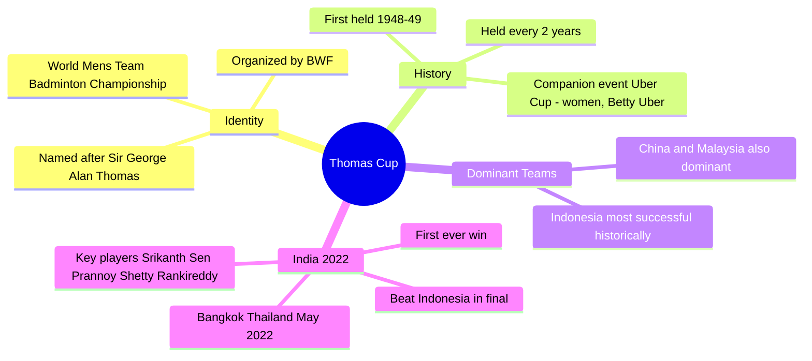

# NOTE — THOMAS CUP
**Section:** GK | **Category:** Miscellaneous | **Topic:** Thomas Cup | **Slug:** `misc-thomas-cup`
**Source:** 🔧 GENERAL KNOWLEDGE (standard sports GK reference; not yet cross-checked against PARMAR SSC reference excerpt)
**Status:** 🔧 DRAFT — awaiting AIR-91 verification before publish (⚠️ note: India's win is a recent, fast-changing sports-record fact — verify currency before publish)
**PYQ Frequency:** 🔥 Official Phase-1 priority topic (GK_PRIORITY_TOPICS, Miscellaneous bucket) | **High Yield:** ✅

---

## 🎭 THE HOOK

For 73 years, one trophy in world badminton belonged almost exclusively to a tight cluster of Asian powerhouses — Indonesia, China, Malaysia, Japan, Denmark occasionally breaking through — and India was never among them. Then, in **May 2022**, in Bangkok, an Indian men's team beat 14-time champions Indonesia in the final, and the **Thomas Cup** — the World Men's Team Badminton Championship — came to India for the very first time. It's named after **Sir George Alan Thomas**, a British badminton (and chess) player who personally donated the trophy and pushed for the tournament's creation, first held in **1948-49**. The tournament happens every two years, mirrors the women's equivalent (the Uber Cup) almost exactly in format, and India's 2022 win remains one of the most significant recent moments in Indian sports history — exactly the kind of "recent achievement" fact SSC GK loves to test in the year or two right after it happens.

---

## 📖 THE CORE

### Origin & Namesake
- **Thomas Cup** = the **World Men's Team Badminton Championship**, organized by the **Badminton World Federation (BWF)**.
- Named after **Sir George Alan Thomas**, an English badminton player (also a top chess player) who donated the trophy.
- First held in **1948-49** (the inaugural edition spanned two years due to the format at the time).
- Held **biennially** (every 2 years).

### Format
- A **team** event — countries field a team of players who compete in multiple singles and doubles matches against the opposing team; the team winning the majority of matches wins the tie.
- Companion event: the **Uber Cup** — the equivalent World Women's Team Badminton Championship, named after **Betty Uber**, first held in **1956-57**, also organized by BWF, held in the same years/cities as the Thomas Cup.

### Most Successful Teams (Historically)
- **Indonesia** has historically been the most successful Thomas Cup nation by total titles won, followed by **China** and **Malaysia** as other dominant historical powers.

### India's Landmark Win (2022)
- India won the **Thomas Cup for the first time in its history** in **May 2022**, held in **Bangkok, Thailand**.
- India defeated 14-time champions **Indonesia** in the final.
- Key players on the winning squad included **Kidambi Srikanth, Lakshya Sen, HS Prannoy**, and the doubles pairing of **Chirag Shetty and Satwiksairaj Rankireddy**.
- This was widely covered as a landmark moment for Indian badminton, alongside other recent Indian successes in the sport.

---

## 🧠 THE MIND MAP

---

## 🔑 THE MNEMONIC

**"Thomas for men, Uber for women, same years, same BWF"** — the pairing structure of world team badminton's two flagship events.

**"2022, Bangkok, Beat Indonesia — India's first Thomas Cup"** — the three key facts of India's landmark win, in one line.

---

## 📌 THE PYQ ANCHOR

🔥 Thomas Cup is on the app's **official Phase-1 priority list** (GK_PRIORITY_TOPICS, Miscellaneous). 🔧 No literal Thomas Cup question confirmed in the 23/46-shift CGL-2025 sample reviewed — given India's 2022 win is a recent landmark sports event, it is a very strong "recent current affairs / sports GK" candidate for SSC CGL; recommend archive cross-check AND verification this is still the most recent edition's result at publish time.

---

## ⚠️ THE TRAP ALERT

- **Thomas Cup is the MEN'S team event; Uber Cup is the WOMEN'S equivalent** — don't mix up the two trophies or their namesakes (Thomas vs. Betty Uber).
- **India won the Thomas Cup for the FIRST TIME ONLY in 2022** — a recent record, not a longstanding achievement; don't assume India had won it earlier.
- **Indonesia is the historically most successful Thomas Cup nation**, and was the team India defeated in the 2022 final — a frequently paired fact.
- **This is a fast-moving sports fact** — the Thomas Cup is held every 2 years, so by the time this note is read, a newer edition's result may exist; always verify against the latest tournament cycle.

---

## ✅ ACTIVE RECALL

1. What is the Thomas Cup, and who organizes it?
2. After whom is the Thomas Cup named?
3. What is the women's equivalent of the Thomas Cup called, and after whom is it named?
4. When did India win the Thomas Cup for the first time, and which team did India defeat in the final?
5. Name at least two key Indian players from the 2022 winning squad.

*(Answers: 1–The World Men's Team Badminton Championship; organized by the Badminton World Federation (BWF) | 2–Sir George Alan Thomas | 3–The Uber Cup, named after Betty Uber | 4–May 2022, in Bangkok, Thailand; India defeated Indonesia in the final | 5–Any two of: Kidambi Srikanth, Lakshya Sen, HS Prannoy, Chirag Shetty, Satwiksairaj Rankireddy)*
