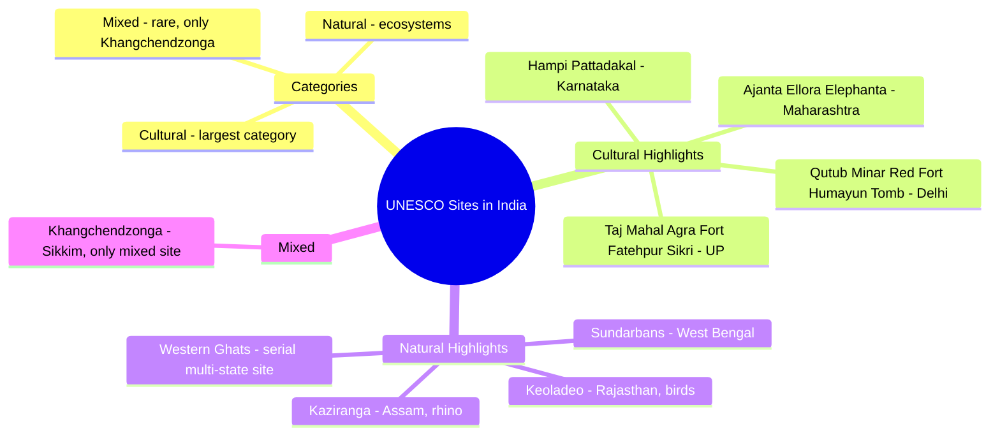

# NOTE — UNESCO WORLD HERITAGE SITES IN INDIA
**Section:** GK | **Category:** Miscellaneous | **Topic:** UNESCO World Heritage Sites in India | **Slug:** `misc-unesco-world-heritage-sites-india`
**Source:** 🔧 GENERAL KNOWLEDGE (standard GK reference; not yet cross-checked against PARMAR SSC reference excerpt)
**Status:** 🔧 DRAFT — awaiting AIR-91 verification before publish (⚠️ the total site COUNT changes almost every year as new sites are inscribed — verify current count before publish)
**PYQ Frequency:** 🔥 Very high-frequency Static GK category | **High Yield:** ✅

---

## 🎭 THE HOOK

India has more UNESCO World Heritage Sites than all but a handful of countries on Earth — and the list keeps growing almost every year, which is exactly why this topic is simultaneously high-yield and slightly dangerous to memorize a fixed number for. What doesn't change, though, is the THREE-WAY classification UNESCO uses for every site worldwide: **Cultural**, **Natural**, and **Mixed** (sites meeting both cultural AND natural criteria) — and India is one of the few countries with sites in all three categories, including one of the world's rarest classifications: Mixed sites, of which there are only a handful globally.

---

## 📖 THE CORE

### UNESCO's Three Site Categories
- **Cultural Sites**: monuments, archaeological sites, historic cities, cultural landscapes (India's largest category by far).
- **Natural Sites**: ecosystems, geological formations, biodiversity habitats.
- **Mixed Sites**: meet BOTH cultural and natural criteria — extremely rare globally; India has one: **Khangchendzonga National Park** (Sikkim).

### Major Cultural Sites (Frequently Tested)
| Site | State |
|---|---|
| **Taj Mahal** | Uttar Pradesh (Agra) |
| **Agra Fort** | Uttar Pradesh |
| **Fatehpur Sikri** | Uttar Pradesh |
| **Red Fort Complex** | Delhi |
| **Qutub Minar and its Monuments** | Delhi |
| **Humayun's Tomb** | Delhi |
| **Ajanta Caves** | Maharashtra |
| **Ellora Caves** | Maharashtra |
| **Elephanta Caves** | Maharashtra |
| **Khajuraho Group of Monuments** | Madhya Pradesh |
| **Sun Temple, Konark** | Odisha |
| **Group of Monuments at Mahabalipuram (Mamallapuram)** | Tamil Nadu |
| **Group of Monuments at Hampi** | Karnataka |
| **Group of Monuments at Pattadakal** | Karnataka |
| **Churches and Convents of Goa** | Goa |
| **Khangchendzonga National Park** (Mixed) | Sikkim |
| **Rani ki Vav (The Queen's Stepwell)** | Gujarat |
| **Jantar Mantar, Jaipur** | Rajasthan |
| **Hill Forts of Rajasthan** | Rajasthan (a serial site covering multiple forts) |
| **Mountain Railways of India** | A serial site (Darjeeling Himalayan Railway, Nilgiri Mountain Railway, Kalka-Shimla Railway) |

### Major Natural Sites (Frequently Tested)
| Site | State |
|---|---|
| **Kaziranga National Park** | Assam (one-horned rhinoceros habitat) |
| **Manas Wildlife Sanctuary** | Assam |
| **Sundarbans National Park** | West Bengal |
| **Keoladeo National Park** | Rajasthan (bird sanctuary, also called Bharatpur Bird Sanctuary) |
| **Nanda Devi and Valley of Flowers National Parks** | Uttarakhand |
| **Western Ghats** | Multiple states (Kerala, Karnataka, Tamil Nadu, Maharashtra, Goa, Gujarat — serial site) |
| **Great Himalayan National Park** | Himachal Pradesh |

### Key Distinguishing Facts
- **Khangchendzonga National Park (Sikkim)** is India's ONLY Mixed-category UNESCO site — meeting both natural and cultural criteria.
- **The first Indian sites inscribed (1983)** included the **Taj Mahal**, **Ajanta Caves**, **Ellora Caves**, and **Agra Fort** — among India's earliest entries.
- **The Western Ghats** are inscribed as a single SERIAL site spanning multiple states, not a single location — a frequently tested "is this one site or many" trap.
- India's total site count is regularly updated; recent inscriptions have included sites tied to historic Maratha forts and other cultural landscapes — exact current count should always be cross-checked against the latest UNESCO list rather than memorized as a fixed number.

---

## 🧠 THE MIND MAP

---

## 🔑 THE MNEMONIC

**"Cultural is common, Natural is scenic, Mixed is Khangchendzonga alone"** — the three-category split with India's sole Mixed-site exception.

**"1983: Taj, Ajanta, Ellora, Agra Fort — the founding four"** — India's earliest UNESCO inscriptions, all in the same year.

---

## 📌 THE PYQ ANCHOR

🔥 UNESCO World Heritage Sites is a very high-frequency Static GK category. 🔧 No literal UNESCO Sites question confirmed in the 23/46-shift CGL-2025 sample reviewed earlier in this session, since this topic wasn't separately tagged during PYQ extraction — site-to-state matching and the Cultural/Natural/Mixed classification are textbook-standard SSC CGL GK staples; recommend a dedicated archive cross-check.

---

## ⚠️ THE TRAP ALERT

- **Khangchendzonga National Park (Sikkim) is India's ONLY Mixed-category site** — don't assume any other famous site (like Western Ghats or Sundarbans) is Mixed; they are purely Natural.
- **The Western Ghats and Mountain Railways of India are SERIAL sites** spanning multiple locations/states, not single physical sites — a frequently tested "how many distinct locations" trap.
- **Keoladeo National Park (Rajasthan) is a bird sanctuary, NOT in a "green," forested state** — its desert-adjacent Rajasthan location often surprises aspirants expecting wetland sites to be in wetter regions.
- **The total UNESCO site count for India changes almost every year** — never memorize a fixed total number as permanently correct; always treat it as date-sensitive.

---

## ✅ ACTIVE RECALL

1. What are UNESCO's three categories of World Heritage Sites?
2. Which is India's only Mixed-category UNESCO site?
3. Name four of India's earliest UNESCO World Heritage Sites, inscribed in 1983.
4. What makes the Western Ghats UNESCO site different from a typical single-location site?
5. In which state is Keoladeo National Park located, and what is it known for?

*(Answers: 1–Cultural, Natural, and Mixed | 2–Khangchendzonga National Park, Sikkim | 3–Any four of: Taj Mahal, Ajanta Caves, Ellora Caves, Agra Fort | 4–It is a SERIAL site, spanning multiple locations across several states (Kerala, Karnataka, Tamil Nadu, Maharashtra, Goa, Gujarat), not one single location | 5–Rajasthan; known as a major bird sanctuary (also called Bharatpur Bird Sanctuary))*
