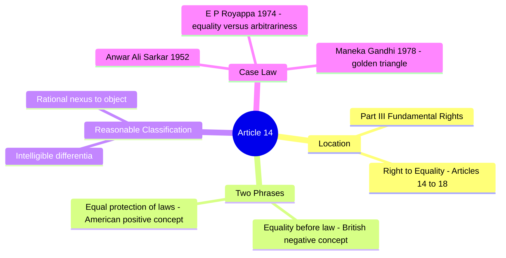

# NOTE — ARTICLE 14
**Section:** GK | **Category:** Polity | **Topic:** Article 14 | **Slug:** `pol-article-14`
**Source:** 🔧 GENERAL KNOWLEDGE (constitutional text + standard polity reference; not yet cross-checked against PARMAR SSC reference excerpt)
**Status:** 🔧 DRAFT — awaiting AIR-91 verification before publish
**PYQ Frequency:** 🔥 Official Phase-1 priority topic (GK_PRIORITY_TOPICS, Polity bucket) | **High Yield:** ✅

---

## 🎭 THE HOOK

Two phrases, one Article, and a century of court battles over the difference between them. Article 14 promises both **"equality before law"** and **"equal protection of the laws"** — and SSC examiners love asking which phrase came from where. The first is borrowed from British common law, a negative concept: no one is above the law, not even the king. The second is borrowed from the American Constitution's 14th Amendment, a positive concept: the state must actively ensure equal treatment, which sometimes means treating unequal people differently to reach a genuinely equal outcome. That second idea — equals treated equally, unequals treated unequally — became the legal seed for everything from reservations to differential tax slabs.

---

## 📖 THE CORE

### Text & Source
- **Article 14**, under **Part III (Fundamental Rights)**, falls within the broader heading **"Right to Equality"** (Articles 14–18).
- Guarantees: **"The State shall not deny to any person equality before the law or the equal protection of the laws within the territory of India."**
- **"Equality before law"** — negative/British concept (rule of law, no one above the law, A.V. Dicey's formulation).
- **"Equal protection of the laws"** — positive/American concept (equal treatment under like circumstances; permits reasonable classification).

### Reasonable Classification Test
- Article 14 does NOT mean absolute equality for everyone in all situations — it permits **"reasonable classification,"** subject to two conditions:
  1. The classification must be based on an **intelligible differentia** (a clear basis distinguishing grouped persons/things from others).
  2. That differentia must have a **rational nexus (relation)** to the object sought to be achieved by the law.
- This is the constitutional basis for things like reservation policy, different tax slabs, and age-based eligibility rules — all upheld as "reasonable classification," not violations of equality.

### Key Case Law
- **State of West Bengal v. Anwar Ali Sarkar (1952):** Early landmark case applying the reasonable classification test.
- **E.P. Royappa v. State of Tamil Nadu (1974):** Expanded Article 14 beyond mere classification — held that **"equality is antithetical to arbitrariness"**, meaning ANY arbitrary state action can be struck down under Article 14, not just unequal classification.
- **Maneka Gandhi v. Union of India (1978):** Built on Royappa, linking Article 14 (equality), Article 19 (freedoms), and Article 21 (life and liberty) — the "golden triangle" of fundamental rights, holding any procedure depriving life/liberty must also be fair, just, and reasonable (satisfying Article 14).

---

## 🧠 THE MIND MAP

---

## 🔑 THE MNEMONIC

**"British BEFORE, American PROTECTION"** — equality BEFORE law = British origin; equal PROTECTION of laws = American origin.

**"Differentia + Nexus = Reasonable Classification"** — the two-part test for when unequal treatment is still constitutional.

---

## 📌 THE PYQ ANCHOR

🔥 Article 14 is on the app's **official Phase-1 priority list** (GK_PRIORITY_TOPICS, Polity). 🔧 No literal Article 14 question confirmed in the 23/46-shift CGL-2025 sample reviewed — Fundamental Rights articles are a textbook-standard SSC CGL GK staple; recommend archive cross-check.

---

## ⚠️ THE TRAP ALERT

- **"Equality before law" is British in origin; "Equal protection of the laws" is American** — examiners frequently swap these in MCQs.
- **Article 14 permits reasonable classification, NOT absolute equality** — don't assume Article 14 bans all differential treatment; it bans only unreasonable/arbitrary classification.
- **Maneka Gandhi (1978) is famous for linking Articles 14, 19, and 21** ("golden triangle") — a frequently tested case-to-principle pairing, often confused with Royappa (1974), which is famous specifically for the "equality vs arbitrariness" doctrine.

---

## ✅ ACTIVE RECALL

1. Under which Part and Article-range of the Constitution does Article 14 fall?
2. What are the two distinct phrases in Article 14, and which country's legal tradition does each come from?
3. What two conditions must a classification satisfy to be "reasonable" under Article 14?
4. Which case held that "equality is antithetical to arbitrariness"?
5. Which case linked Articles 14, 19, and 21 into the "golden triangle"?

*(Answers: 1–Part III, Articles 14-18 (Right to Equality) | 2–"Equality before law" (British) and "Equal protection of the laws" (American) | 3–Intelligible differentia and rational nexus to the object of the law | 4–E.P. Royappa v. State of Tamil Nadu (1974) | 5–Maneka Gandhi v. Union of India (1978))*
