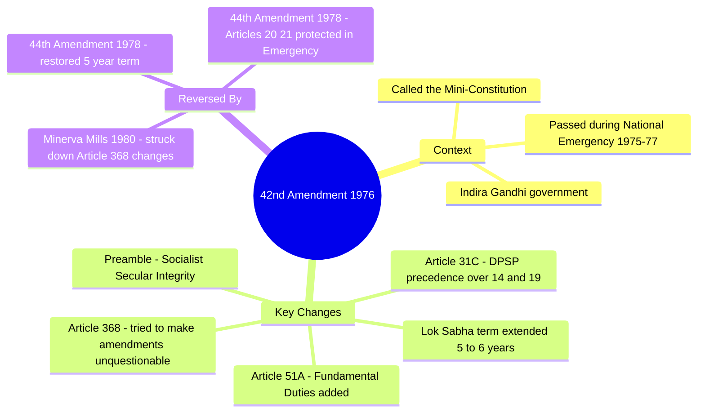

# NOTE — 42ND CONSTITUTIONAL AMENDMENT ACT, 1976
**Section:** GK | **Category:** Polity | **Topic:** 42nd Amendment | **Slug:** `polity-42nd-amendment`
**Source:** 🔧 GENERAL KNOWLEDGE (constitutional text + standard polity reference; not yet cross-checked against PARMAR SSC reference excerpt)
**Status:** 🔧 DRAFT — awaiting AIR-91 verification before publish
**PYQ Frequency:** 🔥 Official Phase-1 priority topic (GK_PRIORITY_TOPICS, Polity bucket) | **High Yield:** ✅

---

## 🎭 THE HOOK

It is the single most consequential piece of constitutional surgery in India's history — and it happened while democracy itself was suspended. Passed in **1976**, during Indira Gandhi's **National Emergency (1975-77)**, the **42nd Amendment Act** rewrote so much of the Constitution that historians and political scientists call it the **"Mini-Constitution"**. It touched the Preamble. It clipped the judiciary's wings. It tilted the balance of power decisively toward Parliament and the executive. And almost everything it changed was, within four years, partially undone by a different amendment and a landmark court case — making the 42nd Amendment one half of a two-part story that SSC examiners love testing as a pair: what the 42nd did, and what the 44th Amendment (1978) and Minerva Mills (1980) later reversed.

---

## 📖 THE CORE

### Context
- Enacted in **1976**, during the **National Emergency** declared in 1975 by President's proclamation on the advice of PM **Indira Gandhi's** government.
- Often called the **"Mini-Constitution"** because of the sheer breadth of changes — it amended the Preamble and dozens of Articles.

### Key Changes Introduced
| Change | Detail |
|---|---|
| **Preamble** | Added the words **"Socialist," "Secular,"** and **"Integrity"** (Unity → Unity and Integrity). |
| **Fundamental Duties** | Added **Part IVA, Article 51A** — India's first list of citizen duties, based on the Swaran Singh Committee. |
| **DPSP vs. Fundamental Rights** | Inserted **Article 31C**, giving DPSPs under Articles 39(b) and (c) precedence over Articles 14 and 19 when implementing legislation. |
| **Judicial Review curtailed** | Limited the power of courts to review constitutional amendments and certain laws; attempted to reduce judicial review of Emergency-era laws. |
| **Tenure extensions** | Extended the term of the Lok Sabha and State Assemblies from 5 to **6 years** (later restored to 5 years by the 44th Amendment). |
| **"Anti-Defection" groundwork** | Several procedural changes strengthening the central government relative to states and the judiciary. |
| **Article 368 amended** | Declared that constitutional amendments under Article 368 CANNOT be questioned in any court on any ground — an attempt to make Parliament's amending power unlimited (later struck down). |

### What Got Reversed
- **Minerva Mills v. Union of India (1980):** Struck down the changes to Article 368 that tried to make Parliament's amending power unlimited, and struck down the blanket precedence given to ALL DPSPs over Fundamental Rights — restoring the Article 14/19 vs. DPSP balance (limited Article 31C's scope back closer to its pre-42nd-Amendment form).
- **44th Amendment Act, 1978:** Reversed the 5-to-6-year tenure extension (restored to 5 years); removed the right to property from the list of Fundamental Rights entirely (moved to Article 300A, a separate move from the 42nd Amendment but part of the same post-Emergency course-correction era); added the protection that Articles 20 and 21 cannot be suspended even during a National Emergency.

---

## 🧠 THE MIND MAP

---

## 🔑 THE MNEMONIC

**"42 expanded, 44 corrected, Minerva Mills perfected"** — the three-part sequence: 42nd Amendment (1976) expanded government power; 44th Amendment (1978) and Minerva Mills (1980) walked parts of it back.

**"Mini-Constitution = Preamble + Duties + DPSP precedence + longer terms"** — the four headline changes to remember for the 42nd Amendment.

---

## 📌 THE PYQ ANCHOR

🔥 The 42nd Amendment is on the app's **official Phase-1 priority list** (GK_PRIORITY_TOPICS, Polity). 🔧 No literal 42nd Amendment question confirmed in the 23/46-shift CGL-2025 sample reviewed — "which amendment added Socialist/Secular to the Preamble," "which amendment added Fundamental Duties," and the "Mini-Constitution" nickname are textbook-standard SSC CGL Polity staples; recommend archive cross-check.

---

## ⚠️ THE TRAP ALERT

- **The 42nd Amendment (1976) added BOTH "Socialist"/"Secular" to the Preamble AND Fundamental Duties (Article 51A)** — these two facts are commonly tested together but sometimes wrongly attributed to different amendments; both are 42nd Amendment changes.
- **The Lok Sabha term was BRIEFLY extended to 6 years by the 42nd Amendment, then restored to 5 years by the 44th Amendment (1978)** — don't assume the current 5-year term was always constant; there was a 6-year interlude.
- **The 42nd Amendment's attempt to make constitutional amendments unquestionable in court was struck down by the Supreme Court in Minerva Mills (1980)** — examiners may test which case undid this specific 42nd Amendment provision.

---

## ✅ ACTIVE RECALL

1. During which event/period was the 42nd Amendment passed, and in which year?
2. What nickname is commonly given to the 42nd Amendment, and why?
3. Name three major changes the 42nd Amendment made (Preamble, Fundamental Duties, DPSP-FR relationship, tenure, or Article 368).
4. Which case struck down the 42nd Amendment's attempt to make Parliament's amending power unlimited and unquestionable?
5. Which subsequent amendment restored the Lok Sabha's term from 6 years back to 5 years?

*(Answers: 1–During the National Emergency (1975-77); passed in 1976 | 2–"Mini-Constitution," because of the sheer breadth of changes it made across the Constitution | 3–Any three of: added Socialist/Secular/Integrity to the Preamble; added Fundamental Duties (Article 51A); inserted Article 31C (DPSP precedence over Articles 14/19); extended Lok Sabha/Assembly terms to 6 years; tried to make Article 368 amendments unquestionable in court | 4–Minerva Mills v. Union of India (1980) | 5–The 44th Amendment Act, 1978)*
