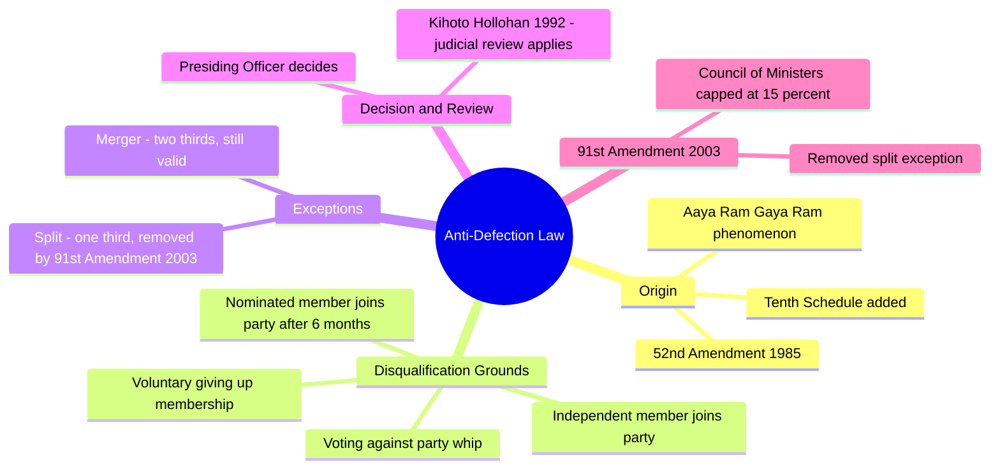

# NOTE — ANTI-DEFECTION LAW (10TH SCHEDULE)
**Section:** GK | **Category:** Polity | **Topic:** Anti-Defection Law | **Slug:** `polity-anti-defection-law`
**Source:** 🔧 GENERAL KNOWLEDGE (constitutional text + standard polity reference; not yet cross-checked against PARMAR SSC reference excerpt)
**Status:** 🔧 DRAFT — awaiting AIR-91 verification before publish
**PYQ Frequency:** 🔥 High-frequency Polity topic, connects to [[polity-schedules-of-the-constitution]] | **High Yield:** ✅

---

## 🎭 THE HOOK

There's a phrase that defined Indian political instability for nearly two decades after independence: **"Aaya Ram Gaya Ram"** ("Ram came, Ram went") — coined after a Haryana MLA named Gaya Lal switched parties THREE TIMES in a single day in 1967. Defection-driven government collapses became so routine that Parliament eventually decided the Constitution itself needed a fix, adding an entirely new Schedule in 1985 specifically to make party-switching politically costly: lose your seat the moment you defect. The Anti-Defection Law didn't end political maneuvering in India, but it did end the era of one legislator single-handedly toppling a government by walking across the aisle.

---

## 📖 THE CORE

### Origin
- Added by the **52nd Constitutional Amendment Act, 1985**, inserting the **Tenth Schedule** into the Constitution.
- Triggered by decades of rampant political defection, epitomized by the **"Aaya Ram Gaya Ram"** phenomenon (Gaya Lal, Haryana, 1967, switched parties three times in one day).
- Applies to members of both Parliament (Lok Sabha/Rajya Sabha) and State Legislatures.

### Grounds for Disqualification
A member can be disqualified for defection if they:
1. **Voluntarily give up membership** of their political party (this need not mean formal resignation — conduct can imply it).
2. **Vote or abstain** from voting in the House CONTRARY to their party's direction (whip), WITHOUT prior permission, and this isn't condoned by the party within 15 days.
3. An **independently elected member** joins a political party after election.
4. A **nominated member** joins a political party AFTER the expiry of 6 months from taking their seat.

### The "Split" and "Merger" Exceptions
- Originally, the Tenth Schedule allowed a **"split"** exception: if **one-third** of a party's legislators broke away together, they would NOT be disqualified for defection — this provision was WIDELY MISUSED to engineer mass defections and was **REMOVED by the 91st Amendment Act, 2003**.
- A **"merger"** exception still exists: if a party MERGES with another, and at least **TWO-THIRDS** of that party's legislators agree to the merger, the merging members are NOT disqualified — this is the only surviving group-defection exception today.

### Who Decides Disqualification?
- The **Presiding Officer** of the House (Speaker of the Lok Sabha/State Assembly, or Chairman of the Rajya Sabha/State Legislative Council) decides disqualification petitions.
- This decision-making power has been CONTROVERSIAL — critics argue the Presiding Officer, often a member of the ruling party, has an inherent conflict of interest.
- **Kihoto Hollohan v. Zachillhu (1992)**: landmark Supreme Court case that upheld the Tenth Schedule's constitutional validity but held that the Presiding Officer's decision IS subject to **judicial review** (on grounds of mala fide, perversity, or violation of natural justice) — a frequently tested case.

### The 91st Amendment, 2003 — Key Changes
- REMOVED the one-third "split" exception entirely.
- Capped the size of the **Council of Ministers** at the Union and State levels to **15% of the total strength** of the respective House (Lok Sabha/State Assembly) — partly to curb defections incentivized by ministerial-post offers ("reward for defection").
- Disqualified members under the Tenth Schedule are also barred from holding ministerial office until re-elected.

---

## 🧠 THE MIND MAP

---

## 🔑 THE MNEMONIC

**"Split is gone, Merger remains — one-third out, two-thirds in"** — the key 2003 change to the group-defection exceptions.

**"Kihoto says: Speaker decides, but courts can check"** — the Kihoto Hollohan case's core holding on judicial review of disqualification decisions.

---

## 📌 THE PYQ ANCHOR

🔥 Anti-Defection Law is a high-frequency Polity topic, directly connecting to [[polity-schedules-of-the-constitution]] (Tenth Schedule). 🔧 No literal Anti-Defection Law question confirmed in the 23/46-shift CGL-2025 sample reviewed earlier in this session — the 52nd/91st Amendments, the split/merger exceptions, and Kihoto Hollohan are textbook-standard SSC CGL Polity staples; recommend a dedicated archive cross-check.

---

## ⚠️ THE TRAP ALERT

- **The "split" exception (one-third) was REMOVED by the 91st Amendment, 2003** — only the "merger" exception (two-thirds) survives today; don't assume both exceptions still exist.
- **The Presiding Officer decides disqualification, but this decision IS subject to judicial review** (per Kihoto Hollohan, 1992) — don't assume the Speaker's decision is final and unchallengeable.
- **The 91st Amendment also capped Council of Ministers size at 15% of House strength** — a frequently overlooked second provision of the same amendment, often tested separately from the split-exception removal.
- **A nominated member has a 6-MONTH grace period** before joining a party triggers disqualification — joining within that window is NOT a defection violation.

---

## ✅ ACTIVE RECALL

1. Which Amendment introduced the Anti-Defection Law, and which Schedule did it add?
2. What phrase describes the pre-1985 defection phenomenon, and what incident inspired it?
3. What was the "split" exception, and what happened to it in 2003?
4. What exception still allows group defection today, and what threshold does it require?
5. What did the Kihoto Hollohan v. Zachillhu (1992) case establish?

*(Answers: 1–The 52nd Constitutional Amendment Act, 1985; added the Tenth Schedule | 2–"Aaya Ram Gaya Ram"; inspired by Haryana MLA Gaya Lal switching parties three times in one day, 1967 | 3–A provision allowing disqualification-free defection if one-third of a party's legislators broke away together; removed by the 91st Amendment Act, 2003 | 4–The "merger" exception; requires at least two-thirds of a party's legislators to agree to the merger | 5–That the Tenth Schedule is constitutionally valid, but the Presiding Officer's disqualification decisions are subject to judicial review)*
