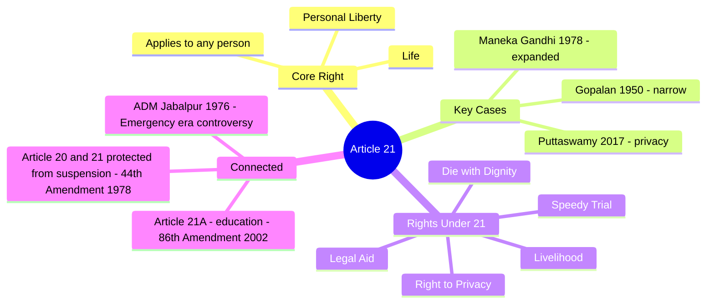

# NOTE — ARTICLE 21
**Section:** GK | **Category:** Polity | **Topic:** Article 21 | **Slug:** `polity-article-21`
**Source:** 🔧 GENERAL KNOWLEDGE / canonical worked example from the app's own TEMPLATE-note.json (Article 21 was the system's own reference example for note quality) — content reviewed, lightly expanded, and re-flagged per this session's verification protocol
**Status:** 🔧 DRAFT — awaiting AIR-91 verification before publish
**PYQ Frequency:** 🔥 Official Phase-1 priority topic (GK_PRIORITY_TOPICS, Polity bucket) | **High Yield:** ✅

---

## 🎭 THE HOOK

In 1977, a young man named Francis Coralie Mullin was locked in Tihar Jail. He couldn't meet his lawyer or family — the authorities argued the Constitution only protected life from being "taken away," not dignity inside a prison cell. The Supreme Court disagreed. In a landmark ruling, it said Article 21 isn't just about avoiding death — it's about living with dignity: no handcuffs without reason, access to a lawyer, even decent food. One Article became the widest umbrella in the Indian Constitution — over 40 rights now shelter under it, from the right to sleep on a footpath to the right to a speedy trial. The government didn't give citizens Article 21's full scope. The Supreme Court grew it, judgment by judgment.

---

## 📖 THE CORE

### Text
- Article 21 states: **"No person shall be deprived of his life or personal liberty except according to procedure established by law."**
- Located in **Part III (Fundamental Rights)**.
- Applies to **citizens AND non-citizens** ("any person") — unlike Article 19, which is citizens-only.

### Evolution Through Case Law
| Case | Year | Significance |
|---|---|---|
| **A.K. Gopalan v. State of Madras** | 1950 | Narrow interpretation — "procedure established by law" meant any procedure enacted by a validly passed law, regardless of fairness. |
| **Maneka Gandhi v. Union of India** | 1978 | Landmark expansion — held that "procedure" must be fair, just, and reasonable, not arbitrary. Effectively merged Article 21 with the spirit of Article 19 and 14 ("golden triangle"). |
| **Justice K.S. Puttaswamy v. Union of India** | 2017 | Declared the **Right to Privacy** a Fundamental Right flowing from Article 21. |

### Rights That Now Flow From Article 21 (judicially expanded, non-exhaustive)
Right to privacy · Right to a speedy trial · Right to free legal aid · Right to livelihood · Right against solitary confinement · Right to a clean environment · Right to education (before being made a separate Article) · Right to die with dignity (passive euthanasia, *Common Cause v. Union of India*, 2018).

### Article 21A
- Added by the **86th Constitutional Amendment Act, 2002**, as a **separate, standalone Article** — guarantees **free and compulsory education to children aged 6–14 years**.
- Commonly confused as "part of" Article 21 — it is legally distinct, though it grew out of Article 21 jurisprudence (the Supreme Court had earlier read a right to education into Article 21 in *Mohini Jain* and *Unni Krishnan* cases before the 86th Amendment formalized it).

### Emergency Protection
- Under **Article 359**, the President can suspend the right to move courts for enforcement of Fundamental Rights during a National Emergency (Article 352) — EXCEPT **Articles 20 and 21**, which were explicitly protected from suspension by the **44th Amendment Act, 1978** (a direct response to Emergency-era (1975-77) abuses, including the Habeas Corpus case, *ADM Jabalpur v. Shivkant Shukla*, 1976, where the Court controversially allowed Article 21 to be suspended — later overruled in spirit by Puttaswamy, 2017).

---

## 🧠 THE MIND MAP

---

## 🔑 THE MNEMONIC

**Article 21 = LIFE-PLUS.** L = Life, I = Liberty, F = Fair procedure (Maneka Gandhi), E = Every person (citizen + non-citizen), PLUS = 40+ rights now flow from it.

**"Gopalan narrowed it, Maneka widened it"** — instant recall for the two opposite-direction landmark cases.

---

## 📌 THE PYQ ANCHOR

🔥 Article 21 is on the app's **official Phase-1 priority list** (GK_PRIORITY_TOPICS, Polity) and is one of the single most-tested Polity topics across SSC exams historically. 🔧 No literal Article 21 question was independently confirmed in the 23/46-shift CGL-2025 sample this session reviewed, but Article 21 (Right to Privacy/Puttaswamy, Emergency-suspension rules) is a recurring staple across SSC CGL years per general exam pattern knowledge — recommend archive cross-check to populate verified pyq_refs before publish.

---

## ⚠️ THE TRAP ALERT

- **Articles 20 and 21 CANNOT be suspended during a National Emergency** — examiners ask which articles survive Emergency suspension; the answer is specifically 20 and 21, NOT all Fundamental Rights.
- **Article 21A (education) is a SEPARATE Article**, added in 2002 by the 86th Amendment — not a sub-clause of Article 21. A very common conflation trap.
- **Gopalan (1950) and Maneka Gandhi (1978) are OPPOSITE rulings** — Gopalan was narrow ("procedure" = any enacted law); Maneka Gandhi was expansive ("procedure" must be fair, just, reasonable). Examiners may ask which case said what.

---

## ✅ ACTIVE RECALL

1. What does Article 21 guarantee, and to whom does it apply (citizens only, or any person)?
2. Which 1978 case dramatically expanded the interpretation of "procedure established by law"?
3. Which 2017 case declared the Right to Privacy a Fundamental Right under Article 21?
4. Which Articles are protected from suspension during a National Emergency, and by which Amendment was this protection added?
5. Is Article 21A part of Article 21, or a separate Article? What does it guarantee?

*(Answers: 1–No person shall be deprived of life or personal liberty except by procedure established by law; applies to any person, citizen or non-citizen | 2–Maneka Gandhi v. Union of India (1978) | 3–Justice K.S. Puttaswamy v. Union of India (2017) | 4–Articles 20 and 21; protection added by the 44th Amendment Act, 1978 | 5–A separate Article, added by the 86th Amendment, 2002; guarantees free and compulsory education to children aged 6-14)*
