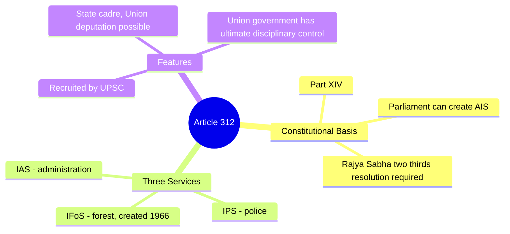

# NOTE — ARTICLE 312 (ALL INDIA SERVICES)
**Section:** GK | **Category:** Polity | **Topic:** Article 312 | **Slug:** `polity-article-312`
**Source:** 🔧 GENERAL KNOWLEDGE (constitutional text + standard polity reference; not yet cross-checked against PARMAR SSC reference excerpt)
**Status:** 🔧 DRAFT — awaiting AIR-91 verification before publish
**PYQ Frequency:** 🔥 Official Phase-1 priority topic (GK_PRIORITY_TOPICS, Polity bucket) | **High Yield:** ✅

---

## 🎭 THE HOOK

Most civil servants in India work for either the Union government or a state government — never both at once. The officers governed by Article 312 are the deliberate exception: they belong to neither, and both, simultaneously. The **All India Services (AIS)** — the IAS, the IPS, and the IFoS — are recruited and trained centrally by the Union, but spend their actual careers serving in state governments, on deputation, answerable to both layers of government at once. It's a structural trick the framers built in on purpose: a steel frame of officers whose loyalty isn't fully captured by any single state government, designed to hold the federal system together by literally sharing personnel between the Centre and the states.

---

## 📖 THE CORE

### Constitutional Basis
- **Article 312**, in **Part XIV** ("Services Under the Union and the States"), empowers **Parliament** to create new **All India Services** common to the Union and the States — **if the Rajya Sabha declares by a resolution, supported by a two-thirds majority of members present and voting, that it is necessary or expedient in the national interest** to do so.
- This is a **special procedural safeguard**: the Rajya Sabha (representing states) must affirmatively trigger Parliament's power to create such a service, since AIS creation affects state administrative autonomy.

### The Three All India Services
| Service | Cadre Controlling Authority |
|---|---|
| **Indian Administrative Service (IAS)** | Department of Personnel & Training (DoPT) |
| **Indian Police Service (IPS)** | Ministry of Home Affairs |
| **Indian Forest Service (IFoS)** | Ministry of Environment, Forest and Climate Change — created later, in **1966**, under Article 312 |

- IAS and IPS predate the current Constitution in spirit — continuations of the British-era "steel frame" (ICS — Indian Civil Service, and Indian Police) — formally constituted under Article 312 read with the **All India Services Act, 1951**.
- IFoS was the **third** All India Service, created in **1966** — the only one of the three created entirely post-independence under Article 312's mechanism.

### Key Structural Features
- AIS officers are recruited by the **Union Public Service Commission (UPSC)** via a common all-India examination (Civil Services Examination for IAS/IPS, etc.).
- Allotted to a **state cadre**, but liable to serve the Union government on deputation.
- **Disciplinary control / removal**: ultimate disciplinary authority rests with the **Union government**, even though officers primarily work under state governments — a frequently tested "who controls AIS officers" question.
- Salaries and service conditions are governed by rules made by the **Central Government**, in consultation with state governments.

---

## 🧠 THE MIND MAP

---

## 🔑 THE MNEMONIC

**"Rajya Sabha says GO, two-thirds makes it so"** — Article 312's special trigger: a Rajya Sabha resolution by two-thirds majority is needed before Parliament can create a new All India Service.

**"IAS-IPS-IFoS, the 1966 add-on is IFoS"** — the three All India Services, with IFoS as the youngest (1966).

---

## 📌 THE PYQ ANCHOR

🔥 Article 312 is on the app's **official Phase-1 priority list** (GK_PRIORITY_TOPICS, Polity). 🔧 No literal Article 312 question confirmed in the 23/46-shift CGL-2025 sample reviewed — "which body recommends creation of a new All India Service" and "name the three All India Services" are textbook-standard SSC CGL Polity staples; recommend archive cross-check.

---

## ⚠️ THE TRAP ALERT

- **It is the RAJYA SABHA, not the Lok Sabha, that must pass the special two-thirds resolution** before Parliament can create a new All India Service — a frequently tested House-mix-up, since Rajya Sabha represents states' interests and AIS creation affects state administrative power.
- **IFoS (Indian Forest Service) was created in 1966**, making it the only one of the three current AIS created entirely under Article 312's post-independence mechanism — IAS and IPS are continuations of British-era services, formally reconstituted post-1950.
- **AIS officers serve state governments day-to-day but remain under the Union government's ultimate disciplinary control** — don't assume state governments have full authority over AIS officer discipline/removal.

---

## ✅ ACTIVE RECALL

1. Under which Article and Part of the Constitution can Parliament create new All India Services?
2. What special procedural step must occur before Parliament can create a new All India Service?
3. Name the three All India Services and their respective controlling ministries/departments.
4. Which of the three All India Services was created most recently, and in which year?
5. Which level of government holds ultimate disciplinary authority over All India Service officers?

*(Answers: 1–Article 312, Part XIV | 2–The Rajya Sabha must pass a resolution, by a two-thirds majority of members present and voting, declaring it necessary/expedient in the national interest | 3–IAS (DoPT), IPS (Ministry of Home Affairs), IFoS (Ministry of Environment, Forest and Climate Change) | 4–Indian Forest Service (IFoS), created in 1966 | 5–The Union (Central) Government)*
