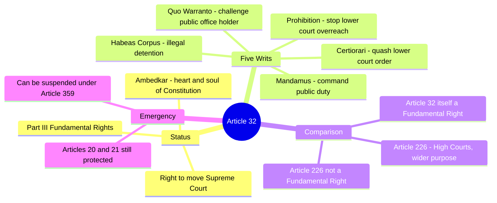

# NOTE — ARTICLE 32
**Section:** GK | **Category:** Polity | **Topic:** Article 32 | **Slug:** `polity-article-32`
**Source:** 🔧 GENERAL KNOWLEDGE (constitutional text + standard polity reference; not yet cross-checked against PARMAR SSC reference excerpt)
**Status:** 🔧 DRAFT — awaiting AIR-91 verification before publish
**PYQ Frequency:** 🔥 Official Phase-1 priority topic (GK_PRIORITY_TOPICS, Polity bucket) | **High Yield:** ✅

---

## 🎭 THE HOOK

Dr. B.R. Ambedkar called it "the very soul of the Constitution and the very heart of it" — not Article 21 (life and liberty), not Article 14 (equality), but **Article 32**, the right that lets you enforce all the others. A Fundamental Right without a way to enforce it is just a promise. Article 32 is the enforcement mechanism: it gives every citizen the right to walk directly into the **Supreme Court** when ANY Fundamental Right is violated, and arms the Court with five specific tools — the writs — borrowed from English common law, each built to attack a different kind of constitutional violation. Without Article 32, Part III of the Constitution would be a list of good intentions. With it, it's a list of things you can actually sue over.

---

## 📖 THE CORE

### Text & Status
- **Article 32**, located in **Part III (Fundamental Rights)**, guarantees the **right to move the Supreme Court** for enforcement of Fundamental Rights — itself a Fundamental Right.
- Famously called **"the heart and soul of the Constitution"** by **Dr. B.R. Ambedkar**.
- Empowers the Supreme Court to issue **directions, orders, or writs** for enforcement of any right conferred by Part III.

### The Five Writs
| Writ | Meaning |
|---|---|
| **Habeas Corpus** | "You may have the body" — directs that a detained person be produced before the court; used against illegal detention. |
| **Mandamus** | "We command" — directs a public official/body to perform a duty it is legally obligated to perform. |
| **Prohibition** | Issued by a higher court to a lower court/tribunal, prohibiting it from continuing proceedings beyond its jurisdiction. |
| **Certiorari** | Issued to quash an order already passed by a lower court/tribunal acting beyond its jurisdiction. |
| **Quo Warranto** | "By what authority" — challenges a person's legal right to hold a public office. |

### Article 32 vs. Article 226
- **Article 226** gives **High Courts** the power to issue writs too — but for a WIDER range of purposes (enforcement of Fundamental Rights AND "for any other purpose"), making Article 226's scope technically broader than Article 32's.
- **Article 32 is itself a Fundamental Right** (cannot be taken away except by constitutional amendment); **Article 226 is NOT a Fundamental Right** — it's a constitutional power of the High Courts, but ordinary legislation cannot abolish it either since it's part of the basic structure (per case law).
- Article 32 can be invoked **only for enforcement of Fundamental Rights**; Article 226 can be invoked for Fundamental Rights violations OR other legal wrongs.

### Suspension
- The right to move courts under Article 32 (for other Fundamental Rights) CAN be suspended during a National Emergency under Article 359 — but Articles 20 and 21 themselves remain protected (per the 44th Amendment, 1978).

---

## 🧠 THE MIND MAP

---

## 🔑 THE MNEMONIC

**"HMPCQ"** — Habeas Corpus, Mandamus, Prohibition, Certiorari, Quo Warranto — the five writs in one string.

**"32 is the heart, 226 is the wider net"** — Article 32 (Supreme Court, Fundamental Rights only, itself a Fundamental Right) vs. Article 226 (High Courts, Fundamental Rights + other purposes, not itself a Fundamental Right).

---

## 📌 THE PYQ ANCHOR

🔥 Article 32 is on the app's **official Phase-1 priority list** (GK_PRIORITY_TOPICS, Polity). 🔧 No literal Article 32 question confirmed in the 23/46-shift CGL-2025 sample reviewed — Writs/Article 32 questions are a textbook-standard SSC CGL Polity staple; recommend archive cross-check.

---

## ⚠️ THE TRAP ALERT

- **Article 32 is itself a Fundamental Right**; Article 226 (High Court writ power) is NOT — a frequently tested status distinction.
- **Article 226's scope is WIDER than Article 32's** (any purpose, not just Fundamental Rights) — counterintuitive since Article 32 is the more "famous" one; examiners exploit this.
- **Don't mix up the writs' purposes** — Habeas Corpus = detention; Mandamus = compel duty; Prohibition = stop before judgment (lower court); Certiorari = quash after judgment (lower court); Quo Warranto = office-holding authority. Prohibition vs. Certiorari (timing: before vs. after) is the most commonly confused pair.

---

## ✅ ACTIVE RECALL

1. Who called Article 32 "the heart and soul of the Constitution"?
2. Name all five writs the Supreme Court can issue under Article 32.
3. Which writ is used to challenge illegal detention?
4. Which writ challenges a person's authority to hold a public office?
5. How does Article 226 differ from Article 32 in scope and status?

*(Answers: 1–Dr. B.R. Ambedkar | 2–Habeas Corpus, Mandamus, Prohibition, Certiorari, Quo Warranto | 3–Habeas Corpus | 4–Quo Warranto | 5–Article 226 (High Courts) has a wider scope — Fundamental Rights AND other purposes — but is NOT itself a Fundamental Right, unlike Article 32)*
