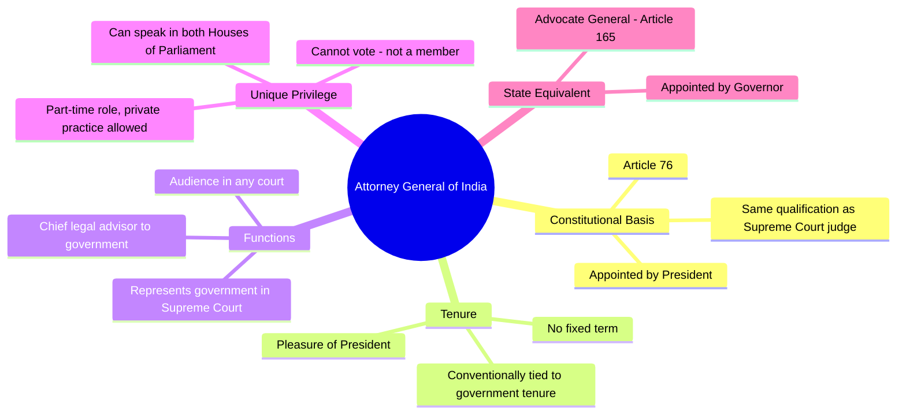

# NOTE — ATTORNEY GENERAL OF INDIA
**Section:** GK | **Category:** Polity | **Topic:** Attorney General of India | **Slug:** `polity-attorney-general`
**Source:** 🔧 GENERAL KNOWLEDGE (constitutional text + standard polity reference; not yet cross-checked against PARMAR SSC reference excerpt)
**Status:** 🔧 DRAFT — awaiting AIR-91 verification before publish
**PYQ Frequency:** 🔥 High-frequency Polity topic, connects to [[polity-supreme-court]] and [[polity-governor-of-a-state]] | **High Yield:** ✅

---

## 🎭 THE HOOK

India's top law officer holds a position that exists in a strange constitutional middle ground: not a judge, not a minister, not an elected official, but the government's chief legal advisor and its principal advocate before the Supreme Court — with the unusual additional right to sit in and speak at ANY session of Parliament, without being a member of it at all. The **Attorney General of India (AG)** is appointed under **Article 76**, qualified for the role exactly the same way a Supreme Court judge is qualified to sit on the bench, but the position itself is part-time, by convention allowing the holder to maintain a private legal practice alongside government duties.

---

## 📖 THE CORE

### Constitutional Basis & Appointment
- **Article 76**: provides for the Attorney General of India.
- Appointed by the **President**, on the advice of the Union Council of Ministers (in practice, the government of the day).
- **Qualifications**: must be qualified to be appointed a **Judge of the Supreme Court** — i.e., a citizen of India who has been a High Court judge for 5 years, or a High Court advocate for 10 years, or (in the President's opinion) a distinguished jurist.
- **No fixed tenure** specified in the Constitution — holds office "during the pleasure of the President," and CONVENTIONALLY resigns when the government that appointed them loses power (tied to the ruling government's tenure, similar to ministers).

### Functions & Powers
- Principal LEGAL ADVISOR to the Government of India on matters referred by the President.
- Represents the **Government of India** in cases before the Supreme Court where the government is a party or has an interest.
- Has the right to AUDIENCE in any court in India (Supreme Court, High Courts, any other court).
- Has the RIGHT TO SPEAK and take part in proceedings of BOTH Houses of Parliament (and any Parliamentary Committee on which they're named) — WITHOUT being a member, and therefore WITHOUT a right to VOTE — a frequently tested unique privilege.
- Performs other duties assigned by the President.

### Key Distinguishing Facts
- **The Attorney General's role is PART-TIME** — unlike many other constitutional officers, the AG is permitted to maintain a PRIVATE legal practice, with certain restrictions (e.g., not advising/appearing against the Government of India in unrelated matters).
- **The Attorney General can speak in Parliament but CANNOT VOTE** — a frequently tested unique hybrid status, distinguishing the AG from both ordinary MPs (who vote) and ordinary witnesses/advisors (who can't address the House directly).
- **Solicitor General and Additional Solicitors General** assist the AG but are appointed under separate, NON-constitutional (statutory/executive) provisions — a frequently tested distinction; only the AG's post itself is directly constitutionally mandated.
- **State-level equivalent**: the **Advocate General** of each state (Article 165), appointed by the Governor — see [[polity-governor-of-a-state]].

---

## 🧠 THE MIND MAP

---

## 🔑 THE MNEMONIC

**"76 appoints, can speak but can't vote"** — the Attorney General's defining constitutional quirk.

**"AG for the Union, Advocate General for the State"** — the clean Centre-State parallel between the two top law officer posts.

---

## 📌 THE PYQ ANCHOR

🔥 Attorney General of India is a high-frequency Polity topic, connecting to [[polity-supreme-court]] and [[polity-governor-of-a-state]] (Advocate General parallel). 🔧 No literal Attorney General question confirmed in the 23/46-shift CGL-2025 sample reviewed earlier in this session — Article 76, the speak-but-no-vote privilege, and the qualification parallel to Supreme Court judges are textbook-standard SSC CGL Polity staples; recommend a dedicated archive cross-check.

---

## ⚠️ THE TRAP ALERT

- **The Attorney General can SPEAK in Parliament but CANNOT VOTE**, since they are not a member of either House — a frequently tested hybrid-status fact.
- **The Attorney General's post has NO fixed tenure specified in the Constitution** — don't assume a standard term like 5 or 6 years; it's tied to the President's pleasure and, by convention, the appointing government's tenure.
- **The Solicitor General is NOT a constitutional post** — unlike the Attorney General (Article 76), the Solicitor General and Additional Solicitors General are created/appointed through executive/statutory arrangements, not direct constitutional provision.
- **The Attorney General's qualifications mirror those of a Supreme Court JUDGE**, not a High Court judge alone — a frequently tested qualification-parallel fact.

---

## ✅ ACTIVE RECALL

1. Under which Article is the Attorney General of India provided for, and who appoints them?
2. What are the qualifications required to become Attorney General?
3. Can the Attorney General vote in Parliament? Can they speak?
4. Is the Solicitor General a constitutional post like the Attorney General?
5. What is the state-level equivalent of the Attorney General, and who appoints them?

*(Answers: 1–Article 76; appointed by the President | 2–The same qualifications required to be appointed a Judge of the Supreme Court | 3–Cannot vote (not a member of either House), but CAN speak and participate in proceedings of both Houses and relevant Parliamentary Committees | 4–No; the Solicitor General is appointed through executive/statutory arrangements, not direct constitutional provision | 5–The Advocate General (Article 165), appointed by the Governor of the state)*
