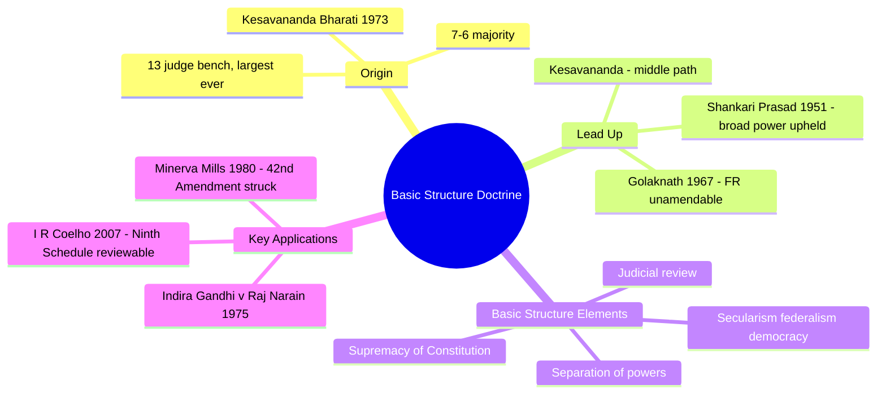

# NOTE — BASIC STRUCTURE DOCTRINE
**Section:** GK | **Category:** Polity | **Topic:** Basic Structure Doctrine | **Slug:** `polity-basic-structure-doctrine`
**Source:** 🔧 GENERAL KNOWLEDGE (constitutional case law + standard polity reference; not yet cross-checked against PARMAR SSC reference excerpt)
**Status:** 🔧 DRAFT — awaiting AIR-91 verification before publish
**PYQ Frequency:** 🔥 Very high-frequency Polity topic, connects to [[polity-judicial-review-and-pil]] and [[polity-42nd-amendment]] | **High Yield:** ✅

---

## 🎭 THE HOOK

On **24 April 1973**, by the narrowest possible margin — **7 judges to 6**, the largest bench ever assembled by the Indian Supreme Court at that time — a single case settled a question that had been tearing at the Constitution for over a decade: can Parliament amend the Constitution to mean ANYTHING it wants, including erasing democracy itself? **Kesavananda Bharati v. State of Kerala** answered NO, inventing an entirely new constitutional concept that exists nowhere in the Constitution's actual TEXT: a "Basic Structure" — a set of core, unnamed features so fundamental to the Constitution's identity that Parliament's amending power under Article 368 cannot touch them, no matter how large its majority.

---

## 📖 THE CORE

### Origin — Kesavananda Bharati v. State of Kerala (1973)
- Decided by a **13-judge bench** (the largest in Indian Supreme Court history), by a margin of **7-6**.
- Held that Parliament has WIDE power to amend the Constitution under **Article 368**, but this power is NOT unlimited — Parliament CANNOT amend the Constitution's "BASIC STRUCTURE" or essential framework.
- This OVERRULED the earlier position in **Golaknath v. State of Punjab (1967)**, which had held Parliament could NOT amend Fundamental Rights AT ALL — Kesavananda Bharati took a more NUANCED middle path: Fundamental Rights CAN be amended, but not in a way that destroys the basic structure.

### Why It Mattered — The Lead-Up
- **Shankari Prasad (1951)** and **Sajjan Singh (1965)**: earlier cases that upheld Parliament's broad amending power, including over Fundamental Rights.
- **Golaknath (1967)**: REVERSED this, holding Fundamental Rights were completely UNAMENDABLE — created a constitutional deadlock, since some amendments (e.g., to facilitate land reform) needed Fundamental Rights adjustment.
- **Kesavananda Bharati (1973)**: resolved the deadlock with the Basic Structure Doctrine — a compromise allowing amendment flexibility WHILE protecting the Constitution's core identity.

### What Counts as "Basic Structure"? (NOT an exhaustive, fixed list — judicially developed over time)
The Supreme Court has, across various cases, identified elements INCLUDING (this list has grown through subsequent rulings, not fixed in Kesavananda Bharati alone):
- Supremacy of the Constitution
- Sovereign, democratic, and republican nature of the Indian polity
- Secular character of the Constitution
- Separation of powers between legislature, executive, and judiciary
- Federal character of the Constitution
- Unity and integrity of the nation
- Judicial review (see [[polity-judicial-review-and-pil]])
- Free and fair elections
- Independence of the judiciary
- Parliamentary system of government
- Rule of law

### Key Applications of the Doctrine
- **Indira Gandhi v. Raj Narain (1975)**: struck down a constitutional amendment clause that sought to place the Prime Minister's election disputes beyond judicial scrutiny — held this violated the basic structure (free and fair elections, judicial review).
- **Minerva Mills v. Union of India (1980)**: struck down parts of the **42nd Amendment** (1976) that tried to give Parliament UNLIMITED amending power and gave ALL Directive Principles unconditional precedence over ALL Fundamental Rights — held the BALANCE between Fundamental Rights and Directive Principles is ITSELF part of the basic structure — see [[polity-42nd-amendment]].
- **I.R. Coelho v. State of Tamil Nadu (2007)**: held that laws placed in the **Ninth Schedule** (meant to shield them from judicial review) are STILL subject to basic structure review if they violate fundamental rights — see [[polity-schedules-of-the-constitution]].

### Key Distinguishing Facts
- **"Basic Structure" is NOT defined anywhere in the Constitution's text** — it is an entirely JUDICIALLY CREATED doctrine, evolved case-by-case since 1973.
- **Kesavananda Bharati's bench of 13 judges remains the LARGEST in Indian Supreme Court history.**
- **The Doctrine applies SPECIFICALLY to Parliament's constitutional AMENDING power (Article 368)** — it does NOT limit Parliament's power to make ordinary laws in the same way (ordinary laws are separately subject to judicial review for violating Fundamental Rights, a related but distinct check).

---

## 🧠 THE MIND MAP

---

## 🔑 THE MNEMONIC

**"Golaknath said never, Kesavananda said sometimes — but never to the core"** — the evolution from absolute unamendability to the nuanced Basic Structure compromise.

**"13 judges, 7-6, one doctrine that outlasted every later Parliament"** — Kesavananda Bharati's defining numbers.

---

## 📌 THE PYQ ANCHOR

🔥 Basic Structure Doctrine is a very high-frequency Polity topic, directly connecting to [[polity-judicial-review-and-pil]] and [[polity-42nd-amendment]]. 🔧 No literal Basic Structure question confirmed in the 23/46-shift CGL-2025 sample reviewed earlier in this session — Kesavananda Bharati's bench size, the Golaknath reversal, and Minerva Mills are textbook-standard SSC CGL Polity staples; recommend a dedicated archive cross-check.

---

## ⚠️ THE TRAP ALERT

- **"Basic Structure" appears NOWHERE in the Constitution's actual text** — it is entirely a judicially created doctrine; don't search for an Article defining it.
- **Kesavananda Bharati (1973) OVERRULED Golaknath (1967)**, which had held Fundamental Rights were completely unamendable — Kesavananda Bharati's position is more nuanced (amendable, but not destructively so).
- **The list of "basic structure" elements is NOT FIXED or exhaustive** — it has grown through subsequent case law (Indira Gandhi v. Raj Narain, Minerva Mills, etc.), not finalized in the original 1973 ruling alone.
- **The 13-judge bench and 7-6 margin are specific, frequently tested numerical facts** — don't round or approximate these.

---

## ✅ ACTIVE RECALL

1. Which case established the Basic Structure Doctrine, and in what year?
2. How many judges sat on the Kesavananda Bharati bench, and what was the margin of the verdict?
3. Which earlier case did Kesavananda Bharati overrule, and what had that case held?
4. Which case struck down parts of the 42nd Amendment using the Basic Structure Doctrine, and what specifically did it protect?
5. Is the "Basic Structure" defined explicitly anywhere in the Constitution's text?

*(Answers: 1–Kesavananda Bharati v. State of Kerala, 1973 | 2–13 judges; a 7-6 majority | 3–Golaknath v. State of Punjab (1967), which had held that Fundamental Rights could not be amended at all | 4–Minerva Mills v. Union of India (1980); protected the balance between Fundamental Rights and Directive Principles, and struck down the attempt to give Parliament unlimited amending power | 5–No, it is entirely a judicially created doctrine, not defined in the constitutional text)*
