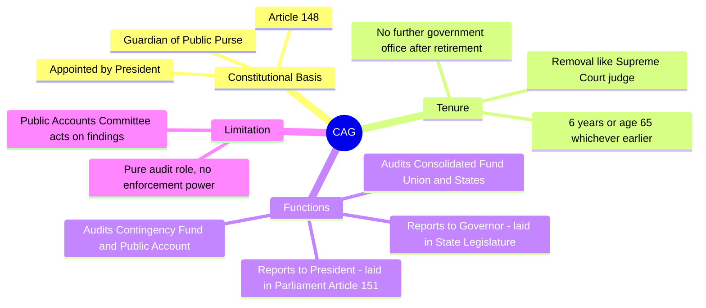

# NOTE — CAG (COMPTROLLER AND AUDITOR GENERAL)
**Section:** GK | **Category:** Polity | **Topic:** CAG | **Slug:** `polity-cag`
**Source:** 🔧 GENERAL KNOWLEDGE (constitutional text + standard polity reference; not yet cross-checked against PARMAR SSC reference excerpt)
**Status:** 🔧 DRAFT — awaiting AIR-91 verification before publish
**PYQ Frequency:** 🔥 Official Phase-1 priority topic (GK_PRIORITY_TOPICS, Polity bucket) | **High Yield:** ✅

---

## 🎭 THE HOOK

Dr. B.R. Ambedkar called this official "the most important officer under the Constitution" — more important, in his words, than even the judiciary, because without this office, no one would ever know if the government actually spent money the way it said it would. The **Comptroller and Auditor General of India (CAG)** is the constitutional auditor of the entire government — every rupee spent from the Consolidated Fund of India, every state government's accounts, every public sector enterprise — all of it eventually crosses the CAG's desk. CAG reports don't enforce anything by themselves; they're submitted to the President or Governor, who lays them before the legislature, and from there, a specific Parliamentary committee — the Public Accounts Committee — takes over the job of holding the government accountable for what the CAG found.

---

## 📖 THE CORE

### Constitutional Basis
- **Article 148**: Provides for the office of CAG, appointed by the **President**, by warrant under his hand and seal.
- Often called the **"Guardian of the Public Purse"** — the institution that audits all receipts and expenditure of the Government of India and of every state.
- Salary and conditions of service are charged on the **Consolidated Fund of India**, and CANNOT be varied to his disadvantage after appointment — designed to ensure independence.

### Tenure & Removal
- Term: **6 years, or until the age of 65**, whichever is earlier.
- Removal procedure is **identical to that of a Supreme Court judge** — only by an order of the President, following a motion passed by both Houses of Parliament with a **special majority**, on grounds of "proved misbehaviour or incapacity" — i.e., via the same impeachment-style process.
- After ceasing to hold office, the CAG is **NOT eligible for further office** under the Government of India or any state government — a unique post-retirement restriction.

### Functions & Powers
- Audits the accounts related to all expenditure from the **Consolidated Fund of India**, Consolidated Fund of each state, and Consolidated Fund of each Union Territory with a Legislative Assembly.
- Audits the accounts of the **Contingency Fund** and **Public Account** of India/states.
- Audits the accounts of government companies and corporations as per relevant laws (subject to specific statutory provisions).
- Submits audit reports relating to the accounts of the Union to the **President**, who lays them before both Houses of Parliament (Article 151).
- Submits audit reports relating to State accounts to the **Governor**, who lays them before the State Legislature.
- Acts as guide/friend/philosopher to the **Public Accounts Committee (PAC)** of Parliament, which examines CAG reports in detail.

### Key Distinction: Audit, Not Enforcement
- The CAG's role is **purely an auditing/reporting function** — it has no power to penalize, recover funds, or enforce compliance. Accountability action is taken by the **Public Accounts Committee** and the legislature based on CAG's findings.

---

## 🧠 THE MIND MAP

---

## 🔑 THE MNEMONIC

**"148 appoints, 151 reports"** — Article 148 (CAG's establishment/appointment), Article 151 (CAG's reports laid before Parliament/Legislature).

**"CAG audits, PAC acts"** — CAG has no enforcement power; the Public Accounts Committee is the body that follows up.

---

## 📌 THE PYQ ANCHOR

🔥 CAG is on the app's **official Phase-1 priority list** (GK_PRIORITY_TOPICS, Polity). 🔧 No literal CAG question confirmed in the 23/46-shift CGL-2025 sample reviewed — CAG's removal procedure, tenure, and Ambedkar's quote are textbook-standard SSC CGL Polity staples; recommend archive cross-check.

---

## ⚠️ THE TRAP ALERT

- **CAG's removal procedure is IDENTICAL to a Supreme Court judge's** (impeachment-style, special majority in both Houses) — a frequently tested comparison; don't assume CAG can be removed by the President alone.
- **CAG has NO power to penalize or recover misspent funds** — its role is strictly audit and reporting; the Public Accounts Committee is the body that acts on CAG's findings. Don't conflate "audits the government" with "enforces against the government."
- **After retirement, the CAG is barred from holding further office** under the Union or any state government — a unique restriction not applicable to most other constitutional posts.

---

## ✅ ACTIVE RECALL

1. Under which Article is the office of CAG established, and who appoints the CAG?
2. What is the CAG's term of office?
3. How is the CAG removed from office, and how does this compare to another constitutional authority?
4. To whom does the CAG submit audit reports on Union accounts, and what happens next?
5. Can the CAG penalize the government for misspending? What body acts on CAG's findings instead?

*(Answers: 1–Article 148; appointed by the President | 2–6 years, or until age 65, whichever is earlier | 3–By presidential order following a special-majority motion in both Houses of Parliament — identical to the removal procedure for a Supreme Court judge | 4–The President, who lays the report before both Houses of Parliament (Article 151) | 5–No, the CAG has no enforcement power; the Public Accounts Committee acts on its findings)*
