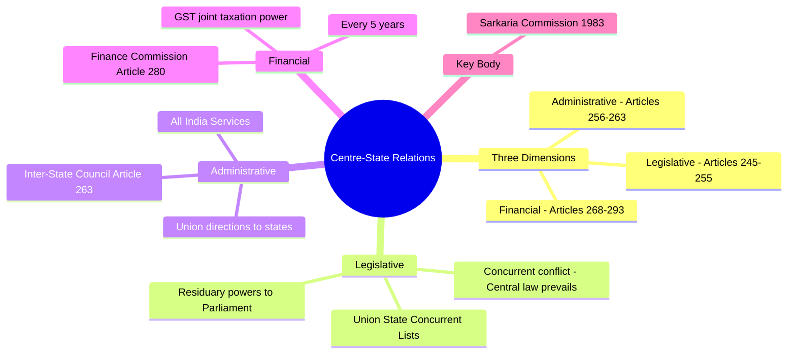

# NOTE — CENTRE-STATE RELATIONS
**Section:** GK | **Category:** Polity | **Topic:** Centre-State Relations | **Slug:** `polity-centre-state-relations`
**Source:** 🔧 GENERAL KNOWLEDGE (constitutional text + standard polity reference; not yet cross-checked against PARMAR SSC reference excerpt)
**Status:** 🔧 DRAFT — awaiting AIR-91 verification before publish
**PYQ Frequency:** 🔥 High-frequency Polity topic, connects to [[polity-emergency-provisions]] and [[polity-parliament-structure]] | **High Yield:** ✅

---

## 🎭 THE HOOK

India calls itself a federation, but constitutional scholars have long debated whether it's really federal at all — because in nearly every dimension that matters (legislative power, administrative authority, financial resources), the Constitution deliberately tilts the balance toward the Centre whenever there's a conflict. Dr. B.R. Ambedkar himself described India's system as **"federal in form but unitary in spirit"** — a deliberate design choice meant to preserve national unity in a vast, diverse country, but one that gives Centre-State Relations its entire dramatic tension: states have real power, but the Centre always holds the trump cards.

---

## 📖 THE CORE

### Three Dimensions of Centre-State Relations
Constitutional scholars typically split Centre-State Relations (Part XI of the Constitution) into THREE dimensions:
1. **Legislative Relations** (Articles 245-255)
2. **Administrative Relations** (Articles 256-263)
3. **Financial Relations** (Articles 268-293)

### Legislative Relations
- **Seventh Schedule's three Lists** (see [[polity-schedules-of-the-constitution]]):
  - **Union List**: subjects only Parliament can legislate on (e.g., defence, foreign affairs, currency).
  - **State List**: subjects only State Legislatures can legislate on (e.g., police, public health, agriculture).
  - **Concurrent List**: subjects BOTH Parliament and States can legislate on — in case of conflict, the CENTRAL law generally PREVAILS (Article 254).
- **Residuary powers** (subjects not listed in any of the three Lists) belong to PARLIAMENT (the Centre) — unlike the US model, where residuary powers go to the states; a frequently tested India-US federalism contrast.
- Parliament CAN legislate on State List subjects under specific conditions: **Rajya Sabha resolution** (Article 249, two-thirds majority, "national interest"), **National Emergency** (Article 250), **State's own request/consent** (Article 252), or to implement **international treaties/agreements** (Article 253).

### Administrative Relations
- The Union can give DIRECTIONS to states on certain matters (Article 256, 257) — non-compliance can be grounds for invoking President's Rule (Article 356).
- **All India Services** (IAS, IPS, IFoS — see [[polity-article-312]]) are a key administrative integration tool, with officers serving states but under ultimate Union disciplinary control.
- **Inter-State Council** (Article 263): a body the President CAN establish to investigate/discuss disputes between states, or matters of common interest to Centre and States.

### Financial Relations
- **Finance Commission** (Article 280): constituted every 5 years to recommend the distribution of tax revenues between the Centre and States, and among the States.
- States CANNOT impose taxes on Union property (and vice versa, with some exceptions), maintaining a degree of fiscal separation.
- GST (see [[eco-gst]]) significantly altered the fiscal relationship, requiring joint Centre-State taxation power via Article 246A.

### Key Distinguishing Facts
- **In case of Concurrent List conflict, the CENTRAL law prevails**, UNLESS the State law has received PRESIDENTIAL ASSENT — a frequently tested nuanced exception (Article 254(2)).
- **Residuary powers rest with PARLIAMENT in India**, the OPPOSITE of the US federal model (where residuary powers rest with the states) — a frequently tested comparative federalism fact.
- **The Sarkaria Commission (1983)** was a landmark body constituted to review and recommend improvements to Centre-State relations, particularly addressing states' concerns about excessive central interference (e.g., misuse of Article 356/President's Rule).

---

## 🧠 THE MIND MAP

---

## 🔑 THE MNEMONIC

**"Federal in form, unitary in spirit"** — Ambedkar's defining characterization of India's Centre-State balance.

**"Leftover power goes to Delhi, not the states"** — India's residuary-powers rule, the opposite of the US model.

---

## 📌 THE PYQ ANCHOR

🔥 Centre-State Relations is a high-frequency Polity topic, connecting to [[polity-emergency-provisions]] (Article 356) and [[polity-parliament-structure]]. 🔧 No literal Centre-State Relations question confirmed in the 23/46-shift CGL-2025 sample reviewed earlier in this session — the three Lists, residuary powers, and the Finance Commission are textbook-standard SSC CGL Polity staples; recommend a dedicated archive cross-check.

---

## ⚠️ THE TRAP ALERT

- **Residuary powers rest with PARLIAMENT (the Centre) in India**, NOT the states — a frequently tested contrast with the US federal model, where the opposite is true.
- **In Concurrent List conflicts, the CENTRAL law prevails UNLESS the State law has received Presidential assent** — don't assume Central law always wins unconditionally; this is a specific, testable exception.
- **The Finance Commission is constituted every 5 YEARS under Article 280** — don't confuse its periodic constitution with a one-time or annual body.
- **The Sarkaria Commission (1983) specifically addressed Centre-State tensions**, particularly around President's Rule misuse — a frequently tested standalone reform-body fact.

---

## ✅ ACTIVE RECALL

1. What are the three dimensions of Centre-State Relations, and which Articles cover each?
2. With whom do residuary powers rest in India, and how does this differ from the US model?
3. In case of a Concurrent List conflict between Central and State law, which generally prevails, and what is the key exception?
4. What is the Finance Commission, and how often is it constituted?
5. What was the Sarkaria Commission (1983), and what issue did it primarily address?

*(Answers: 1–Legislative (Articles 245-255), Administrative (Articles 256-263), Financial (Articles 268-293) | 2–With Parliament (the Centre) in India; in the US, residuary powers rest with the states — the opposite arrangement | 3–Central law generally prevails, UNLESS the State law has received Presidential assent (Article 254(2)) | 4–A body constituted under Article 280 to recommend tax revenue distribution between Centre and States; constituted every 5 years | 5–A landmark commission reviewing Centre-State relations, particularly addressing states' concerns about excessive central interference, including misuse of Article 356/President's Rule)*
