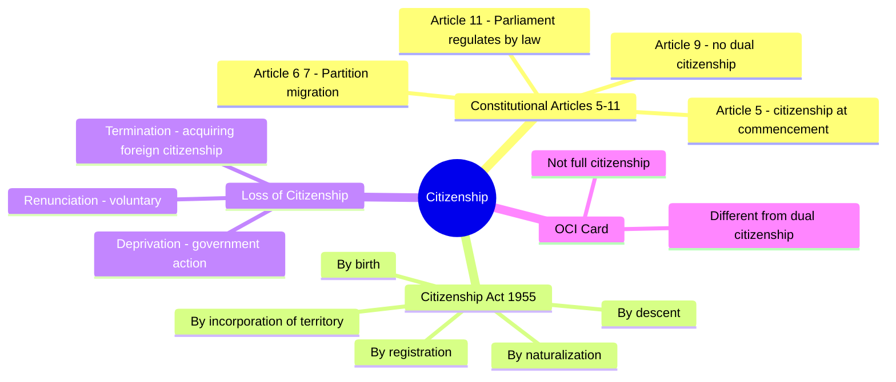

# NOTE — CITIZENSHIP (ARTICLES 5-11)
**Section:** GK | **Category:** Polity | **Topic:** Citizenship | **Slug:** `polity-citizenship`
**Source:** 🔧 GENERAL KNOWLEDGE (constitutional text + standard polity reference; not yet cross-checked against PARMAR SSC reference excerpt)
**Status:** 🔧 DRAFT — awaiting AIR-91 verification before publish
**PYQ Frequency:** 🔥 High-frequency Polity topic | **High Yield:** ✅

---

## 🎭 THE HOOK

India's Constitution does something unusual with citizenship: it spends only SEVEN Articles (5-11) directly on the subject — barely a paragraph of constitutional real estate compared to the sprawling chapters on Fundamental Rights or Centre-State relations — and then hands the ENTIRE ongoing job of defining and regulating citizenship over to ordinary Parliamentary legislation (Article 11). That's a deliberate design choice: citizenship rules needed to be flexible enough to adapt as India's circumstances changed, rather than locked permanently into the harder-to-amend constitutional text.

---

## 📖 THE CORE

### Constitutional Provisions (Articles 5-11, Part II)
| Article | Content |
|---|---|
| **Article 5** | Citizenship at the COMMENCEMENT of the Constitution (26 January 1950) — based on domicile in India at that time |
| **Article 6** | Citizenship rights for persons who migrated TO India FROM Pakistan (around Partition) |
| **Article 7** | Citizenship rights (or loss thereof) for persons who migrated FROM India TO Pakistan |
| **Article 8** | Citizenship rights for persons of Indian origin residing OUTSIDE India |
| **Article 9** | A person who VOLUNTARILY acquires citizenship of a FOREIGN state is NOT considered an Indian citizen — India does NOT recognize dual citizenship (a frequently tested standalone fact) |
| **Article 10** | Continuance of citizenship rights, subject to laws made by Parliament |
| **Article 11** | Empowers PARLIAMENT to regulate the right of citizenship by LAW — the basis for the Citizenship Act, 1955 |

### The Citizenship Act, 1955 — Methods of Acquiring Citizenship
1. **By Birth**: depends on the parents' citizenship status and the date of birth (rules have been amended multiple times, generally tightening over the decades — birth in India alone is NOT automatically sufficient under current rules, unlike the original 1955 provisions).
2. **By Descent**: a child born OUTSIDE India to Indian citizen parent(s), subject to registration requirements.
3. **By Registration**: available to certain categories (e.g., persons of Indian origin who have resided in India for a specified period, spouses of Indian citizens).
4. **By Naturalization**: granted to a foreign national who has resided in India for a specified period and meets other conditions, via a formal application/certificate process.
5. **By Incorporation of Territory**: if India's territory expands (e.g., annexation, merger), residents of the newly incorporated territory may become Indian citizens automatically.

### Loss of Citizenship (Citizenship Act, 1955)
- **Renunciation**: voluntary giving up of Indian citizenship.
- **Termination**: automatic loss upon voluntarily acquiring the citizenship of another country (consistent with Article 9's no-dual-citizenship principle).
- **Deprivation**: the Government can compulsorily deprive a person of citizenship under specific circumstances (e.g., citizenship obtained by fraud, disloyalty to the Constitution).

### Key Distinguishing Facts
- **India does NOT recognize dual citizenship** — Article 9 makes voluntary acquisition of foreign citizenship grounds for losing Indian citizenship; the "Overseas Citizen of India (OCI)" card, often mistakenly called "dual citizenship," is actually a DIFFERENT, more limited status (long-term visa-like benefits, NOT full citizenship/voting rights).
- **Article 11 hands ALL detailed citizenship regulation to Parliament** — meaning the bulk of citizenship LAW (acquisition methods, loss conditions) comes from the Citizenship Act, 1955 (and its amendments), NOT directly from the constitutional Articles themselves.
- **Articles 5-11 deal PRIMARILY with the citizenship situation AT THE TIME the Constitution commenced (1950)** — ongoing/future citizenship matters are governed by Parliamentary law under Article 11.

---

## 🧠 THE MIND MAP

---

## 🔑 THE MNEMONIC

**"5 to 11, just the starting line — Parliament writes the rest"** — the constitutional Articles cover only the 1950 starting point; ongoing citizenship law comes from Parliament (Article 11).

**"No dual citizenship, only OCI as a substitute"** — Article 9's core principle, paired with the commonly confused OCI status.

---

## 📌 THE PYQ ANCHOR

🔥 Citizenship is a high-frequency Polity topic. 🔧 No literal Citizenship question confirmed in the 23/46-shift CGL-2025 sample reviewed earlier in this session — Article 9's no-dual-citizenship rule and the Citizenship Act's five acquisition methods are textbook-standard SSC CGL Polity staples; recommend a dedicated archive cross-check.

---

## ⚠️ THE TRAP ALERT

- **India does NOT recognize dual citizenship** (Article 9) — the OCI card is OFTEN mistakenly called "dual citizenship," but it's a SEPARATE, more limited status without full citizenship rights like voting.
- **Article 11 gives Parliament the power to regulate ALL FUTURE citizenship matters by ordinary law** — don't assume the Constitution itself comprehensively defines citizenship; most operational detail comes from the Citizenship Act, 1955.
- **Articles 5-11 primarily address citizenship AT THE TIME the Constitution commenced (1950)**, especially Partition-related migration (Articles 6, 7) — don't assume these Articles govern ALL citizenship matters indefinitely; ongoing regulation is statutory.
- **The Citizenship Act, 1955 lists FIVE ways to acquire citizenship** — birth, descent, registration, naturalization, and incorporation of territory — a frequently tested complete list.

---

## ✅ ACTIVE RECALL

1. How many Articles does the Constitution devote directly to citizenship, and in which Part?
2. What does Article 9 state about dual citizenship?
3. Which Article empowers Parliament to regulate citizenship through ordinary law, and what Act resulted from it?
4. Name the five ways of acquiring Indian citizenship under the Citizenship Act, 1955.
5. Is the OCI (Overseas Citizen of India) card the same as dual citizenship?

*(Answers: 1–Seven Articles (5-11), in Part II | 2–A person who voluntarily acquires the citizenship of a foreign state is not considered an Indian citizen — India does not recognize dual citizenship | 3–Article 11; resulted in the Citizenship Act, 1955 | 4–By birth, by descent, by registration, by naturalization, by incorporation of territory | 5–No; OCI is a separate, more limited status offering long-term visa-like benefits, not full citizenship rights such as voting)*
