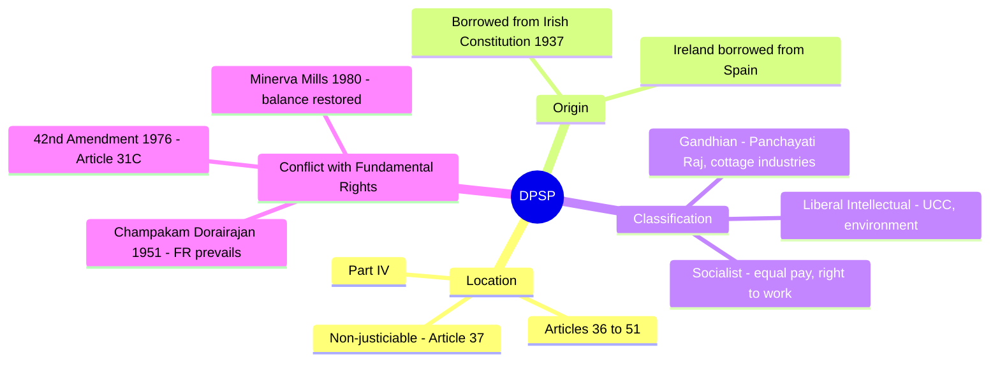

# NOTE — DIRECTIVE PRINCIPLES OF STATE POLICY (DPSP)
**Section:** GK | **Category:** Polity | **Topic:** Directive Principles of State Policy | **Slug:** `polity-dpsp`
**Source:** 🔧 GENERAL KNOWLEDGE (constitutional text + standard polity reference; not yet cross-checked against PARMAR SSC reference excerpt)
**Status:** 🔧 DRAFT — awaiting AIR-91 verification before publish
**PYQ Frequency:** 🔥 Official Phase-1 priority topic (GK_PRIORITY_TOPICS, Polity bucket) | **High Yield:** ✅

---

## 🎭 THE HOOK

Part III of the Constitution gives you rights you can sue over. Part IV gives you promises you can't. The Directive Principles of State Policy (DPSP) are the Constitution's conscience — a list of social and economic goals the state is *directed* to pursue, but which **no court can enforce**. Dr. B.R. Ambedkar described them as "instruments of instructions" to whichever government comes to power — not law in the punishable sense, but a roadmap of what a "good government" should be doing. The framers borrowed the idea wholesale from Ireland's 1937 Constitution, which itself borrowed the underlying philosophy from Spain. It's a strange kind of constitutional promise: written with full seriousness, enforceable by nobody, yet quietly reshaping decades of Indian law anyway — because courts kept finding ways to read DPSP goals INTO enforceable Fundamental Rights.

---

## 📖 THE CORE

### Location & Nature
- **Part IV, Articles 36–51** of the Constitution.
- **Non-justiciable** — Article 37 explicitly states DPSPs "shall not be enforceable by any court," but are nevertheless **"fundamental in the governance of the country"** and it is the duty of the State to apply them in making laws.
- **Borrowed from the Irish Constitution (1937)**, which in turn drew on the Spanish Constitution.

### Classification (Commonly Tested Grouping)
| Type | Examples |
|---|---|
| **Gandhian** | Article 40 (Panchayati Raj), Article 43 (cottage industries), Article 46 (welfare of SC/ST/OBC), Article 47 (prohibition of intoxicating drinks) |
| **Socialist** | Article 39 (equal pay for equal work, distribution of wealth), Article 41 (right to work/education/public assistance), Article 42 (humane conditions of work, maternity relief) |
| **Liberal-Intellectual** | Article 44 (Uniform Civil Code), Article 45 (early childhood care, post-86th Amendment), Article 48 (scientific agriculture/animal husbandry), Article 48A (environment protection), Article 51 (international peace) |

### DPSP vs. Fundamental Rights — The Conflict
- **Champakam Dorairajan case (1951):** Supreme Court held Fundamental Rights (Part III) prevail over DPSPs (Part IV) in case of conflict — DPSPs cannot override Fundamental Rights.
- **Golaknath case (1967):** Reinforced Fundamental Rights' supremacy; held Parliament cannot amend/abridge Fundamental Rights.
- **Kesavananda Bharati case (1973):** Established the Basic Structure Doctrine — Parliament can amend Fundamental Rights but not destroy the Constitution's basic structure.
- **42nd Amendment (1976):** Inserted Article 31C, giving DPSPs under Articles 39(b) and (c) precedence over Articles 14 and 19 if a law is made to implement them.
- **Minerva Mills case (1980):** Struck down the part of the 42nd Amendment that gave ALL DPSPs unconditional precedence over ALL Fundamental Rights — held that the harmony/balance between Part III and Part IV is itself part of the Constitution's basic structure.

---

## 🧠 THE MIND MAP

---

## 🔑 THE MNEMONIC

**"Part III you can sue, Part IV is just a cue"** — Fundamental Rights are justiciable (Part III); DPSPs are non-justiciable guiding principles (Part IV).

**"Ireland gave DPSP, Spain gave Ireland"** — the borrowing chain for DPSP's origin.

---

## 📌 THE PYQ ANCHOR

🔥 DPSP is on the app's **official Phase-1 priority list** (GK_PRIORITY_TOPICS, Polity). 🔧 No literal DPSP question confirmed in the 23/46-shift CGL-2025 sample reviewed — DPSP classification and Fundamental-Rights-vs-DPSP case law are textbook-standard SSC CGL Polity staples; recommend archive cross-check.

---

## ⚠️ THE TRAP ALERT

- **DPSPs are NON-JUSTICIABLE** — no court can enforce them directly; don't confuse them with Fundamental Rights (Part III), which ARE enforceable via Article 32/226.
- **The DPSP-vs-Fundamental-Rights conflict has flip-flopped across cases** — Champakam Dorairajan (1951, FR wins) → 42nd Amendment (1976, DPSP given precedence via Article 31C) → Minerva Mills (1980, balance restored, blanket DPSP precedence struck down). Examiners test the sequence.
- **DPSP borrowed from Ireland, NOT directly from Britain or the USA** — a common origin-country mix-up (Britain is the source for Parliamentary system; USA for Fundamental Rights structure; Ireland specifically for DPSP).

---

## ✅ ACTIVE RECALL

1. In which Part and Article range of the Constitution do the Directive Principles fall?
2. Are DPSPs enforceable by courts? What does Article 37 say about their status?
3. From which country's Constitution were the DPSPs borrowed?
4. Which case first held that Fundamental Rights prevail over DPSPs in case of conflict?
5. Which case struck down the 42nd Amendment's attempt to give ALL DPSPs unconditional precedence over ALL Fundamental Rights?

*(Answers: 1–Part IV, Articles 36-51 | 2–No, not enforceable by any court (Article 37), but fundamental in governance and a duty of the State to apply | 3–Ireland (1937 Constitution) | 4–Champakam Dorairajan v. State of Madras (1951) | 5–Minerva Mills v. Union of India (1980))*
