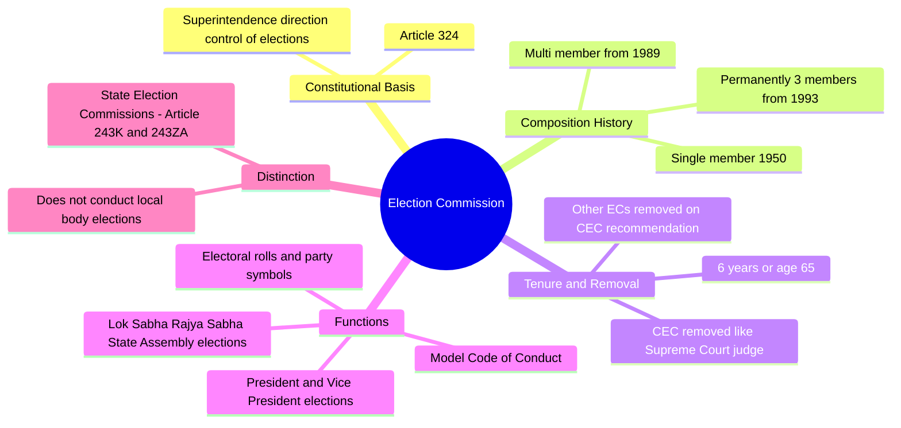

# NOTE — ELECTION COMMISSION OF INDIA
**Section:** GK | **Category:** Polity | **Topic:** Election Commission | **Slug:** `polity-election-commission`
**Source:** 🔧 GENERAL KNOWLEDGE (constitutional text + standard polity reference; not yet cross-checked against PARMAR SSC reference excerpt)
**Status:** 🔧 DRAFT — awaiting AIR-91 verification before publish (⚠️ EXTRA CAUTION: appointment procedure changed via 2023 legislation — verify current law before publishing, see Trap Alert)
**PYQ Frequency:** 🔥 Official Phase-1 priority topic (GK_PRIORITY_TOPICS, Polity bucket) | **High Yield:** ✅

---

## 🎭 THE HOOK

India runs the largest democratic exercise on the planet — hundreds of millions of voters, across a country with dozens of languages and a thousand logistical nightmares — and the entire machinery answers to a body most aspirants only know by its acronym: the **ECI**. What makes it constitutionally interesting isn't just its size of task, but its DESIGN: it started as a one-person institution in 1950, became a three-person body in 1989 (then briefly went back to one, then settled permanently at three from 1993), and its independence is protected the same way judges' independence is — through a removal process deliberately made difficult, so no government in power can simply fire an Election Commissioner for inconvenient rulings.

---

## 📖 THE CORE

### Constitutional Basis
- **Article 324**: Vests the "superintendence, direction, and control" of elections to Parliament, State Legislatures, and the offices of President and Vice-President in the **Election Commission of India**.
- The Commission decides the composition: originally a **single-member body**; became **multi-member** by Presidential Order in **1989** (3 members, ahead of the 1989 general election); reverted briefly to single-member in 1990; made permanently multi-member (Chief Election Commissioner + 2 Election Commissioners) from **1 October 1993** onward.

### Composition & Appointment
- Comprises the **Chief Election Commissioner (CEC)** and such number of **Election Commissioners (ECs)** as the President may fix — currently CEC + 2 ECs.
- When ECs are present, the CEC acts as **Chairman** of the Commission; decisions, where there is a difference of opinion, are taken by **majority**.
- Appointment: historically made by the President on the advice of the Council of Ministers. The **Chief Election Commissioner and Other Election Commissioners (Appointment, Conditions of Service and Term of Office) Act, 2023** introduced a **Selection Committee** (Prime Minister, a Union Cabinet Minister, and the Leader of Opposition in the Lok Sabha) to recommend names to the President — replacing the Supreme Court's 2023 interim "CJI-inclusive panel" directive from *Anoop Baranwal v. Union of India*. 🔧 **This is an evolving/recently-amended area of law — verify the exact current composition of the Selection Committee before publishing, as it has been subject to litigation and legislative change.**

### Tenure & Removal
- CEC and ECs hold office for **6 years, or until age 65**, whichever is earlier.
- **CEC's removal**: Same procedure as a Supreme Court judge — impeachment-style, special majority in both Houses of Parliament, on grounds of "proved misbehaviour or incapacity."
- **Other ECs' removal**: Can be removed by the President only on the **recommendation of the CEC** — making it relatively easier than removing the CEC, but still requiring CEC's concurrence (designed to prevent arbitrary executive removal).

### Functions
- Conducts elections to the **Lok Sabha, Rajya Sabha** (oversight of the process), **State Legislative Assemblies/Councils**, and the offices of **President and Vice-President**.
- Prepares and revises **electoral rolls**.
- Grants recognition to political parties and allots **election symbols**; adjudicates disputes related to symbol allotment.
- Enforces the **Model Code of Conduct** during election periods.
- Does NOT conduct elections to local bodies (Panchayats/Municipalities) — that falls under **State Election Commissions** (Article 243K for Panchayats, Article 243ZA for Municipalities) — a frequently tested distinction.

---

## 🧠 THE MIND MAP

---

## 🔑 THE MNEMONIC

**"324 controls, 1993 makes it three for good"** — Article 324 is the constitutional basis; 1993 is when the 3-member structure became permanent.

**"CEC needs Parliament to go, ECs just need CEC to say so"** — removal asymmetry between the CEC (impeachment-style) and other ECs (President acts on CEC's recommendation).

---

## 📌 THE PYQ ANCHOR

🔥 Election Commission is on the app's **official Phase-1 priority list** (GK_PRIORITY_TOPICS, Polity). 🔧 No literal ECI question confirmed in the 23/46-shift CGL-2025 sample reviewed — Article 324, CEC removal procedure, and the local-body exclusion (State Election Commissions) are textbook-standard SSC CGL Polity staples; recommend archive cross-check. ⚠️ Appointment procedure is a fast-moving legal area (2023 Act + ongoing litigation) — verify current status before publish.

---

## ⚠️ THE TRAP ALERT

- **The Election Commission does NOT conduct Panchayat/Municipality elections** — those are run by separate **State Election Commissions** under Articles 243K and 243ZA; a very commonly tested distinction.
- **CEC and other ECs have DIFFERENT removal procedures** — CEC requires Parliament's special-majority impeachment-style process; other ECs can be removed by the President on the CEC's recommendation alone — don't assume identical protection for both.
- **The Commission's composition has changed over time** (1-member → 3-member in 1989 → briefly 1 again → permanently 3 from 1993) — and the appointment process itself changed again via 2023 legislation. This is one of the most legally "live" topics in Polity — flag for extra verification given the date of this note.

---

## ✅ ACTIVE RECALL

1. Under which Article is the Election Commission of India established, and what powers does it grant?
2. How many members does the Election Commission currently have, and since when has this composition been permanent?
3. What is the term of office for the CEC and Election Commissioners?
4. How does the removal procedure differ between the CEC and other Election Commissioners?
5. Does the Election Commission of India conduct Panchayat and Municipal elections? If not, who does?

*(Answers: 1–Article 324; vests superintendence, direction, and control of elections to Parliament, State Legislatures, and the offices of President/Vice-President | 2–3 members (CEC + 2 ECs); permanent since 1 October 1993 | 3–6 years, or until age 65, whichever is earlier | 4–CEC is removed via a Supreme-Court-judge-style impeachment process (special majority in Parliament); other ECs can be removed by the President on the CEC's recommendation | 5–No; State Election Commissions (Article 243K for Panchayats, Article 243ZA for Municipalities) conduct local body elections)*
