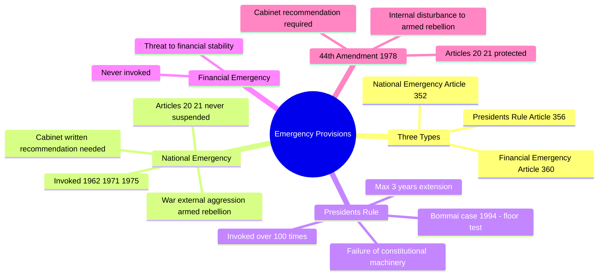

# NOTE — EMERGENCY PROVISIONS
**Section:** GK | **Category:** Polity | **Topic:** Emergency Provisions | **Slug:** `polity-emergency-provisions`
**Source:** 🔧 GENERAL KNOWLEDGE (constitutional text + standard polity reference; not yet cross-checked against PARMAR SSC reference excerpt)
**Status:** 🔧 DRAFT — awaiting AIR-91 verification before publish
**PYQ Frequency:** 🔥 Phase-2 backlog topic (from original CHANAKYA Smart Notes system doc) — closely linked to official priority topics [[polity-president-powers]] and [[polity-42nd-amendment]] | **High Yield:** ✅

---

## 🎭 THE HOOK

Part XVIII of the Constitution contains a strange kind of safety valve — a set of provisions the framers hoped would rarely be used, written specifically to let India temporarily abandon its own federal, democratic structure during genuine crises, and then hand it back. They were used exactly once for each of the three types the Constitution provides, and the National Emergency's only truly controversial use — 1975-77, under Indira Gandhi — frightened the country so badly that Parliament spent the next few years rewriting the rules specifically to make sure it could never happen quite that easily again. Understanding Emergency Provisions means understanding both halves of that story: the original 1950 design, and the 44th Amendment's 1978 attempt to fix what went wrong.

---

## 📖 THE CORE

### The Three Types of Emergency
| Type | Article | Trigger | Invoked |
|---|---|---|---|
| **National Emergency** | **Article 352** | War, external aggression, or **armed rebellion** (originally "internal disturbance," changed to "armed rebellion" by the **44th Amendment, 1978**) | 1962 (China war), 1971 (Pakistan war), 1975 (internal disturbance — the controversial one) |
| **President's Rule (State Emergency)** | **Article 356** | Failure of constitutional machinery in a state | Invoked **100+ times** across India's history — far more frequently than the other two types |
| **Financial Emergency** | **Article 360** | Threat to the financial stability or credit of India | **NEVER invoked** to date |

### National Emergency (Article 352) — Key Details
- Proclaimed by the **President**, but only on the **written recommendation of the Cabinet** (post-44th Amendment requirement — added specifically to prevent a single individual, like the PM acting alone, from triggering it).
- Must be approved by **both Houses of Parliament within one month**, by a **special majority**; once approved, remains in force for **6 months** at a time, renewable indefinitely with repeated parliamentary approval.
- **Effects**: Centre gains power to legislate on State List subjects; Centre can give directions to states; **Fundamental Rights under Article 19 are automatically suspended** (for the duration of war/external aggression-triggered emergencies only — NOT automatically for armed-rebellion-triggered ones, per 44th Amendment refinements); other Fundamental Rights (except Articles 20 and 21) CAN be suspended via separate Presidential Order under Article 359.
- **Articles 20 and 21 can NEVER be suspended**, even during a National Emergency — this protection was specifically added by the **44th Amendment Act, 1978**, in direct response to the human rights abuses of the 1975-77 Emergency.

### President's Rule (Article 356) — Key Details
- Imposed when the President, on receipt of a report from the State Governor (or otherwise), is satisfied that a state's government cannot function in accordance with the Constitution.
- Must be approved by Parliament within **2 months**; once approved, lasts **6 months**, extendable up to a **maximum of 3 years** in total (via 6-month renewals, subject to specific conditions after the first year).
- **S.R. Bommai v. Union of India (1994)**: Landmark Supreme Court case that made the imposition of President's Rule **subject to judicial review**, and held that the **floor test** (proving majority on the floor of the Assembly), not the Governor's subjective discretion, is the proper test of a government's majority — significantly curbed the misuse of Article 356.

### Financial Emergency (Article 360) — Key Details
- Proclaimed when the President is satisfied that the financial stability or credit of India (or any part of its territory) is threatened.
- **Never invoked** in India's history to date — the most-tested "which emergency has never happened" fact.
- Effects (if invoked): Union can give directions to states regarding financial matters, including reduction of salaries of government servants, including judges.

### 44th Amendment's Corrections (1978) — Post-Emergency Reforms
- Changed the National Emergency's trigger word from "**internal disturbance**" to "**armed rebellion**" — a much higher, harder-to-misuse threshold.
- Required **written Cabinet recommendation** (not just PM's advice alone) before the President can proclaim a National Emergency.
- Made **Articles 20 and 21 non-suspendable** even during a National Emergency.
- Reduced the automatic suspension of Fundamental Rights under Article 19 to ONLY apply when the Emergency is proclaimed on grounds of war or external aggression (not armed rebellion).

---

## 🧠 THE MIND MAP

---

## 🔑 THE MNEMONIC

**"352 for the nation, 356 for the state, 360 for the wallet — but 360 never happened yet"** — quick Article-to-Emergency-type mapping, with the standout "never invoked" fact attached to Financial Emergency.

**"44 fixed what 42 and '75 broke"** — the 44th Amendment (1978) was a direct corrective response to the Emergency-era abuses (1975-77) and some of the 42nd Amendment's overreaches.

---

## 📌 THE PYQ ANCHOR

🔥 Emergency Provisions was explicitly listed as a Phase-2 backlog topic in the original CHANAKYA Smart Notes system document, and connects directly to two official priority topics, [[polity-president-powers]] and [[polity-42nd-amendment]]. 🔧 No literal Emergency Provisions question confirmed in the 23/46-shift CGL-2025 sample reviewed in this session — the three Emergency types, their Articles, and the "Financial Emergency never invoked" fact are textbook-standard SSC CGL Polity staples; recommend archive cross-check.

---

## ⚠️ THE TRAP ALERT

- **Financial Emergency (Article 360) has NEVER been invoked** — the single most-tested fact across all three Emergency types.
- **National Emergency's trigger changed from "internal disturbance" to "armed rebellion" via the 44th Amendment (1978)** — examiners may ask which term was used originally vs. now.
- **President's Rule has been invoked 100+ times** — by far the most frequently used of the three Emergency types, despite being the LEAST historically controversial compared to the 1975-77 National Emergency.
- **Articles 20 and 21 can NEVER be suspended**, even during a National Emergency — a protection specifically added by the 44th Amendment in response to Emergency-era abuses; don't assume ALL Fundamental Rights are suspendable.
- **S.R. Bommai (1994) introduced the "floor test" as the proper way to assess a state government's majority** — curbing arbitrary Governor-driven dismissals under Article 356.

---

## ✅ ACTIVE RECALL

1. Name the three types of Emergency under the Indian Constitution, along with their respective Articles.
2. Which type of Emergency has NEVER been invoked in India's history?
3. What change did the 44th Amendment make to the National Emergency's trigger condition?
4. Which landmark Supreme Court case made President's Rule subject to judicial review and introduced the "floor test"?
5. Which two Articles can never be suspended, even during a National Emergency?

*(Answers: 1–National Emergency (Article 352), President's Rule (Article 356), Financial Emergency (Article 360) | 2–Financial Emergency (Article 360) | 3–Changed the trigger from "internal disturbance" to "armed rebellion," a higher threshold | 4–S.R. Bommai v. Union of India (1994) | 5–Articles 20 and 21)*
