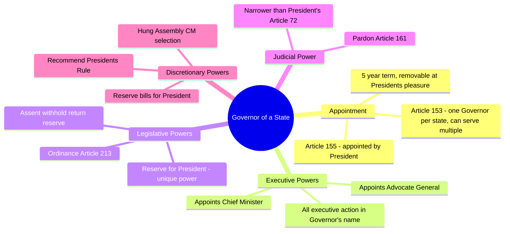

# NOTE — GOVERNOR OF A STATE
**Section:** GK | **Category:** Polity | **Topic:** Governor of a State | **Slug:** `polity-governor-of-a-state`
**Source:** 🔧 GENERAL KNOWLEDGE (constitutional text + standard polity reference; not yet cross-checked against PARMAR SSC reference excerpt)
**Status:** 🔧 DRAFT — awaiting AIR-91 verification before publish
**PYQ Frequency:** 🔥 High-frequency Polity topic, connects to [[polity-president-powers]] and [[polity-emergency-provisions]] | **High Yield:** ✅

---

## 🎭 THE HOOK

Every Governor's office is, in a sense, a scaled-down mirror of the President's — same broad category of powers (executive, legislative, judicial, discretionary), same constitutional design of acting on ministerial advice rather than personal will. But one structural difference makes the Governor's office uniquely controversial: Governors are appointed DIRECTLY by the President (acting on the Union government's advice), with NO state-level electoral process involved at all — meaning a state's chief constitutional figurehead can be, and often is, someone with closer political ties to the ruling party at the Centre than to the state they govern. That tension between a Centre-appointed officer and state-level democratic accountability sits at the heart of nearly every Governor-related controversy in Indian politics.

---

## 📖 THE CORE

### Appointment & Tenure
- Appointed by the **President of India** (Article 155) — in practice, on the advice of the Union Council of Ministers/Home Ministry, with NO state legislative or electoral involvement.
- **Article 153**: there shall be a Governor for each state — though the SAME person CAN be appointed Governor of two or more states simultaneously (a frequently tested possibility, used periodically).
- **Term**: normally **5 years**, but serves "during the pleasure of the President" — meaning a Governor CAN be removed before the 5-year term ends, without any stated reason or formal process required.
- **Qualifications**: must be a citizen of India, at least 35 years old; by convention (not strict constitutional requirement), Governors are typically NOT appointed from the same state they will govern, to maintain independence from local political ties.

### Executive Powers
- All executive action of the state government is formally taken in the Governor's name.
- Appoints the **Chief Minister** (the leader of the majority party/coalition in the State Assembly) and other Ministers on the CM's advice.
- Appoints the **Advocate General** of the state (the state-level equivalent of the Attorney General — see [[polity-attorney-general]]).

### Legislative Powers
- Summons, prorogues, and can dissolve the State Legislative Assembly.
- Addresses the State Legislature at the start of the first session after each general election, and at the start of each year.
- Gives assent to state bills; can WITHHOLD assent, RETURN a bill once for reconsideration (except Money Bills), or RESERVE a bill for the PRESIDENT'S consideration — a power UNIQUE to the Governor (the President has no equivalent "reserve for someone else" power) — a frequently tested distinguishing feature.
- Can promulgate **Ordinances** (Article 213) when the State Legislature is not in session — parallel to the President's Article 123 power.

### Judicial/Pardoning Power
- **Article 161**: Governor can grant pardons, reprieves, respites, or remissions of punishment for offences against STATE law — narrower than the President's Article 72 power (which covers court-martial sentences and death sentences specifically, areas the Governor's power does NOT extend to in the same way) — see [[polity-president-powers]].

### Discretionary Powers
- Unlike the President (who acts almost entirely on ministerial advice), the Governor has SOME areas of genuine personal discretion, including:
  - Reserving a bill for Presidential consideration.
  - Recommending President's Rule (Article 356) in the state — see [[polity-emergency-provisions]].
  - Selecting a Chief Minister in a HUNG ASSEMBLY situation (no clear majority).
  - Dismissing a government that has lost its majority but refuses to resign.

### Key Distinguishing Facts
- **"Reserving a bill for Presidential consideration" is a power UNIQUE to the Governor** — no equivalent exists for the President sending a bill to a "higher" authority.
- **A single person CAN be appointed Governor of MULTIPLE states simultaneously** — a real, used constitutional possibility, not merely theoretical.
- **The Governor serves "during the pleasure of the President"**, meaning removal can occur at any time without cause — a frequently tested security-of-tenure contrast with judges (who have much stronger removal protections).

---

## 🧠 THE MIND MAP

---

## 🔑 THE MNEMONIC

**"155 appoints, 161 pardons, 213 ordains, reserve is unique"** — four key Governor facts in one line, echoing the President's parallel numbers (74, 72, 123).

**"One person, many states — Governor's office allows it"** — the multi-state Governor possibility, a frequently surprising fact.

---

## 📌 THE PYQ ANCHOR

🔥 Governor of a State is a high-frequency Polity topic, directly mirroring [[polity-president-powers]] and connecting to [[polity-emergency-provisions]] (President's Rule recommendation). 🔧 No literal Governor question confirmed in the 23/46-shift CGL-2025 sample reviewed earlier in this session — the reserve-bill power, removal-at-pleasure tenure, and discretionary powers are textbook-standard SSC CGL Polity staples; recommend a dedicated archive cross-check.

---

## ⚠️ THE TRAP ALERT

- **Reserving a bill for the President's consideration is a power UNIQUE to the Governor** — the President has no parallel "send it up the chain" option; don't assume symmetry between the two offices on this point.
- **The Governor's pardon power (Article 161) is NARROWER than the President's (Article 72)** — it doesn't extend to court-martial sentences in the same way, and there's debate over death-sentence cases specifically; don't treat the two as identical in scope.
- **A single Governor CAN govern multiple states simultaneously** — a real, exercised constitutional option, not a hypothetical.
- **The Governor serves "during the pleasure of the President"** — removable at any time without cause, unlike judges who have strong constitutional removal protections (impeachment-style process).

---

## ✅ ACTIVE RECALL

1. Who appoints the Governor of a state, and under which Article?
2. What is the Governor's term of office, and under what condition can they be removed early?
3. What power does a Governor have over bills that has no equivalent for the President?
4. How does the Governor's pardon power (Article 161) differ in scope from the President's (Article 72)?
5. Name two areas where the Governor exercises genuine personal discretion.

*(Answers: 1–The President of India, under Article 155 | 2–Normally 5 years; can be removed at any time, as the Governor serves "during the pleasure of the President," without requiring a stated reason | 3–Reserving a bill for the President's consideration | 4–The Governor's pardon power is narrower — it doesn't extend to court-martial sentences in the way the President's Article 72 power does | 5–Any two of: selecting a CM in a hung assembly, recommending President's Rule, reserving a bill for the President, dismissing a government that has lost majority but refuses to resign)*
