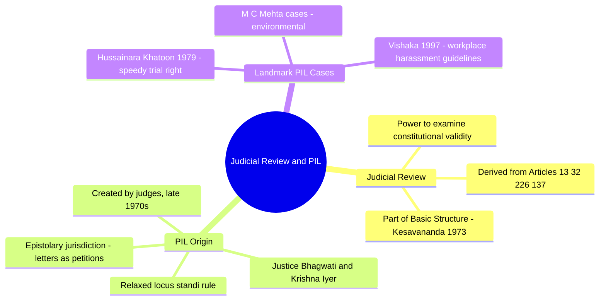

# NOTE — JUDICIAL REVIEW & PIL
**Section:** GK | **Category:** Polity | **Topic:** Judicial Review & Public Interest Litigation | **Slug:** `polity-judicial-review-and-pil`
**Source:** 🔧 GENERAL KNOWLEDGE (constitutional text + standard polity reference; not yet cross-checked against PARMAR SSC reference excerpt)
**Status:** 🔧 DRAFT — awaiting AIR-91 verification before publish
**PYQ Frequency:** 🔥 Very high-frequency Polity topic, connects to [[polity-supreme-court]] and [[polity-article-32]] | **High Yield:** ✅

---

## 🎭 THE HOOK

For most of legal history, only a person DIRECTLY harmed by a law or government action could challenge it in court — a strict rule called "locus standi" that effectively locked out anyone too poor, too powerless, or too geographically remote to personally approach a court. In the late 1970s, a handful of activist Supreme Court judges — most prominently **Justice P.N. Bhagwati** and **Justice V.R. Krishna Iyer** — quietly dismantled that barrier, inventing an entirely new procedural tool: **Public Interest Litigation (PIL)**, allowing ANY public-spirited citizen to approach the court on behalf of people who couldn't approach it themselves. It's one of the few times in Indian legal history that judges essentially CREATED a new legal mechanism through case law rather than Parliament legislating it into existence.

---

## 📖 THE CORE

### Judicial Review
- **Judicial Review**: the power of the judiciary (Supreme Court and High Courts) to examine the CONSTITUTIONAL VALIDITY of legislative enactments and executive actions, and to strike them down if found unconstitutional.
- NOT explicitly named as a single Article in the Constitution, but DERIVED from multiple provisions: **Article 13** (laws inconsistent with Fundamental Rights are void), **Article 32** (Supreme Court's writ jurisdiction — see [[polity-article-32]]), **Article 226** (High Court writ jurisdiction), and **Article 137** (Supreme Court's power to review its own judgments).
- Confirmed as part of the Constitution's **"Basic Structure"** in **Kesavananda Bharati v. State of Kerala (1973)** — meaning judicial review CANNOT be removed even by a constitutional amendment.
- Judicial review applies to BOTH legislative acts (laws passed by Parliament/State Legislatures) and executive actions (government orders, policies).

### Public Interest Litigation (PIL)
- A judicially CREATED mechanism (not originally part of the Constitution's text), pioneered in the late 1970s-early 1980s by judges including **Justice P.N. Bhagwati** and **Justice V.R. Krishna Iyer**.
- Relaxes the traditional rule of **"locus standi"** (standing to sue) — allowing ANY public-spirited person/organization to approach the court on behalf of a person or class of persons who, due to poverty, disability, or social/economic disadvantage, cannot approach the court themselves.
- Often initiated through informal means — even a LETTER addressed to the court can be treated as a writ petition (sometimes called "**Epistolary Jurisdiction**" — letters becoming the basis for judicial proceedings).
- Frequently used in cases involving environmental protection, prisoners' rights, bonded labour, child labour, and other social-justice concerns.

### Key Landmark PIL Cases (Frequently Tested)
- **Hussainara Khatoon v. State of Bihar (1979)**: PIL concerning undertrial prisoners languishing in jail for periods longer than their potential maximum sentence — led to the recognition of the **right to speedy trial** as part of Article 21.
- **M.C. Mehta cases** (multiple, 1980s onward): environmental PIL litigation, led to significant environmental jurisprudence (e.g., closure of polluting industries near the Taj Mahal, vehicular pollution norms in Delhi).
- **Vishaka v. State of Rajasthan (1997)**: PIL that led to the **Vishaka Guidelines** on workplace sexual harassment, in the ABSENCE of specific legislation at the time (later formalized into the POSH Act, 2013).

### Key Distinguishing Facts
- **PIL is a JUDGE-CREATED procedural innovation**, not an explicit constitutional or statutory provision — a frequently tested origin fact.
- **Judicial Review is part of the Constitution's "Basic Structure"** (per Kesavananda Bharati, 1973) — Parliament cannot remove it even through a constitutional amendment, distinguishing it from ordinary legal/procedural rules that CAN be changed by legislation.
- **PIL relaxed the traditional "locus standi" rule** — a fundamental procedural shift, enabling third-party representation of disadvantaged groups.

---

## 🧠 THE MIND MAP

---

## 🔑 THE MNEMONIC

**"Bhagwati and Krishna Iyer opened the courtroom door for everyone"** — the two judges credited with pioneering PIL.

**"Kesavananda made review unbreakable"** — judicial review's protected status as part of the Basic Structure Doctrine.

---

## 📌 THE PYQ ANCHOR

🔥 Judicial Review & PIL is a very high-frequency Polity topic, directly connecting to [[polity-supreme-court]] and [[polity-article-32]]. 🔧 No literal Judicial Review/PIL question confirmed in the 23/46-shift CGL-2025 sample reviewed earlier in this session — the pioneering judges, landmark PIL cases, and the Basic Structure connection are textbook-standard SSC CGL Polity staples; recommend a dedicated archive cross-check.

---

## ⚠️ THE TRAP ALERT

- **PIL was created by JUDGES through case law, NOT by a specific constitutional Article or Parliamentary statute** — a frequently tested origin misconception.
- **Justice P.N. Bhagwati and Justice V.R. Krishna Iyer are the most credited pioneers of PIL** — don't attribute its origin to a single judge or to legislative action.
- **Judicial Review is part of the Basic Structure** (Kesavananda Bharati, 1973), meaning even a constitutional amendment CANNOT remove it — a frequently tested "what can't be amended away" fact.
- **Hussainara Khatoon (1979) established the right to a SPEEDY TRIAL** under Article 21 — don't confuse this case's specific contribution with other PIL landmark cases like Vishaka (workplace harassment) or M.C. Mehta (environment).

---

## ✅ ACTIVE RECALL

1. What is Judicial Review, and from which Articles is it derived?
2. Which case established Judicial Review as part of the Constitution's Basic Structure?
3. Who are the two judges most credited with pioneering Public Interest Litigation (PIL)?
4. What traditional legal rule did PIL relax, and what does it mean?
5. What did the Hussainara Khatoon v. State of Bihar (1979) case establish?

*(Answers: 1–The power of courts to examine the constitutional validity of laws/executive actions; derived from Articles 13, 32, 226, and 137 | 2–Kesavananda Bharati v. State of Kerala (1973) | 3–Justice P.N. Bhagwati and Justice V.R. Krishna Iyer | 4–"Locus standi" (standing to sue); PIL relaxed this rule to allow any public-spirited person to approach the court on behalf of disadvantaged persons who cannot do so themselves | 5–The right to a speedy trial, as part of Article 21, based on the plight of undertrial prisoners jailed longer than their potential maximum sentence)*
