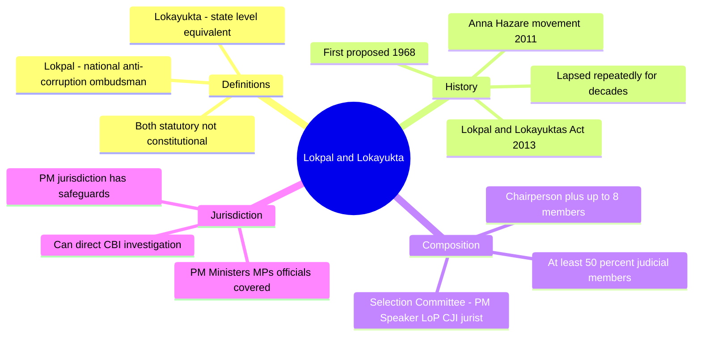

# NOTE — LOKPAL & LOKAYUKTA
**Section:** GK | **Category:** Polity | **Topic:** Lokpal & Lokayukta | **Slug:** `polity-lokpal-and-lokayukta`
**Source:** 🔧 GENERAL KNOWLEDGE (constitutional/statutory text + standard polity reference; not yet cross-checked against PARMAR SSC reference excerpt)
**Status:** 🔧 DRAFT — awaiting AIR-91 verification before publish
**PYQ Frequency:** 🔥 High-frequency Polity topic | **High Yield:** ✅

---

## 🎭 THE HOOK

It took **45 YEARS** from first proposal to actual law — the Lokpal Bill was introduced in Parliament for the FIRST time in **1968**, and then died, was reintroduced, and died again across roughly a dozen attempts over four decades, until a massive 2011 anti-corruption movement led by social activist **Anna Hazare** finally forced Parliament's hand. The **Lokpal and Lokayuktas Act, 2013** finally created India's anti-corruption ombudsman at the national level (Lokpal) and mandated states to create their own equivalent bodies (Lokayuktas) — a rare example of sustained civil-society pressure directly reshaping the statute books after decades of legislative inertia.

---

## 📖 THE CORE

### What Are Lokpal and Lokayukta?
- **Lokpal**: an anti-corruption ombudsman body at the NATIONAL/Union level, investigating corruption complaints against public officials, including the Prime Minister (with specific safeguards/exclusions for certain matters), Ministers, MPs, and central government officials.
- **Lokayukta**: the STATE-level equivalent, one per state, investigating corruption complaints against state officials.
- Both are **STATUTORY bodies** (created by ordinary law), NOT constitutional bodies — a frequently tested status distinction.

### Origin & Legislative History
- First proposed in **1968** (the original Lokpal Bill); reintroduced and lapsed numerous times over the following four decades without becoming law.
- The **2011 anti-corruption movement**, led by **Anna Hazare** (with associates including Arvind Kejriwal, who later founded the Aam Aadmi Party), generated massive public pressure that directly accelerated the bill's passage.
- The **Lokpal and Lokayuktas Act, 2013** was finally enacted, establishing the Lokpal at the Centre and mandating states to establish their own Lokayuktas within a specified period.

### Composition of the Lokpal
- Comprises a **Chairperson** and up to **8 Members** (with at least 50% being judicial members, and mandatory representation for SC/ST/OBC/minorities/women).
- **Chairperson**: must be either a former Chief Justice of India, a sitting/former Supreme Court judge, or an eminent person meeting specific eligibility criteria.
- Appointed by the **President**, on the recommendation of a **Selection Committee** comprising the Prime Minister, the Speaker of the Lok Sabha, the Leader of Opposition (or the single largest opposition party's leader if no recognized Leader of Opposition exists), the Chief Justice of India (or a nominated SC judge), and an eminent jurist.

### Jurisdiction & Powers
- Covers the Prime Minister, Union Ministers, Members of Parliament, and Group A/B/C/D central government officials — though specific SAFEGUARDS limit Lokpal's jurisdiction over the PM regarding matters of international relations, security, public order, atomic energy, and space (a frequently tested PM-jurisdiction nuance).
- Has powers to investigate and, in some cases, INITIATE PROSECUTION through its own investigation wing or by directing existing agencies (e.g., CBI).

### Key Distinguishing Facts
- **Lokpal and Lokayukta are STATUTORY, not constitutional, bodies** — unlike the CAG or Election Commission, which have direct constitutional backing.
- **States WERE ALREADY free to establish their own Lokayuktas before 2013** (several states, like Maharashtra, had Lokayuktas decades earlier) — the 2013 Act made it MANDATORY for ALL states to establish one, standardizing what had previously been optional.
- **Anna Hazare's 2011 movement is the single most-cited trigger** for the Act's eventual passage, after over 40 years of legislative failure.

---

## 🧠 THE MIND MAP

---

## 🔑 THE MNEMONIC

**"1968 to 2013, forty-five years to law"** — the long legislative gestation period of the Lokpal Act.

**"Lokpal for the nation, Lokayukta for the state"** — the clean jurisdictional split.

---

## 📌 THE PYQ ANCHOR

🔥 Lokpal & Lokayukta is a high-frequency Polity topic. 🔧 No literal Lokpal question confirmed in the 23/46-shift CGL-2025 sample reviewed earlier in this session — the 2013 Act, Anna Hazare's role, and the statutory (not constitutional) status are textbook-standard SSC CGL Polity staples; recommend a dedicated archive cross-check.

---

## ⚠️ THE TRAP ALERT

- **Lokpal and Lokayukta are STATUTORY bodies, NOT constitutional bodies** — a frequently tested status distinction from bodies like the CAG or Election Commission, which ARE constitutional.
- **The Lokpal Bill was first proposed in 1968**, NOT in 2011 — the 2011 Anna Hazare movement accelerated an already decades-old, repeatedly-failed legislative effort; don't assume the concept originated in 2011.
- **The Lokpal's jurisdiction over the Prime Minister has specific SAFEGUARDS/exclusions** (international relations, security, public order, atomic energy, space) — don't assume the PM is covered without limitation.
- **Some states had Lokayuktas BEFORE the 2013 Act** (it was optional pre-2013) — the Act made establishing one MANDATORY for all states, not the first-ever introduction of the concept.

---

## ✅ ACTIVE RECALL

1. What is the difference between Lokpal and Lokayukta in terms of jurisdiction level?
2. When was the Lokpal Bill first proposed, and when did it finally become law?
3. What 2011 movement, and led by whom, accelerated the Lokpal Act's passage?
4. Are Lokpal and Lokayukta constitutional or statutory bodies?
5. What safeguards limit the Lokpal's jurisdiction over the Prime Minister?

*(Answers: 1–Lokpal operates at the national/Union level; Lokayukta is the state-level equivalent, one per state | 2–First proposed in 1968; became law via the Lokpal and Lokayuktas Act, 2013 | 3–The 2011 anti-corruption movement, led by Anna Hazare | 4–Statutory bodies, not constitutional bodies | 5–Exclusions/safeguards regarding matters of international relations, security, public order, atomic energy, and space)*
