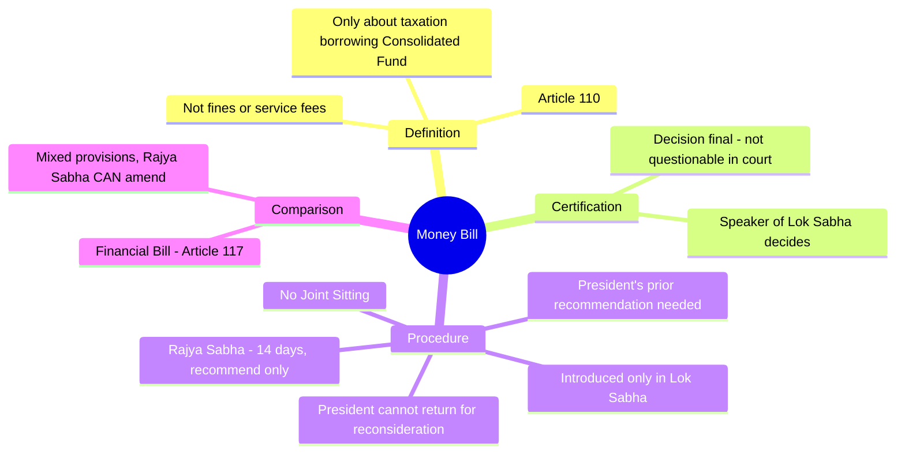

# NOTE — MONEY BILL
**Section:** GK | **Category:** Polity | **Topic:** Money Bill | **Slug:** `polity-money-bill`
**Source:** 🔧 GENERAL KNOWLEDGE (constitutional text + standard polity reference; not yet cross-checked against PARMAR SSC reference excerpt)
**Status:** 🔧 DRAFT — awaiting AIR-91 verification before publish
**PYQ Frequency:** 🔥 Official Phase-1 priority topic (GK_PRIORITY_TOPICS, Polity bucket) | **High Yield:** ✅

---

## 🎭 THE HOOK

There's exactly one kind of legislation in India where the Rajya Sabha's opinion is, constitutionally, just a suggestion. A Money Bill can only be **introduced in the Lok Sabha**, and once it's passed there and sent to the Rajya Sabha, the upper house gets a strict **14-day window** to return it with recommendations — recommendations the Lok Sabha is completely free to ignore. If the Rajya Sabha sits on it past 14 days, the bill is deemed passed by both houses anyway, exactly as the Lok Sabha sent it. This isn't an accident of procedure — it's a deliberate constitutional design choice: financial control was meant to rest with the directly elected house. The catch, and the part that generates controversy, is **who decides if a bill counts as a "Money Bill" in the first place** — and the Constitution gives that decision to one person alone.

---

## 📖 THE CORE

### Constitutional Basis
- **Article 110** defines a Money Bill — a bill is a Money Bill if it contains ONLY provisions dealing with:
  - Imposition, abolition, remission, alteration, or regulation of any tax.
  - Regulation of borrowing of money by the Government of India.
  - Custody of the Consolidated Fund of India or Contingency Fund of India.
  - Appropriation of money out of the Consolidated Fund of India.
  - Declaring expenditure to be "charged" expenditure on the Consolidated Fund.
  - Receipt of money on account of the Consolidated Fund / public account of India, or audit of accounts.
- A bill is NOT a Money Bill merely because it imposes fines, fees for licenses, or fees for services rendered.

### Who Decides?
- **The Speaker of the Lok Sabha** has the SOLE and FINAL authority to certify whether a bill is a Money Bill — per Article 110(3), this decision is final and cannot be questioned in any court.
- This certification power has been the subject of significant political/legal controversy (e.g., Aadhaar Act passed as a Money Bill, challenged before the Supreme Court).

### Procedure
| Step | Rule |
|---|---|
| Introduction | Only in the **Lok Sabha**, and only on the recommendation of the **President**. |
| Rajya Sabha's role | Can only make recommendations within **14 days**; cannot reject or amend. |
| Lok Sabha's response | Free to accept or reject ALL Rajya Sabha recommendations. |
| Deemed passage | If Rajya Sabha doesn't return the bill within 14 days, it's deemed passed by both Houses in the form passed by Lok Sabha. |
| Joint Sitting | **NOT applicable** to Money Bills — joint sittings (Article 108) are only for ordinary bills in case of deadlock. |
| President's assent | President **cannot return** a Money Bill for reconsideration (unlike ordinary bills, which the President can send back once).

### Money Bill vs. Financial Bill
- A **Financial Bill (Article 117)** contains some Money Bill matters PLUS other ordinary legislative provisions — it must also originate in the Lok Sabha but follows a different, less restrictive procedure regarding the Rajya Sabha (which can amend/reject Financial Bills, unlike Money Bills).

---

## 🧠 THE MIND MAP

---

## 🔑 THE MNEMONIC

**"14 days, Speaker decides, no return"** — the three pillars of Money Bill procedure: Rajya Sabha's 14-day window, Speaker's final certification, President cannot return it.

**"Money Bill = Lok Sabha's House, Rajya Sabha is a guest"** — captures the Rajya Sabha's limited, advisory-only role.

---

## 📌 THE PYQ ANCHOR

🔥 Money Bill is on the app's **official Phase-1 priority list** (GK_PRIORITY_TOPICS, Polity). 🔧 No literal Money Bill question confirmed in the 23/46-shift CGL-2025 sample reviewed — Money Bill procedure (Article 110, 14-day rule, Speaker's certification) is a textbook-standard SSC CGL Polity staple; recommend archive cross-check.

---

## ⚠️ THE TRAP ALERT

- **The Speaker of the Lok Sabha — NOT the President or the Rajya Sabha Chairman — certifies whether a bill is a Money Bill**, and this decision is final and cannot be challenged in court (Article 110(3)).
- **A Money Bill can ONLY originate in the Lok Sabha**, and only with prior Presidential recommendation — the Rajya Sabha cannot introduce one.
- **There is NO Joint Sitting for Money Bills** — Joint Sittings (Article 108) apply only to ordinary bills in case of inter-house deadlock; Money Bills bypass this entirely since the Rajya Sabha cannot reject them.
- **Don't confuse Money Bill (Article 110) with Financial Bill (Article 117)** — Financial Bills can be amended/rejected by the Rajya Sabha; Money Bills cannot.

---

## ✅ ACTIVE RECALL

1. Under which Article is a Money Bill defined?
2. Who has the sole authority to certify whether a bill is a Money Bill, and can this be challenged?
3. In which House can a Money Bill be introduced, and what prior approval is needed?
4. How long does the Rajya Sabha have to return a Money Bill, and what happens if it doesn't?
5. Can the President return a Money Bill for reconsideration?

*(Answers: 1–Article 110 | 2–The Speaker of the Lok Sabha; the decision is final and cannot be questioned in any court | 3–Only the Lok Sabha; requires prior recommendation of the President | 4–14 days; if not returned, it is deemed passed by both Houses as passed by the Lok Sabha | 5–No, the President cannot return a Money Bill for reconsideration)*
