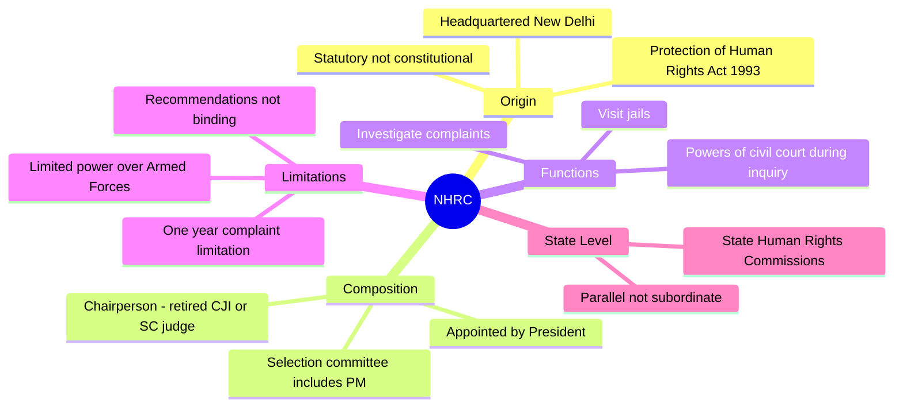

# NOTE — NATIONAL HUMAN RIGHTS COMMISSION (NHRC)
**Section:** GK | **Category:** Polity | **Topic:** National Human Rights Commission | **Slug:** `polity-nhrc`
**Source:** 🔧 GENERAL KNOWLEDGE (statutory text + standard polity reference; not yet cross-checked against PARMAR SSC reference excerpt)
**Status:** 🔧 DRAFT — awaiting AIR-91 verification before publish
**PYQ Frequency:** 🔥 High-frequency Polity topic, connects to [[polity-lokpal-and-lokayukta]] | **High Yield:** ✅

---

## 🎭 THE HOOK

Unlike the Election Commission or the CAG, the National Human Rights Commission has NO direct constitutional backing whatsoever — it's a creature of ordinary legislation, the **Protection of Human Rights Act, 1993**, established to give India a dedicated watchdog body for human rights violations at a moment when India was facing growing international scrutiny over its rights record. The NHRC's powers, deliberately, fall short of a court's full authority — it can investigate and recommend, but its core enforcement tool is essentially RECOMMENDATION and PUBLIC PRESSURE, not binding judicial command, a structural limitation that has shaped every debate about the body's effectiveness ever since.

---

## 📖 THE CORE

### Origin & Legal Basis
- Established under the **Protection of Human Rights Act, 1993** — a STATUTORY body, NOT a constitutional one (a frequently tested status, paralleling [[polity-lokpal-and-lokayukta]]).
- Headquartered in **New Delhi**.
- "Human Rights" under the Act means rights relating to life, liberty, equality, and dignity guaranteed by the Constitution or international covenants, enforceable by Indian courts.

### Composition
- A **Chairperson** (must be a retired Chief Justice of India OR a Supreme Court judge) and several Members, including persons with knowledge of human rights matters.
- Appointed by the **President**, on the recommendation of a committee comprising the Prime Minister (chair), Speaker of the Lok Sabha, Home Minister, Leaders of Opposition in both Houses, and the Deputy Chairman of the Rajya Sabha.

### Functions & Powers
- Investigates complaints of human rights violations (on its own initiative, or based on a petition from a victim or anyone on their behalf).
- Can VISIT jails and other detention facilities to study living conditions of inmates.
- Reviews safeguards under the Constitution and other laws for human rights protection, and recommends remedial measures.
- Has the POWERS OF A CIVIL COURT while conducting inquiries (summoning witnesses, examining evidence under oath) — but its FINAL findings/recommendations are NOT legally binding; it can only RECOMMEND action to the concerned government/authority, which retains discretion on implementation.
- CANNOT investigate complaints made more than ONE YEAR after the alleged violation occurred — a frequently tested limitation.
- Has LIMITED jurisdiction over the Armed Forces — for human rights violations by armed forces personnel, the NHRC can only seek a report from the Central Government and make recommendations, NOT conduct an independent investigation in the same manner as civilian cases.

### State Human Rights Commissions (SHRC)
- States can establish their own State Human Rights Commissions, with similar structure and powers at the state level, operating in PARALLEL to the NHRC (not as subordinate branches).

### Key Distinguishing Facts
- **NHRC's recommendations are NOT legally binding** — the single most-tested limitation of the body; it lacks direct enforcement power, relying on persuasion, public pressure, and the government's voluntary compliance.
- **The one-year limitation period** for filing complaints is a frequently tested specific numerical detail.
- **NHRC's powers over the Armed Forces are significantly limited** compared to its general civilian jurisdiction.

---

## 🧠 THE MIND MAP

---

## 🔑 THE MNEMONIC

**"NHRC can investigate, but only Parliament/government can enforce"** — the core limitation defining the NHRC's recommendation-only power.

**"One year to complain, or the door closes"** — the NHRC's strict complaint-filing time limit.

---

## 📌 THE PYQ ANCHOR

🔥 NHRC is a high-frequency Polity topic, connecting structurally to [[polity-lokpal-and-lokayukta]] (both statutory, recommendation-based bodies). 🔧 No literal NHRC question confirmed in the 23/46-shift CGL-2025 sample reviewed earlier in this session — the 1993 Act, the non-binding recommendation power, and the one-year complaint limit are textbook-standard SSC CGL Polity staples; recommend a dedicated archive cross-check.

---

## ⚠️ THE TRAP ALERT

- **NHRC is a STATUTORY body, NOT a constitutional one** — established by the Protection of Human Rights Act, 1993, not by direct constitutional provision; a frequently tested status confusion.
- **NHRC's findings/recommendations are NOT legally binding** — it can only recommend; don't assume it has direct enforcement authority like a court.
- **Complaints must be filed within ONE YEAR of the alleged violation** — a frequently tested specific time-limit fact.
- **NHRC's jurisdiction over the Armed Forces is LIMITED** — it can only seek reports and recommend, not independently investigate in the same manner as civilian human rights cases.

---

## ✅ ACTIVE RECALL

1. Under which Act was the NHRC established, and is it a constitutional or statutory body?
2. Who can be appointed Chairperson of the NHRC?
3. Are NHRC's recommendations legally binding on the government?
4. Within what time limit must a complaint be filed with the NHRC?
5. What limitation does the NHRC face regarding human rights violations by the Armed Forces?

*(Answers: 1–The Protection of Human Rights Act, 1993; it is a statutory body, not a constitutional one | 2–A retired Chief Justice of India or a Supreme Court judge | 3–No, NHRC's recommendations are not legally binding; it can only recommend action, which the government may or may not implement | 4–Within one year of the alleged violation | 5–The NHRC cannot independently investigate Armed Forces personnel in the same manner as civilian cases; it can only seek a report from the Central Government and make recommendations)*
