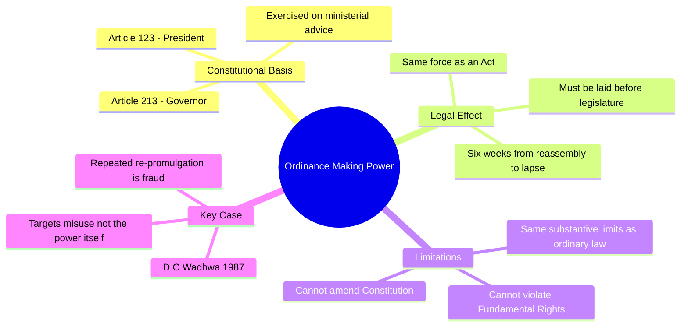

# NOTE — ORDINANCE-MAKING POWER
**Section:** GK | **Category:** Polity | **Topic:** Ordinance-Making Power | **Slug:** `polity-ordinance-making-power`
**Source:** 🔧 GENERAL KNOWLEDGE (constitutional text + standard polity reference; not yet cross-checked against PARMAR SSC reference excerpt)
**Status:** 🔧 DRAFT — awaiting AIR-91 verification before publish
**PYQ Frequency:** 🔥 High-frequency Polity topic, connects to [[polity-president-powers]] and [[polity-governor-of-a-state]] | **High Yield:** ✅

---

## 🎭 THE HOOK

Laws are supposed to come from Parliament, after debate, scrutiny, and a vote — except when Parliament isn't even IN session and something urgent can't wait. For exactly that scenario, the Constitution built in an emergency legislative shortcut: the **Ordinance**, a law issued directly by the President (or Governor, at the state level) that has the FULL force of an Act of Parliament the moment it's signed, without a single MP ever voting on it. It's meant to be a narrow, temporary tool for genuine urgency — but its repeated overuse by successive governments to bypass normal legislative debate has made Ordinance-making power one of Indian Polity's most consistently controversial topics.

---

## 📖 THE CORE

### Constitutional Basis
- **Article 123**: empowers the **President** to promulgate Ordinances when EITHER House of Parliament is NOT in session, and the President is satisfied that CIRCUMSTANCES EXIST requiring immediate action.
- **Article 213**: parallel power for the **Governor** at the STATE level, to promulgate Ordinances when the State Legislature (or one House, in a bicameral state) is not in session.
- Both Article 123 and Article 213 powers are exercised on the advice of the COUNCIL OF MINISTERS (President/Governor act on ministerial advice, not personal discretion, in this context) — consistent with the broader principle that these are largely formal heads of state.

### Legal Effect & Time Limit
- An Ordinance has the SAME force and effect as an Act of Parliament/State Legislature — fully binding law, immediately upon promulgation.
- MUST be laid before Parliament/State Legislature when it reassembles, and CEASES to operate at the expiry of **SIX WEEKS** from the date Parliament/the Legislature REASSEMBLES, UNLESS approved by a resolution before that — a frequently tested precise time limit.
- If BOTH Houses pass resolutions DISAPPROVING the Ordinance before the six weeks expire, it ceases to operate earlier, on the date of disapproval.
- The President/Governor can WITHDRAW an Ordinance at any time before its expiry.

### Limitations on Ordinance Power
- Cannot be used to amend the Constitution.
- Generally subject to the SAME substantive limitations as ordinary legislative power — i.e., an Ordinance CANNOT do something a regular Act of Parliament/Legislature itself couldn't do (e.g., cannot violate Fundamental Rights any more than ordinary legislation could).
- **D.C. Wadhwa v. State of Bihar (1987)**: landmark Supreme Court case that held the REPEATED RE-PROMULGATION of Ordinances (re-issuing the same Ordinance again and again WITHOUT ever placing it before the Legislature for actual debate/approval) is a FRAUD on the Constitution and constitutionally IMPERMISSIBLE — a frequently tested case addressing Ordinance MISUSE.

### Key Distinguishing Facts
- **An Ordinance can be issued ONLY when Parliament is NOT in session** — Article 123's text triggers on "either House of Parliament" not being in session; AIR-91 should verify the precise operative reading (whether both Houses must be out of session, or whether one House being out suffices) against the exact constitutional text before publish, as this nuance is a common source of error in secondary sources.
- **The six-week countdown begins from the date Parliament REASSEMBLES**, NOT from the date the Ordinance was originally promulgated — a frequently tested timing-reference-point trap.
- **D.C. Wadhwa (1987) specifically targeted the ABUSE of repeated re-promulgation**, not the Ordinance power itself, which remains constitutionally valid when used as intended (genuine urgency, followed by proper legislative ratification).

---

## 🧠 THE MIND MAP

---

## 🔑 THE MNEMONIC

**"123 for the Union, 213 for the States — same six-week clock for both"** — the parallel President/Governor Ordinance powers, sharing the same expiry rule.

**"Wadhwa stopped the repeat trick"** — D.C. Wadhwa's case targeting endless Ordinance re-promulgation without legislative approval.

---

## 📌 THE PYQ ANCHOR

🔥 Ordinance-Making Power is a high-frequency Polity topic, directly connecting to [[polity-president-powers]] and [[polity-governor-of-a-state]]. 🔧 No literal Ordinance question confirmed in the 23/46-shift CGL-2025 sample reviewed earlier in this session — Article 123/213, the six-week limit, and D.C. Wadhwa's case are textbook-standard SSC CGL Polity staples; recommend a dedicated archive cross-check.

---

## ⚠️ THE TRAP ALERT

- **The six-week expiry countdown starts from when Parliament REASSEMBLES**, NOT from the original promulgation date — a frequently tested timing-reference trap.
- **An Ordinance CANNOT be used to amend the Constitution**, and is subject to the same substantive limits (e.g., Fundamental Rights compliance) as ordinary legislation — don't treat it as a power exceeding normal legislative limits, only as a TIMING shortcut.
- **D.C. Wadhwa (1987) condemned REPEATED RE-PROMULGATION without legislative debate**, NOT the Ordinance power itself — the power remains valid when used genuinely and followed by proper ratification.
- **Article 123 (President) and Article 213 (Governor) are PARALLEL powers**, exercised on ministerial advice in both cases, not personal discretion.

---

## ✅ ACTIVE RECALL

1. Under which Articles can the President and Governor promulgate Ordinances respectively?
2. What is the legal effect of an Ordinance once promulgated?
3. From what point does the six-week countdown for an Ordinance's expiry begin?
4. What did the D.C. Wadhwa v. State of Bihar (1987) case address?
5. Can an Ordinance be used to amend the Constitution?

*(Answers: 1–President: Article 123; Governor: Article 213 | 2–It has the same force and effect as an Act of Parliament/State Legislature, immediately binding | 3–From the date Parliament/the Legislature REASSEMBLES, not the original promulgation date | 4–It held that repeated re-promulgation of Ordinances without placing them before the Legislature for actual debate/approval is a fraud on the Constitution and constitutionally impermissible | 5–No, an Ordinance cannot be used to amend the Constitution)*
