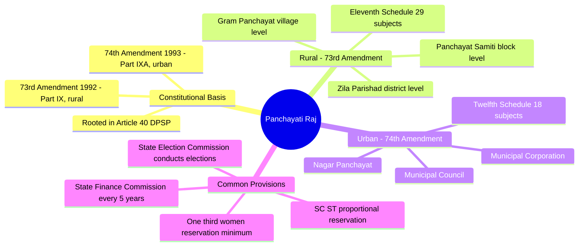

# NOTE — PANCHAYATI RAJ (73RD & 74TH AMENDMENTS)
**Section:** GK | **Category:** Polity | **Topic:** Panchayati Raj | **Slug:** `polity-panchayati-raj`
**Source:** 🔧 GENERAL KNOWLEDGE (constitutional text + standard polity reference; not yet cross-checked against PARMAR SSC reference excerpt)
**Status:** 🔧 DRAFT — awaiting AIR-91 verification before publish
**PYQ Frequency:** 🔥 High-frequency Polity topic, connects to [[polity-dpsp]] | **High Yield:** ✅

---

## 🎭 THE HOOK

For 42 years after independence, local self-government in India existed mostly as a constitutional SUGGESTION, not a guarantee — Article 40, a Directive Principle, simply told states they SHOULD organize village panchayats, with no enforcement teeth and wildly inconsistent results across states. That changed in **1992**, when two amendments passed in quick succession turned local government from an optional state-level experiment into a constitutionally MANDATED three-tier system: the **73rd Amendment** for rural India (Panchayats) and the **74th Amendment** for urban India (Municipalities) — together creating what's often called India's "third tier" of government, sitting below the Centre and the States.

---

## 📖 THE CORE

### Constitutional Basis
- **73rd Amendment Act, 1992**: added **Part IX** ("The Panchayats") and the **Eleventh Schedule** (29 subjects) to the Constitution — covers RURAL local self-government.
- **74th Amendment Act, 1993**: added **Part IXA** ("The Municipalities") and the **Twelfth Schedule** (18 subjects) — covers URBAN local self-government.
- Both came into force on **24 April 1993** (73rd) and **1 June 1993** (74th) respectively.
- Rooted in **Article 40** (a Directive Principle, Part IV) — "The State shall take steps to organise village panchayats" — which existed since 1950 but had no binding force until these amendments.

### The 73rd Amendment — Panchayati Raj (Rural)
- Establishes a **three-tier system**:
  1. **Gram Panchayat** (village level)
  2. **Panchayat Samiti** (intermediate/block level)
  3. **Zila Parishad** (district level)
- **Gram Sabha**: the body of all registered voters within a Panchayat area — the foundational deliberative unit.
- **Reservation**: mandates reservation of seats for **SC/ST** (in proportion to population) and **NOT LESS THAN one-third** of seats for **WOMEN** (including within SC/ST reserved seats) — a frequently tested minimum-quota fact.
- **Elections**: every 5 years, conducted by the **State Election Commission** (a separate body from the Election Commission of India — see [[polity-election-commission]]).
- **State Finance Commission**: constituted every 5 years to review the financial position of Panchayats and recommend resource distribution.

### The 74th Amendment — Municipalities (Urban)
- Establishes THREE types of urban local bodies based on settlement size/transition status:
  1. **Nagar Panchayat** — for areas transitioning from rural to urban.
  2. **Municipal Council** — for smaller urban areas.
  3. **Municipal Corporation** — for larger urban areas/cities.
- Similar reservation provisions (SC/ST proportional, women not less than one-third).
- Introduces the **Wards Committee** concept for larger municipalities.

### Key Distinguishing Facts
- **Both amendments are NOT automatically applicable to certain areas** — Scheduled Areas (under the Fifth Schedule) and tribal areas (Sixth Schedule) initially required separate legislation; the **Panchayats (Extension to Scheduled Areas) Act, 1996 (PESA)** extended Panchayati Raj provisions, with modifications, to Scheduled Areas.
- **The Eleventh Schedule lists 29 subjects** for Panchayats; the **Twelfth Schedule lists 18 subjects** for Municipalities — both added BY these respective amendments, a frequently tested numbers pairing.
- **State Election Commission conducts Panchayat/Municipal elections**, NOT the Election Commission of India — a frequently tested distinction (see [[polity-election-commission]]).

---

## 🧠 THE MIND MAP

---

## 🔑 THE MNEMONIC

**"73 for rural, 74 for urban — both born in '92-'93"** — the amendment-to-domain pairing with their years.

**"Eleventh has 29, Twelfth has 18"** — the subject-count pairing for the two Schedules added by these amendments.

---

## 📌 THE PYQ ANCHOR

🔥 Panchayati Raj is a high-frequency Polity topic, directly connecting to [[polity-dpsp]] (Article 40) and [[polity-election-commission]] (State Election Commission distinction). 🔧 No literal Panchayati Raj question confirmed in the 23/46-shift CGL-2025 sample reviewed earlier in this session — the three-tier structure, reservation quotas, and Schedule numbers are textbook-standard SSC CGL Polity staples; recommend a dedicated archive cross-check.

---

## ⚠️ THE TRAP ALERT

- **The State Election Commission, NOT the Election Commission of India, conducts Panchayat and Municipal elections** — a frequently tested body-confusion trap (see [[polity-election-commission]]).
- **Women's reservation is "NOT LESS THAN one-third," not "exactly one-third"** — states/laws can and do exceed this minimum (some states mandate 50%); don't treat one-third as a hard ceiling.
- **The 73rd Amendment covers RURAL local government (Panchayats); the 74th covers URBAN (Municipalities)** — a frequently tested amendment-number-to-domain pairing, easy to swap.
- **Scheduled/tribal areas were NOT automatically covered** by the 73rd Amendment — PESA (1996) was a SEPARATE Act needed to extend provisions there, with modifications.

---

## ✅ ACTIVE RECALL

1. Which Amendment introduced Panchayati Raj (rural local government), and which Part/Schedule did it add to the Constitution?
2. Which Amendment introduced Municipalities (urban local government), and which Part/Schedule did it add?
3. Name the three tiers of the Panchayati Raj system.
4. What is the minimum reservation mandated for women in Panchayats/Municipalities?
5. Which body conducts Panchayat and Municipal elections — the ECI or a separate body?

*(Answers: 1–73rd Amendment Act, 1992; added Part IX and the Eleventh Schedule | 2–74th Amendment Act, 1993; added Part IXA and the Twelfth Schedule | 3–Gram Panchayat (village), Panchayat Samiti (block/intermediate), Zila Parishad (district) | 4–Not less than one-third of seats | 5–The State Election Commission, a separate body from the Election Commission of India)*
