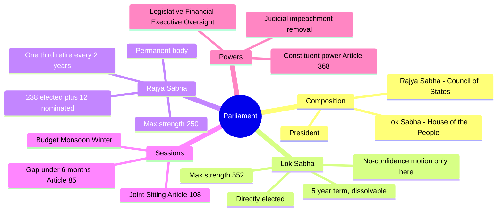

# NOTE — PARLIAMENT: STRUCTURE & POWERS
**Section:** GK | **Category:** Polity | **Topic:** Parliament — Structure & Powers | **Slug:** `polity-parliament-structure`
**Source:** 🔧 GENERAL KNOWLEDGE (constitutional text + standard polity reference; not yet cross-checked against PARMAR SSC reference excerpt)
**Status:** 🔧 DRAFT — awaiting AIR-91 verification before publish
**PYQ Frequency:** 🔥 Official Phase-1 priority topic (GK_PRIORITY_TOPICS, Polity bucket) | **High Yield:** ✅

---

## 🎭 THE HOOK

India's Parliament is technically THREE bodies wearing one name. Most people think "Parliament" means the Lok Sabha and Rajya Sabha — but Article 79 defines Parliament as consisting of the **President, the Lok Sabha, AND the Rajya Sabha** — a fact that surprises most aspirants the first time they read it carefully, and a favourite SSC trap. The President isn't a ceremonial bystander to Parliament; constitutionally, no bill becomes law without flowing through all three. From there, the two Houses split power almost evenly — except in the one area, finance, where the Constitution deliberately tilts everything toward the directly elected Lok Sabha, and the one area, removing a sitting government, where only the Lok Sabha holds the trigger.

---

## 📖 THE CORE

### Composition (Article 79)
- Parliament = **President + Lok Sabha (House of the People) + Rajya Sabha (Council of States)**.
- **Lok Sabha**: Maximum strength **552** (per original constitutional cap, current effective strength is lower; states + UTs representatives, with provision for nominated Anglo-Indian members now removed by the 104th Amendment, 2019). Members directly elected by the people; term **5 years**, subject to dissolution.
- **Rajya Sabha**: Maximum strength **250** — 238 representing States/UTs (elected by State Legislative Assemblies via proportional representation/single transferable vote) + **12 nominated** by the President for contributions to literature, science, art, and social service. **Permanent body**, never dissolved — one-third of members retire every 2 years (6-year term per member).

### Key Structural Differences
| Feature | Lok Sabha | Rajya Sabha |
|---|---|---|
| Nature | Directly elected, dissolvable | Permanent, indirectly elected |
| Term | 5 years | 6 years per member (staggered) |
| Money Bills | Can introduce & has final say | Only 14 days to recommend |
| No-Confidence Motion | Can be moved here | Cannot be moved here |
| Presiding Officer | Speaker | Vice-President of India (ex-officio Chairman) |

### Sessions & Procedure
- Three sessions per year: **Budget Session**, **Monsoon Session**, **Winter Session** — not fixed by the Constitution as a rule, but by convention (gap between two sessions cannot exceed 6 months per Article 85).
- **Joint Sitting (Article 108)**: Called by the President to resolve a deadlock between the two Houses on an ordinary/Financial Bill — presided over by the **Speaker of the Lok Sabha**. NOT applicable to Money Bills or Constitutional Amendment Bills.
- **Quorum**: One-tenth of the total membership of each House.

### Powers
- **Legislative**: Makes laws on subjects in the Union List and Concurrent List; Parliament can also legislate on State List subjects under specific conditions (e.g., Rajya Sabha resolution under Article 249, National Emergency under Article 250, President's Rule).
- **Financial**: Controls the Union Budget; no tax can be levied/collected except by authority of law (Article 265); Money Bills are Lok Sabha-dominated.
- **Executive Oversight**: Council of Ministers is collectively responsible to the **Lok Sabha** (Article 75(3)) — confidence/no-confidence motions can only be moved in the Lok Sabha.
- **Constituent Power**: Can amend the Constitution under Article 368.
- **Electoral**: Participates in the election of the President and Vice-President.
- **Judicial**: Can impeach the President, and remove judges of the Supreme Court/High Courts via a motion requiring special majority in both Houses.

---

## 🧠 THE MIND MAP

---

## 🔑 THE MNEMONIC

**"Parliament = President + 2 Houses, not just 2 Houses"** — Article 79's most commonly missed detail.

**"Lok Sabha can fire the government, Rajya Sabha cannot"** — no-confidence motions are exclusively a Lok Sabha power.

---

## 📌 THE PYQ ANCHOR

🔥 Parliament Structure & Powers is on the app's **official Phase-1 priority list** (GK_PRIORITY_TOPICS, Polity). 🔧 No literal Parliament-structure question confirmed in the 23/46-shift CGL-2025 sample reviewed — Lok Sabha/Rajya Sabha composition, tenure, and Joint Sitting rules are textbook-standard SSC CGL Polity staples; recommend archive cross-check.

---

## ⚠️ THE TRAP ALERT

- **Parliament constitutionally INCLUDES the President**, not just the two Houses — Article 79 is explicit; a frequent "what is Parliament" trap.
- **No-confidence motions can be moved ONLY in the Lok Sabha**, never the Rajya Sabha — since the Council of Ministers is responsible to the Lok Sabha alone (Article 75(3)).
- **Joint Sittings do NOT apply to Money Bills or Constitutional Amendment Bills** — only to ordinary/Financial Bills stuck in deadlock between the Houses.
- **Rajya Sabha is never fully dissolved** — only one-third retire every 2 years, unlike the Lok Sabha which can be wholly dissolved.

---

## ✅ ACTIVE RECALL

1. According to Article 79, what three components make up the Indian Parliament?
2. What is the maximum strength of the Lok Sabha and the Rajya Sabha respectively?
3. In which House alone can a No-Confidence Motion be moved, and why?
4. Who presides over a Joint Sitting of Parliament, and to which bills does it NOT apply?
5. How is the Rajya Sabha different from the Lok Sabha in terms of dissolution?

*(Answers: 1–The President, the Lok Sabha, and the Rajya Sabha | 2–Lok Sabha: 552 (maximum); Rajya Sabha: 250 (maximum) | 3–Lok Sabha; because the Council of Ministers is collectively responsible to the Lok Sabha alone (Article 75(3)) | 4–The Speaker of the Lok Sabha; does not apply to Money Bills or Constitutional Amendment Bills | 5–The Rajya Sabha is a permanent body, never fully dissolved (one-third retire every 2 years); the Lok Sabha can be wholly dissolved)*
