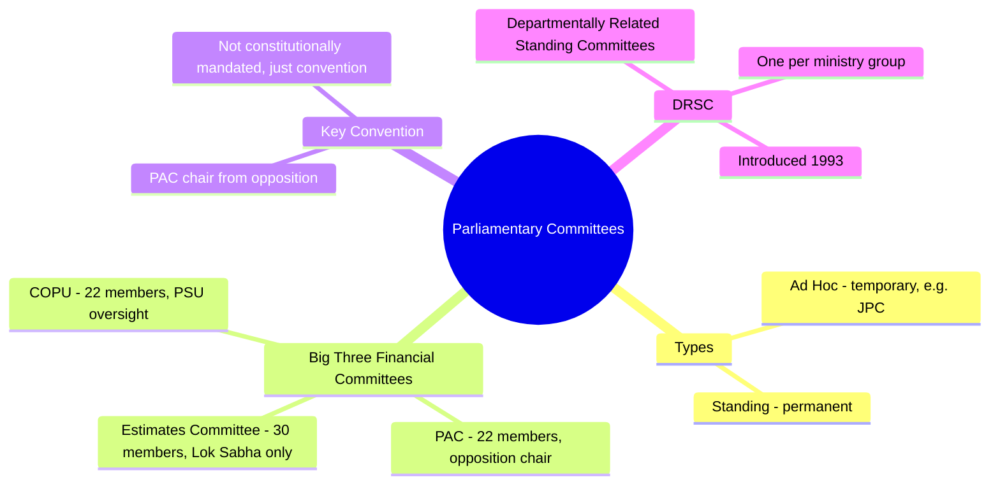

# NOTE — PARLIAMENTARY COMMITTEES
**Section:** GK | **Category:** Polity | **Topic:** Parliamentary Committees | **Slug:** `polity-parliamentary-committees`
**Source:** 🔧 GENERAL KNOWLEDGE (constitutional/procedural text + standard polity reference; not yet cross-checked against PARMAR SSC reference excerpt)
**Status:** 🔧 DRAFT — awaiting AIR-91 verification before publish
**PYQ Frequency:** 🔥 High-frequency Polity topic, connects to [[eco-union-budget-basics]] and [[polity-cag]] | **High Yield:** ✅

---

## 🎭 THE HOOK

A Parliament with 500+ members debating every line of every government expenditure on the floor of the House would simply never finish — so Parliament delegates the genuinely DETAILED scrutiny work to smaller, specialized teams of MPs called **Parliamentary Committees**, often dubbed "mini-Parliaments" for the depth of investigation they're able to conduct away from the floor's time pressure and political theatre. The single most powerful of these, the **Public Accounts Committee (PAC)**, exists specifically to examine the government's accounts AFTER the CAG has audited them — making the PAC and the CAG a two-step accountability chain: the CAG finds the discrepancies, the PAC interrogates the officials responsible.

---

## 📖 THE CORE

### Types of Parliamentary Committees
- **Standing Committees**: PERMANENT (reconstituted periodically, typically annually), continue from session to session.
- **Ad Hoc Committees**: TEMPORARY, created for a specific purpose, dissolved once that purpose is fulfilled (e.g., a Joint Parliamentary Committee/JPC investigating a specific scam or scandal).

### The "Big Three" Financial Committees (Frequently Tested)
| Committee | Members | Chairperson | Function |
|---|---|---|---|
| **Public Accounts Committee (PAC)** | 22 (15 Lok Sabha + 7 Rajya Sabha) | By CONVENTION, a member of the OPPOSITION (often from the Lok Sabha) | Examines the CAG's reports on government expenditure — see [[polity-cag]] |
| **Estimates Committee** | 30 (Lok Sabha members ONLY) | A Lok Sabha member, typically from the ruling party | Examines the budget estimates and suggests economies in public expenditure |
| **Committee on Public Undertakings (COPU)** | 22 (15 Lok Sabha + 7 Rajya Sabha) | A member appointed by the Speaker | Examines the reports/accounts of Public Sector Undertakings (PSUs) |

### Key Distinguishing Facts
- **The PAC's Chairperson is, BY CONVENTION (not constitutional mandate), a member of the OPPOSITION** — a deliberately self-imposed norm meant to ensure independent, non-partisan financial oversight of the ruling government; a frequently tested convention.
- **The Estimates Committee has members ONLY from the Lok Sabha** — unlike the PAC and COPU, which include BOTH Lok Sabha and Rajya Sabha members; a frequently tested membership-composition distinction.
- **None of the "Big Three" financial committees are explicitly named in the Constitution** — they exist through Parliamentary RULES OF PROCEDURE, not direct constitutional provision (though their oversight function connects to constitutional financial-accountability principles).

### Departmentally Related Standing Committees (DRSCs)
- A system of subject-specific Standing Committees (one per ministry/department or group of related ministries), introduced in **1993**, to provide more DETAILED legislative and policy scrutiny than the floor of the House typically allows.
- Examine Bills referred to them, Demands for Grants, and ministry annual reports/policy documents.

---

## 🧠 THE MIND MAP

---

## 🔑 THE MNEMONIC

**"PAC checks CAG's work, Estimates checks the Budget, COPU checks PSUs"** — the three financial committees and their distinct targets.

**"Estimates is Lok Sabha only, PAC and COPU mix both Houses"** — the membership-composition rule that's easy to get wrong.

---

## 📌 THE PYQ ANCHOR

🔥 Parliamentary Committees is a high-frequency Polity topic, directly connecting to [[polity-cag]] and [[eco-union-budget-basics]]. 🔧 No literal Parliamentary Committees question confirmed in the 23/46-shift CGL-2025 sample reviewed earlier in this session — the PAC-opposition-chair convention and the Estimates Committee's Lok-Sabha-only composition are textbook-standard SSC CGL Polity staples; recommend a dedicated archive cross-check.

---

## ⚠️ THE TRAP ALERT

- **The PAC's chairperson convention (opposition member) is a CONVENTION, not a constitutional or even statutory requirement** — don't assume it's legally mandated; it's a self-imposed parliamentary norm.
- **The Estimates Committee has members ONLY from the Lok Sabha**, while the PAC and COPU draw from BOTH Houses — a frequently tested composition distinction.
- **The PAC examines accounts based on the CAG's reports**, AFTER the CAG has already audited — don't confuse the PAC's review role with the CAG's original auditing function (see [[polity-cag]]).
- **None of the "Big Three" financial committees are named directly in the Constitution** — they exist via Parliament's own procedural rules.

---

## ✅ ACTIVE RECALL

1. What are the two broad types of Parliamentary Committees?
2. Name the "Big Three" financial committees of Parliament, and what each examines.
3. By convention, who chairs the Public Accounts Committee (PAC)?
4. Which financial committee has members ONLY from the Lok Sabha?
5. What are Departmentally Related Standing Committees (DRSCs), and when were they introduced?

*(Answers: 1–Standing Committees (permanent) and Ad Hoc Committees (temporary) | 2–Public Accounts Committee (examines CAG's reports on government expenditure), Estimates Committee (examines budget estimates), Committee on Public Undertakings (examines PSU reports/accounts) | 3–By convention, a member of the Opposition | 4–The Estimates Committee | 5–Subject-specific Standing Committees, one per ministry/department group, providing detailed legislative/policy scrutiny; introduced in 1993)*
